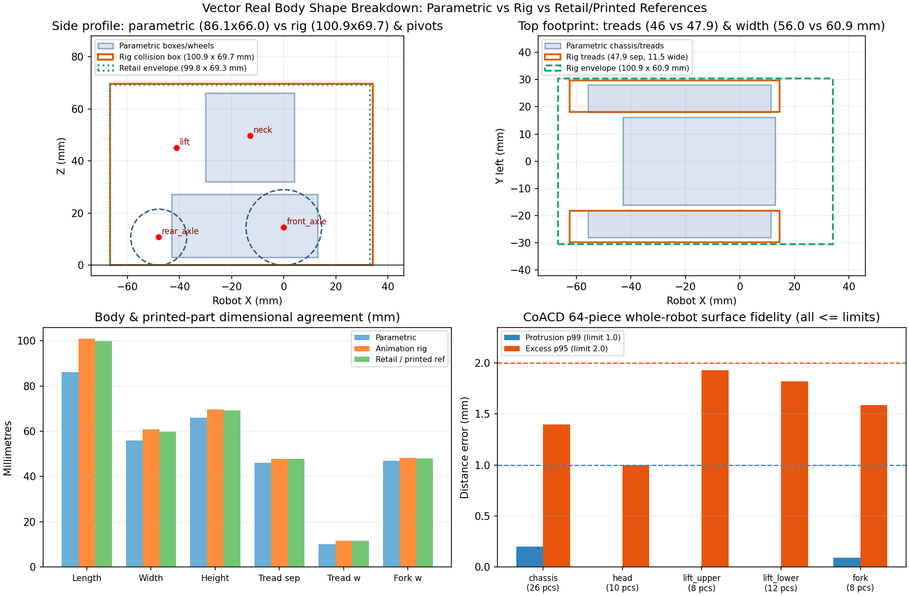

# The robot's real outer shape

Before this change the parametric model drew Vector as boxes and cylinders measuring 86.1 × 56.0 × 66.0 mm at rest. Retail listings give the robot as 9.98 × 5.99 × 6.93 cm. This change does two things:

- `simulacrum/body_mesh.py` builds the real outer shape from the rig Anki's animators used. `mjcf.build_mjcf(v, body=...)` and `VectorSim(body=...)` use it when asked.
- The parameter table takes the rig's dimensions where the boxes had them wrong: tread width and spacing, head box, chassis box, ground clearance and the cube's outer size. The parametric model now measures 86.1 × 59.4 × 69.4 mm. The tread contact inset is refitted for the new geometry on the reference MuJoCo, 4.0.1.



Breakdown table and plot: [`measurements.csv`](measurements.csv) · [`plot_breakdown.py`](plot_breakdown.py)

## Where the shape comes from

[`Victor_rig_01.obj`](https://github.com/kercre123/vector-animations-raw/blob/59b198d4e6fb7394ae4c3d832dea2c4d28866ab0/assets/rigs/Base/obj/Victor_rig_01.obj) in kercre123/vector-animations-raw, commit `59b198d4e6fb`, 13,309,832 bytes, sha256 `59890fafc1c122726d73f49fab66913d45d87426143107d9359e6ca81e7fad60`. That repository carries no licence (GitHub reports NOASSERTION), so the rig and everything cut from it stay out of this tree: `python3 -m simulacrum.body_mesh fetch` downloads it at that commit and hash, and `build` writes the meshes to `~/.cache/vector-simulacrum/body/`.

The rig is in Maya centimetres, +Z forward, +X to the robot's left, +Y up. `register` puts the origin on the table (the lowest tread vertex) under the front axle (a circle fitted to the front rims). It also centres the rig between its outer rims, which sit 0.36 mm off the robot's centre line. The rig is level: the rear axle sits 3.746 mm below the front one, and the wheel radii differ by 3.75 mm.

## The rig's joints against the parameter table

`build` refuses a rig whose joints sit more than 1 mm from the table. Fitted in robot mm:

| Feature | Rig | Table (firmware) | Difference |
|---|---:|---:|---:|
| Front axle height | 14.51 | 14.5 (FW:23) | 0.01 |
| Rear axle x, height | −47.99, 10.77 | −48, 10.75 (FW:28, WEBOTS:32) | 0.01, 0.02 |
| Neck pivot x, z (centre of the head's round side frames) | −12.92, 49.71 | −13, 49 (FW:117) | 0.08, 0.71 |
| Upper lift pivot x, z (rear end cap of the upper links) | −41.26, 45.04 | −41, 45 (FW:123) | 0.26, 0.04 |
| Lift link length, upper / lower links | 65.05 / 65.39 | 66 (FW:84) | 0.95 / 0.61 |
| Camera lens centre from the rig's neck pivot, x, z | 18.91, −8.02 | 18.84, −7.96 (FW:120, optical centre) | 0.07, 0.06 |

End caps are fitted as half-rings beyond their centres (rms 0.18 to 0.25 mm), wheels and the head's side frames as full circles. The camera row shows the rig's head is level: a head turned by h would move the lens 20.54·sin h vertically, so the 0.06 mm bounds h to 0.17°.

The lift is a parallelogram, though not an exact one in the rig. The lower links pivot 0.05 mm ahead of and 12.12 mm below the upper ones; the SDK viewer has 12.0 mm. Their front caps are 12.41 mm apart, and the two links differ in length by 0.34 mm. The model turns the lower links about their own rear cap, at the lift's angle. The rig holds the lift at −11.14°, near the low dock (FW:77, 32 mm).

The links are 0.6 to 0.95 mm shorter than the firmware's 66 mm. The model keeps the firmware's arm, because the robot reports lift height through it. The fork is placed exactly where the rig has it at rest, and then follows a 66 mm arc. At full lift, after a 56.5° swing, that puts it 0.90 mm from where a 65.05 mm arm would put it, or 0.58 mm for a 65.39 mm arm. These numbers are computed from the geometry, not measured on a robot.

## The rig against the real robot

These checks do not come from Anki's CAD.

**Retail size.** Several listings give 9.98 × 5.99 × 6.93 cm (3.93 × 2.36 × 2.73 in); no vendor spec sheet was found. The extents run from the body's rear to the fork's front, across the outer wheel rims, and from the table to the top of the head. They are measured in the compiled MuJoCo model at rest (lift at the low dock, head level) by `validate.py`:

| Model | Length × width × height (mm) | Against retail |
|---|---|---|
| Rig shape, visual meshes | 100.6 × 60.3 × 69.3 | +0.8, +0.4, +0.0 |
| Rig shape, collision pieces | 100.5 × 60.3 × 69.3 | +0.7, +0.4, +0.0 |
| Parametric model, corrected table | 86.1 × 59.4 × 69.4 | −13.7, −0.5, +0.1 |
| Parametric model, table before this change | 86.1 × 56.0 × 66.0 | −13.7, −3.9, −3.3 |

The parametric model is still short at both ends: by 8.3 mm at the back (x −58.4 against −66.7), where only the rig has the body behind the rear axle, and by 6.2 mm at the fork (27.7 against 33.9).

**Parts printed to fit a real Vector.** Each was designed by a hobbyist against a physical robot, and none was taken from the rig. Files are read from the Internet Archive mirrors of their Thingiverse pages, measured, and not kept: most are CC BY-NC.

| Part (designer, Thingiverse id) | Theirs | Rig | Table now (before) |
|---|---:|---:|---:|
| Front wheel rim diameter (Dauler 3764077 "stock", 3298622) | 26.0 | 26.0 | (29.0 cylinder incl. tread) |
| Rear wheel rim diameter (Dauler 3764077, 3298622; FabioDB 4444528) | 18.5; 18.59 | 18.5 | (21.5 cylinder incl. tread) |
| Tread width (Dauler 3241305, 3464746; madizmo 4287628) | 11.6 | 11.5 | 11.5 (10.0) |
| Tread loop outer perimeter (printed as a ring 56.0 mm across) | 175.9 | 175.7 | — |
| Fork width (Dauler 3731746, forks7) | 48.0 | 48.2 | 47.0 over the side plates |
| Lower rear panel width (Steve/M 3964462, butt plate) | 32.4 | 32.9 | 32.2 (chassis box) |
| Light cube outer (Dauler 3239449 cap, 3405048 box) | 45.0 | 42.2 (cube rig) | 45.0 (44) |

**Unit 3's iPhone LiDAR scans** ([iphone-lidar-orbits](../iphone-lidar-orbits/README.md)) **do not resolve the shape at the millimetre.** Distance from scan points to each surface, for the body and head inside the treads and behind the fork, as registered (median / p90 mm):

| Surface | level | lift up | head up |
|---|---|---|---|
| rig | 3.6 / 9.8 | 3.8 / 10.7 | 3.4 / 9.7 |
| rig scaled ×1.10 | 4.5 / 11.3 | 4.3 / 11.4 | 4.5 / 11.3 |
| rig scaled ×0.90 | 3.4 / 9.1 | 3.7 / 12.1 | 3.1 / 8.7 |
| rig moved 5 mm back | 3.4 / 9.5 | 3.9 / 10.9 | 3.5 / 9.5 |
| parametric boxes | 4.8 / 12.8 | 5.2 / 15.0 | 4.9 / 14.3 |

The scans rank the rig ahead of the boxes, but they cannot tell it from the rig shrunk 10 % or moved 5 mm. This null result stands: the scans' 3 mm voxels and 2 to 9 mm pose error are coarser than the question. `lidar_vs_rig.py` reproduces the table. The parametric row is the table before this change.

## What the cube rig gets wrong

The animation cube is 42.2 mm. Two parts printed to fit the real cube are 45.0 mm, which matches the Webots `Block1x1` value. The engine's 44 mm (BLOCKDEF:6) is the size it gives the marker-bearing faces. The rig is trusted for the robot, where the checks above agree, and not for the cube. The table keeps `cube_size_mm` 44 for the markers and adds `cube_outer_mm` 45.0 for contact; the free and carried cube boxes use it.

## Dimensions corrected in the table

| Parameter | Before | Now | Evidence |
|---|---:|---:|---|
| `tread_width_mm` | 10.0 | 11.5 | rig; three printed treads give 11.6 |
| `tread_center_spacing_mm` (new) | — | 47.9 | rig tread chains at y −23.98 and +23.90. The wheels, tip supports and treads are placed here. `tread_spacing_mm` stays 46: FW:26 uses it in the robot's own odometry. |
| `head_box_mm` | 34 × 40 × 34 | 39.7 × 46.4 × 38.8 | rig head |
| `head_box_center_wrt_neck_mm` (new) | — | 1.5, 0, 1.0 | rig head; the head's mass sits there too |
| `chassis_length_mm`, `chassis_center_x_mm` | 56, −15 | 61, −17.5 | the box now reaches the rear axle (x −48 … 13); the rig body runs to x −66.7, up to 67.9 mm high at the back |
| `chassis_ground_clearance_mm` | 3.0 (assumed) | 1.2 | rig body's lowest point; WEBOTS:97,185 gave 1.2 |
| `cube_outer_mm` (new) | — | 45.0 | two printed cube parts |
| `tread_contact_inset_mm` | 3.1 | 3.41 | refitted, below |

The masses are unchanged. With the head box moved, `mjcf.derive` places the head's mass at the box's centre, so the robot keeps the table's centre of mass.

### Refits

Every fit was run before and after on the reference MuJoCo 4.0.1, Linux x86_64, through `run_in_ct.sh` (which checks the libmujoco actually loaded). "Before" is the base commit's own tree, at its own fit. The outputs are in [`refit/`](refit): `fit_spins.json`, `fit_drive.txt` and `fit_servos.txt`, each with its `-before` twin; [`refit/mujoco-3.11.0/`](refit/mujoco-3.11.0) holds the same fits on 3.11.0.

**Tread contact inset** (`fit_spins.py`: fitted on unit 1's four spins, held out on unit 3's four camera spins; RMS of each spin's turn-rate ratio from 1):

| | Table before, at its 4.0.1 fit | Corrected table |
|---|---:|---:|
| Fitted inset | 3.242 mm (the table held 3.1) | 3.415 mm (stored 3.41), per spin 3.34 to 3.53 |
| Unit 1, the fitted spins | 0.77 % | 1.50 % |
| Unit 3, held out | 2.19 % | 1.61 % |
| Unit 3 with no inset | 16.23 % | 15.96 % |

The corrected geometry fits the held-out robot better and the fitted one less well. On MuJoCo 3.11.0 the same geometry fits 3.168 mm (held out 2.12 %, fitted 0.88 %). `tests/test_spin_fit.py` now compares the table with `refit/fit_spins.json` and, on Linux x86_64 with the pinned MuJoCo, checks that the fit reproduces it.

**Drive and servos** (`fit_recording.py --wheels-held-noload` and `--servos`). Each segment's error is a fraction of its own scale, averaged: wheel speed error over the commanded speed, plus gyro error over the nominal turn rate in spins; head and lift error over the joint's range.

| | Table before | Corrected table |
|---|---:|---:|
| Wheel segments fitted / held out | 0.126 / 0.128 | 0.125 / 0.129 |
| Head and lift segments fitted / held out | 0.033 / 0.035 | 0.032 / 0.035 |

The drive fit would lower the fitted wheel segments (to 0.115 on the corrected table, 0.117 before) without improving the held-out ones (0.129, and 0.133 before), so no drive value changes. The servo fit moves nothing.

## How the collision shape is built

The rig is a visual model: most of its groups are open shells, and it has no faces where parts meet. `build` cuts it into the five moving parts, in each part's body frame at joint angle zero:

| Part | Rig groups | Model body |
|---|---|---|
| Chassis | body, backpack, tread chains, wheels | `chassis` |
| Head | head and face | `head` |
| Upper lift links | both upper links | `lift_arm` |
| Lower lift links | both lower links | `lift_lower` (new) |
| Fork | crossbar and side plates | `lift_fork` |

Each part is then made solid:

1. The part is voxelised at 0.5 mm. A voxel counts as inside when the surface lies beyond it in at least 5 of the 6 axis directions: a hole in a shell lets one direction out, not five.
2. Gaps up to 3 mm are closed and enclosed cavities filled.
3. The chassis is filled with the head and treads closing its open front and sides. Then the head (one voxel wider) and both whole tread hulls (one voxel wider) are carved back out.
4. Slivers one voxel thin and components under 2 % of the largest are dropped.
5. CoACD (concavity 0.01 for the chassis and 0.02 for the rest, seed 20261122) splits the solid into convex pieces within a budget per part: chassis 48, head 10, upper links 8, lower links 12, fork 8.
6. Every piece is clipped to the convex hull of its own part's rig surface, so no piece reaches past the part.

Each side's treads and wheels become one convex hull, cut 0.3 mm above the table as `mjcf._tip_supports_xml` does and shrunk 0.5 mm inward, so the wheels and tip supports alone carry the robot. The built body has 88 collision pieces: 50 on the chassis (48 and the two tread hulls), 10, 8, 12 and 8 on the others.

In the model the pieces carry contact, with the table's friction (tread hulls `tread_friction`, the rest `chassis_friction`) and no mass. The primitive geoms keep their names and masses but lose contact and drawing, so total mass and every part's mass are unchanged. The upper and lower links share the arm mass equally. The lower links turn on their own hinge, held to the lift's angle by an equality. Visual meshes are the rig's own triangles in geom group 2.

## How it is drawn

The rig names a material for every face. Its material file (`Victor_rig_01.mtl` at the same commit, 1,444 bytes, sha256 `df0a22584d80b173c410e156d1450455ff17325654342991f42ceef90f70350b`) gives 13 of its 16 materials a diffuse colour of 0.00 to 0.10, one a mid grey (0.61) and the eyes a dark teal; it has no textures. The real robot is black too. `build` therefore writes one visual mesh per look, and mesh mode gives each look a MuJoCo material:

| Look | Where the rig uses it |
|---|---|
| gloss black | main body, wheels and cogs, the fork's back and bottom |
| dark grey | lift links, the fork's front, rims, head top and sides |
| gunmetal | the head's side parts, one back panel |
| rubber | both tread chains |
| screen | the face, mouth, eyelids and screen edges |
| light diffuser | the backpack's three lights and its wifi light |
| eye, eye glow | the eyes, lit teal |

The colours keep the rig's order of dark and light, and the finishes are chosen to look like the robot. They are display values, not measurements, and visual geoms take no part in contact. A build from before looks is drawn in one flat grey; `python3 -m simulacrum.body_mesh visuals` rewrites an existing build's visual meshes by look without decomposing it again. `render_mj.py` adds a key and a fill light to the copy of the scene it draws.

## Fidelity of the built body

Scored over the whole robot at the rig's pose:

- **Protrusion** is rig surface lying outside every piece: shape the collision model lacks.
- **Excess** is exposed piece surface, measured from the nearest rig surface: filling where the robot has none.

Samples are 0.35 mm apart. Piece surface within 1.5 mm of another piece counts as an interface, not exterior. The limits were fixed before any build was scored: protrusion p99 ≤ 1 mm and excess p95 ≤ 2 mm.

| Part | Pieces | Protrusion p99 / max | Excess p50 / p95 / max |
|---|---:|---|---|
| Chassis | 50 | 0.55 / 0.78 | 0.29 / 0.93 / 3.27 |
| Head | 10 | 0.22 / 0.50 | 0.20 / 0.60 / 1.60 |
| Upper links | 8 | 0.00 / 0.42 | 0.60 / 1.85 / 2.31 |
| Lower links | 12 | 0.00 / 0.55 | 0.66 / 1.69 / 2.32 |
| Fork | 8 | 0.14 / 0.75 | 0.42 / 1.59 / 2.81 |

**Rear touchdown.** Rolled back about the rear axle, the rig's surface first meets the table at 70.35°, and so do the body pieces. The tread hulls never do: the tip supports carry the robot there. Unit 3 held its wheelstands at 70.14° (W4) and 70.15° (W8). The build fails a body whose pieces touch down more than 2° before the rig.

`python3 -m simulacrum.body_mesh check` prints both from a build. A body that misses a limit exits 1. Build time on an 8-core Linux container: 39 min.

## Checks of the model

`validate.py BODY_DIR` checks five things (MuJoCo 4.0.1):

- **Envelope.** The table above. The primitive model runs from x −58.4 to 27.7, the rig shape from −66.7 to 33.9.
- **Drag.** Over 900 control ticks of driving straight, spinning, stopping and reversing on the table, no piece other than the wheels touched it.
- **Faults.** The fidelity measure on the fork, with its largest piece (20.2 mm across):
  - moved 2 mm: protrusion p99 1.50, fails;
  - removed: protrusion p99 4.81, fails;
  - grown 30 % about its centroid: excess p95 2.19, fails;
  - unbroken: protrusion p99 0.15, excess p95 1.42, passes. 4 of 4 as expected.
- **Rear touchdown.** The section above.
- **Cost.** Driving straight at 150 mm/s took 205.2 ms per simulated second with the rig shape and 182.4 ms with the primitives, 12 % more (one run each, holding the container's run lock).

## Wheelstands and the rescue

**Wheelstands.** Replayed with `evidence/unit3-wheelstand/reproduction/replay.py` from the wheelstand pull request, given a `--body` option that is not part of this change: driven tip supports, a 60 mN m lift stall, the corrected table, MuJoCo 4.0.1. Medians over its four cases (two release times, two onset times):

| | Peak | Time to peak | Hold | Pitch RMSE | Cube travel |
|---|---:|---:|---:|---:|---:|
| Unit 3, W4 | 72.25° | 0.284 s | 70.14° | — | 9.5–10.1 mm |
| Real body, W4 | 69.6° | 0.520 s | 69.5° | 11.2° | 10.9 mm |
| Primitive model, W4 | 33.8° | 0.576 s | 32.8° | 42.7° | 12.0 mm |
| Unit 3, W8 | 72.50° | 0.275 s | 70.15° | — | — |
| Real body, W8 | 69.5° | 0.458 s | 69.2° | 8.7° | 5.2 mm |
| Primitive model, W8 | 33.5° | 0.693 s | 20.7° | 46.2° | 15.4 mm |

With the real shape the robot stops where the rig's rear body meets the table. In every case it holds 69.08 to 69.55°, within 1.07° of unit 3. The peak is 2.6 to 3.0° low, and it comes 0.18 to 0.24 s late. The lift is the likely cause, not tested here: the reproduction's 60 mN m stall cap is a choice, since no recording identifies the lift's torque (its Finding 2), and under load unit 3's lift kept to its profile. The primitive model has no body behind the rear axle to stop it and settles at 20.7 to 32.8°. On MuJoCo 3.11.0 the real body holds 69.10 to 69.40°.

**Rescue.** `experiments/righting/rescue_pipeline.py --no-cube`, corrected table, MuJoCo 4.0.1. With the real body (`--body`) both patients, one on each side, are upright (under 10° of tilt) at 10.83 s and end at 0.0°. With the primitive model they are upright at 10.97 s. `render_mj.py` films a run with MuJoCo's renderer.

## Tests

`tests/test_body_mesh.py` has 29 cases. None needs the rig: every shape is made up in the test. They cover:

- circle and end-cap fits;
- the hinge sign;
- the table check;
- voxel surfaces closed and exact;
- a shell with an 8-voxel hole filled, and a pocket open on two sides left empty;
- scrap removal;
- the clipped tread hull and its inward shrink, and the clip of a piece to a hull;
- each triangle's look from its material, a split by look that keeps every triangle, and an unknown material refused;
- the rear touchdown angle of a known shape;
- the fidelity measure on known shapes;
- the mesh-mode MJCF from a body of boxes. It has the lower-link equality, carrier geoms without contact, the arm mass split, and the table friction on pieces; it compiles to the primitive model's mass and the table's centre of mass, and the lower links follow the lift in `VectorSim`, and its visual meshes take their looks as materials.

`tests/test_mjcf.py` checks the treads at the built spacing, the head box offset and the cube's outer size.

`tests/mutate.py` has 19 body-shape arms, one per property. Run through the harness's own control, swap and verdict logic on the merged commit, MuJoCo 4.0.1 through `run_in_ct.sh`: 19 of 19 caught, 0 survived, 0 set-up errors.

Full suite there: 445 declared, 445 ran, 435 passed, 8 skipped for optional inputs, 2 failed. Both pass on `main` itself, so this change causes them:

- `test_printed_parts.SyntheticParts.test_tread_masses_follow_the_wheel_bodies_not_the_table` computed its expected inertia change from `tread_spacing_mm` (23.0 mm a side) while the wheels are built at `tread_center_spacing_mm` (23.95 mm). The test now starts from where the wheels are; the printed-parts module then passes 27 of 27 and its mutation arm is caught.
- `test_replay.Replay.test_contact_trial_medium_ccw_trace_and_fast_turn_rates`, segment `spin_cw_220`: the 42 mm contact trial (`contact_trial.py`, the browser's `?contact=42`) turns 2.16 % off the robot against a 2 % limit. That trial places its own contact patches, so the table's inset does not enter it; it was tuned with the treads 46 mm apart, and with the treads where the rig has them it misses by 0.16 points. **Not fixed here.** The trial needs retuning by its owner, and the limit is not loosened.

`web/tools/export_model.py --check`: 14 files up to date; `robot.json` is made on MuJoCo 4.0.1, as `web/test/robot.test.js` requires. The browser tests themselves (`npm test`) were not run.

## What the checks caught while this was built

1. **The fidelity measure caught a real decomposition defect.** The first chassis fill leaked through the gap between body and treads: 16 cm³ of solid inside a 169 cm³ hull. With six-direction voting it reached 130 cm³, but the scraps left at the tread edges used up CoACD's budget. The result was one hull of 224 cm³ over the whole robot and 23 slivers. The build reported it as excess p95 3.85 mm, outside the limit; cleaning the solid brought it to 1.40.
2. **An instrument fault, reported as such.** The first envelope check gave the rig shape 95.3 mm of height. MuJoCo re-centres a mesh on its principal axes, and that bounding box, turned back to the world, overstates the extent. The check now uses the mesh's vertices.
3. **Excess measured per part alone flagged hidden faces.** These were the head's underside and the recess it sits in, which the rig has no surface for. On the same build, scoring the whole robot with a 1.5 mm interface band took the head's excess p95 from 9.05 to 1.02 mm. The lower links then still missed (2.38 mm with 8 pieces) and were given 12 (1.82 mm). The limit was not moved.
4. **The tread hulls braked the wheelstand.** Cut at the tip supports' height but not shrunk, they touched the table as the robot tipped back, and the stand stopped near 36°. Shrinking them 0.5 mm inside the tip supports let it reach the rig's angle.
5. **A second instrument fault.** One build scored protrusion p99 5.32 mm on the chassis. The planes of each piece had been taken from its triangles, and some normals pointed inward. Rescored with the planes from qhull, the same pieces score 0.55.
6. **The rear touchdown caught pieces reaching past the body.** A build within both fidelity limits touched down at 66.25°, 4° before the rig: some pieces reached beyond their part's own convex hull. Clipping every piece to that hull brought it to 70.35°.
7. **A refit claim that was wrong.** After the head box moved, a spin fit on MuJoCo 4.0.1 first put unit 3's held-out spins within 0.44 % RMS. The head's mass had stayed at the neck in `derive` while its box moved, which shifted the centre of mass by 0.26 mm and the fitted inset by 0.27 mm. With the mass at the box the same fit gave 1.61 %, and the first figure was withdrawn.
8. **The fault check's resolution.** The fault check first grew the fork's largest piece by 20 %, and on the final build that passed: excess p95 1.78 against the 2 mm limit. Growing a 20 mm piece by 20 % moves its far ends out 2 mm, about what the limit allows over a whole part. `validate.py` now prints the score for growths of 10 to 50 % and the smallest it catches, 30 % (+3 mm, excess p95 2.19), and its fault arm grows the piece by 30 %. A per-piece p95 does not do better: the worst unbroken fork piece scores 2.01 mm and the grown one 2.03.

## Using it

```bash
python3 -m simulacrum.body_mesh fetch
```

```bash
python3 -m simulacrum.body_mesh build
```

```python
from simulacrum import body_mesh
from simulacrum.robot import VectorSim
sim = VectorSim(body=body_mesh.load(body_mesh.DEFAULT_OUT))
```

The build needs numpy, scipy and CoACD (`pip install coacd`; built with 1.0.14). Without CoACD it falls back to one hull per rig group, which fills the links' and fork's concavities: excess p95 9 to 13 mm in the first build, scored per part.

## Not done

- Mass and inertia still come from the parameter table and the primitive boxes, not from the shape.
- `com_x_mm` is assumed, and the inset fit trades against it.
- The lift-link length (65.05 to 65.39 mm in the rig, 66 in firmware) is the one rig dimension a printed part could still settle. TheDimensionalForge's replacement upper arms are on Cults3D only, behind a Cloudflare check, and were not read.
- The cube's outer size rests on two printed parts; no caliper reading of a real cube was taken.
- The 42 mm contact trial's `spin_cw_220` test fails with the corrected geometry (2.16 % against 2 %); see Tests.
