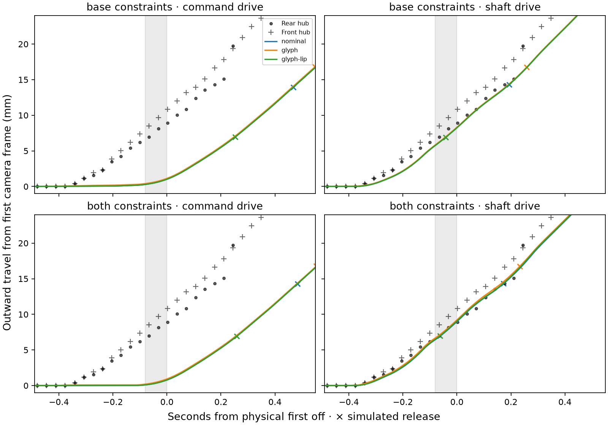

# Does starting depth explain P2Y8's W35 charger release?



Time zero is the first SDK sample reporting charger off. The preceding sample still reported on at −81 ms. Only the first camera frame was used to set the initial longitudinal position. Subsequent front and rear hub travel tests the departure trajectory. This is one recorded departure.

| Replay with canonical constraints | Nominal start | Glyph only | Glyph and dock lip |
|---|---:|---:|---:|
| Measured speeds sent to wheel controller | +468 ms | +548 ms | +253 ms |
| Measured speeds tracked at wheel shafts | +193 ms | +258 ms | −42 ms |

The glyph and lip place the pad center 2.12 mm outward of the pins in the first frame. The glyph alone places it 7.82 mm inward. Both use the seated W34 hub span to establish the lateral plane. That nearly 10 mm disagreement dominates the release prediction. With shaft tracking and the five anchors the candidate impedance gives −62 ms, also inside the SDK interval. Rear/front travel RMSE is 3.45/2.49 mm with canonical constraints and 2.92/1.78 mm with candidate constraints. Starting depth can explain the timing gap when departure travel is reproduced. This recording cannot establish absolute seating depth across other departures.

See the [camera registration](../dock-pad-registration/README.md), [impedance experiment](../dock-impedance/README.md), and [all twelve scores](scores.csv). To reproduce from this directory with the canonical simulator dependencies installed:

```sh
(cd ../dock-posture-history && python3 history.py) > /tmp/depth-history.json
for c in base both; do
  for d in command shaft; do
    for r in nominal glyph glyph-lip; do
      node replay.mjs "$c" "$d" "$r" < /tmp/depth-history.json > "$c-$d-$r.csv"
    done
  done
done
python3 compare.py
```
