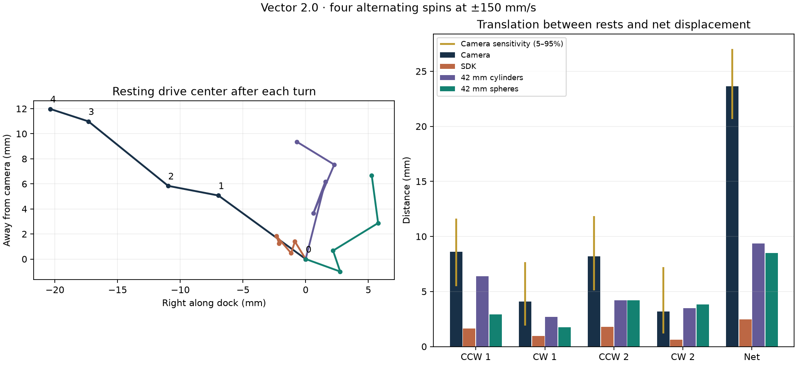
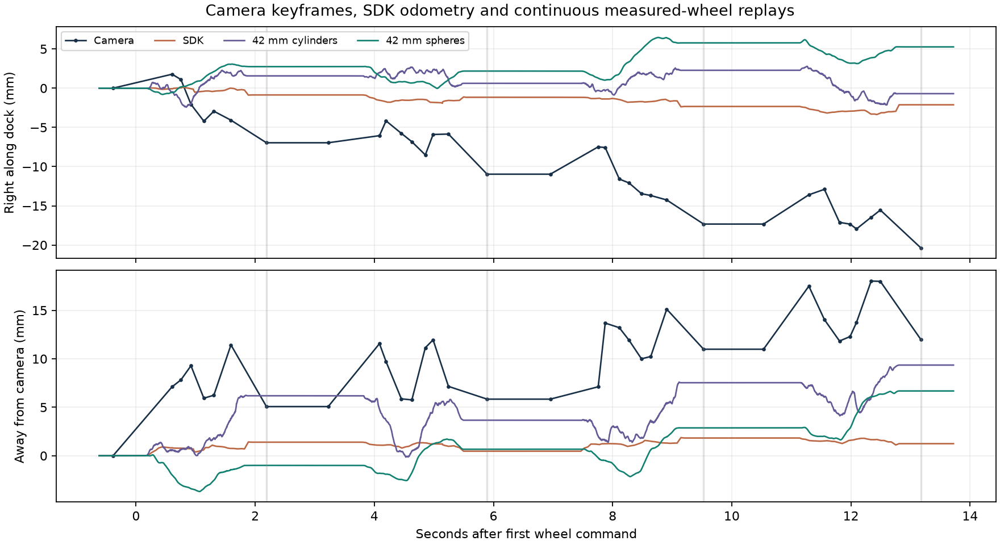

# External camera measures drift during four alternating Vector 2.0 spins

The robot moved **23.6 mm net** in the dock frame, about **20.4 mm left and 12.0 mm away from the camera**. SDK drive-center odometry reported 2.5 mm net. The 42 mm cylinder replay predicted 9.4 mm, and the 42 mm sphere replay predicted 8.5 mm. Most of the missing displacement is lateral. The cylinder replay finished 0.7 mm left of its start, and the sphere replay finished 5.3 mm right. In this run, the previously observed simulator drift coexisted with substantially larger physical drift.

| Interval | External camera (mm) | SDK odometry (mm) | 42 mm cylinders, 1 ms (mm) | 42 mm spheres, 0.125 ms (mm) |
|---|---:|---:|---:|---:|
| CCW 1 | 8.6 | 1.6 | 6.4 | 2.9 |
| CW 1 | 4.1 | 1.0 | 2.7 | 1.8 |
| CCW 2 | 8.2 | 1.8 | 4.2 | 4.2 |
| CW 2 | 3.2 | 0.6 | 3.5 | 3.8 |
| **Start to finish** | **23.6** | **2.5** | **9.4** | **8.5** |

Each row measures straight-line displacement between resting poses. Net displacement uses the first and last poses. The camera shows leftward movement on all four turns. Both models predicted rightward movement on the two CCW turns. A similar displacement magnitude on a single turn can hide a directional error. [Signed turn vectors and residuals](by-turn.csv) · [Cropped, upright video with trajectory overlays](four-spins.mp4)

## How position was measured independently

The fixed 1920 × 1080 camera looked across the shelf toward the dock. All images were rotated 180° before digitizing. The four corners of the upright home glyph supplied the metric reference: 46 × 46 mm with its center 48.5 mm above the surface. The front center of the dock ramp provided a fifth, noncoplanar reference, 94 mm forward of the glyph. We fit a local equidistant fisheye projection and camera pose, with the principal point fixed at the image center. The approximately rectangular shelf supplied two additional constraints on the orientation of its side boundaries relative to its rear edge. The five dock references had 0.68 px RMS reprojection residual; this is an in-sample residual. The visible rear edge spans about 0.42 m under this fit. The near boundary is outside the usable calibration region, so the full depth and clearance to that edge are unknown. [Charger dimensions in firmware](https://github.com/kercre123/victor/blob/669ec7499a7084640b57706a7937884a6568be50/engine/charger.h#L101-L115) · [Digitized dock references](dock-calibration.jpg)

We manually picked the forward end of the backpack indicator lens in **35 keyframes**. The geometric model places that feature about 65.5 mm above the surface and 11.3 mm behind the point used for comparison, the unloaded drive center 25 mm aft of the SDK origin. Rays were intersected with the landmark-height plane before applying that lever arm. Simply projecting the top of the robot onto the tabletop would give a different trajectory. During motion, the visible roof axis supplied approximate heading; a clipped exposure in the first spin was omitted. At all five rests, the line connecting the two eyes supplied an independent transverse axis. Eye height (55.9 mm) was estimated from the optical landmarks and rigid-body constraints across those five poses. No SDK position, heading, gyro, or wheel speed entered the camera reconstruction. Template matching of the stationary glyph gave zero whole-pixel shift between the five resting frames. [Robot landmark crops](rest-landmarks.jpg) · [Backpack picks](camera-picks.csv) · [Eye picks](eyes.csv) · [Visual model used for landmark geometry](../../web/src/game/topology.js)

A second reconstruction using the eye midpoint as the tracked point gave **20.9 mm net**. It shares the camera calibration and resting headings. Perturbing the dock picks, shelf picks, eye and lens picks, landmark height, lever arm and focal prior gave **20.6–27.0 mm** for the middle 90% of 160 sensitivity trials. Those are conditional sensitivity values. Omitting the shelf constraint entirely and changing the focal prior from 450 to 720 px gave **24.7–32.5 mm**. The oblique single-camera geometry limits exact scale, particularly for individual 3–4 mm steps. All of these checks put net physical drift above both replay predictions. [Optical cross-check and per-turn sensitivity](optical-checks.csv)

## Wheel input and time alignment

The four 1.5 s commands alternated equal and opposite 150 mm/s wheel speeds. In the 0.7–1.4 s portion of each command, the measured mean speed magnitudes ranged from 145.8 to 147.4 mm/s. Both models replayed the two measured speeds throughout one continuous simulation, with the same 42 mm fore-aft contact span and the starting head and lift from telemetry. No contact parameters were refitted. SDK and simulated poses were transformed to the same body-fixed drive center, registered once at the initial optical heading and translated to the initial position. The two previously published contact models were selected before scoring this trial. [Earlier pressure-model comparison](../endurance-drift/pressure.md)

There are 240 SDK states in the analysis window (60 ms median spacing) and 110 captured camera samples around the spins (126 ms median spacing). The camera keyframes have host receipt times, corrected by +18 ms from a post-run host clock comparison. Camera exposure and streaming delay were not measured. Use the resting endpoints for metric comparisons. Lines between optical keyframes show interpolation. The video shows the nearest captured crop and updates the plot at analyzed keyframes. Its left panel is a full-resolution crop beginning at pixel (560, 505) in the rotated camera frame.

Reproduce both plots and CSV outputs with `python replay_camera_spins.py` from the repository root. The script uses the [anonymized SDK recording](robot.jsonl) and optical picks. The [aligned trajectories](aligned.csv) can also be read without MuJoCo. This four-turn trial describes one robot on one shelf. It establishes that a model closer to SDK odometry can still move farther from the physical trajectory.
