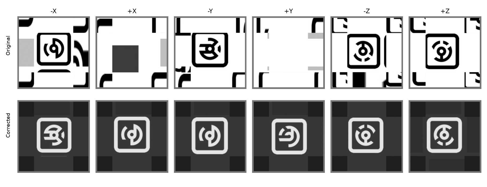

# What Vector's simulated camera sees on the light cube

The SDK OBJ's texture coordinates use the top of the source image as their origin. Three.js flips loaded images by default. With the old loader, Chromium placed pieces of glyphs on the corner caps and left the centers of two faces blank. The web viewer now samples the atlas in the correct orientation and maps the marker region to the photographed light-on-dark polarity. The two gray values chosen for shell and caps approximate the photograph. Absolute reflectance and exposure remain unmeasured.



With a 44 mm cube, the rendered outer border measures 22.0–23.3 mm across the twelve horizontal and vertical dimensions at a threshold of 140/255. The largest center offset on either image axis is 1.1 mm. These reproduce the web asset as actually drawn. The engine's nominal square is 23 mm. Render sampling is 0.1 mm per pixel under uniform lighting. The [threshold sweep](measurements.csv) includes a weak extra texture line on the −X face that shifts its apparent height at the lowest threshold.

This corrects the optional SDK optical surface seen by both viewer cameras. The recorded-pose analysis projects a mathematical 23 mm segment directly, so the rendering fix cannot account for its raised-stripe residual.

To reproduce, install the pinned SDK assets with the web project's fetch tool, start Vite from the web directory, and install the righting experiment's Playwright dependency. From this evidence directory run:

```sh
CHROMIUM=/path/to/chromium node render.cjs http://127.0.0.1:5173/ /tmp/cube-projections
python measure.py /tmp/cube-projections
```
