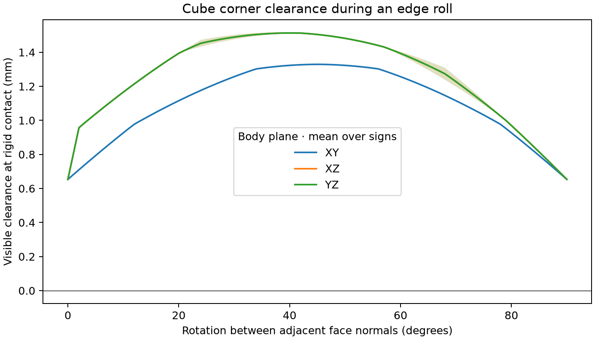

# Visible cube clearance at the first rigid contact

The deployed 44 mm optical rig and Vector 2.0 contact boxes disagree even in a face-down pose. At first geometric contact with a plane, the closest visible vertex is 0.653 mm above it. Halfway through an edge roll the gap is 1.329–1.505 mm, depending on the edge. The largest sampled difference was 1.517 mm. A visible gap of this magnitude can therefore occur with a stationary, supported cube.



The line for each plane averages the four signed quadrants. The band spans their range. The calculation projects all referenced optical vertices and the exact support points of the 103 axis-aligned collision boxes onto the same unit normal at 1° intervals. The body frame and the scale match the 44 mm rig path in the web viewer. It measures undeformed plane contact. Solver penetration, camera projection, and the actual compliance and rounding of rubber on a physical cube require separate measurements. This calculation does not establish a fork contact or determine which envelope better represents the physical rubber.

Run from this directory after fetching the [deployed normalized optical OBJ](https://p1r4n351-vector-simulacrum.static.hf.space/robot/sdk/Victor_cube_rig.obj) (SHA-256 32d426fe57344bf8a398ecec648b3c0232e221bb8f75a9c3b74be3ec589b6b7e).

```sh
python support.py Victor_cube_rig.obj ../../web/public/robot/vector2/vector-free-dock.xml
```

The deployed scene and repository scene at 7d2aecb produced identical [sampled clearances](support.csv).

[Stock photograph with separate rail and rubber measurements](photo-spans.md)

[Five recorded pushes replayed at four shell and pad widths](push-width.md)
