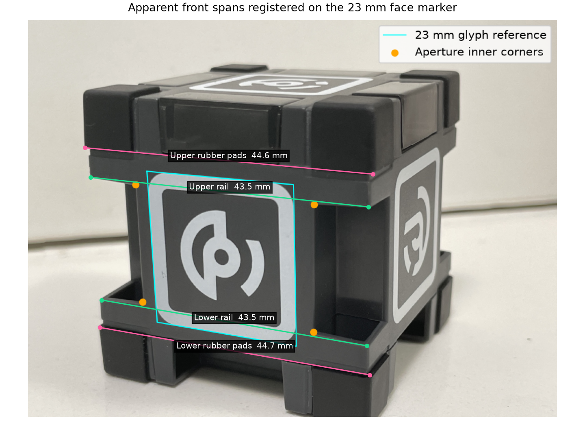

# Front shell and rubber widths from the stock cube photograph

The upper and lower rigid rails both span **43.5 mm** in the marker plane. The outer front pad boundaries span **44.6 and 44.7 mm**, respectively. Across these picks, rubber adds about 1.1–1.2 mm of apparent width. For comparison the Vector 2.0 collision boxes span 45.00 mm through the front rails at ±10 mm height and 45.31 mm through the pads at ±16 mm height. The rendering rig has a 44.00 mm overall envelope. The photograph suggests the distinction between shell and rubber deserves separate measurement.

The independent scale reference is the nominal 23 mm outer glyph. The analysis transfers the published glyph-plane homography through the four orange aperture picks in the [registered stock photo](../unit3-printed-fork-contact/cube-face-photo.png) and its [metric coordinates](../unit3-printed-fork-contact/cube-face-photo.csv). Front endpoints were manually picked where the top and bottom rails meet the recess and where the pads meet the rails. The two measurements per material are repetitions within one exposure. Moving each endpoint by up to two pixels per coordinate gave 43.12–43.89 mm for the rails and 44.27–45.11 mm for the pads (outward rounded). These limits cover only endpoint placement. The marker is recessed, and its physical print tolerance, the rounded pads' depth relative to its plane, lens distortion and the exact boundary on the near corner remain systematic uncertainties. Neither the unloaded rubber width nor compression at the shelf is established by the image.

Run `python photo.py` from this directory to regenerate the overlay and [four spans](photo-spans.csv). The scale comes from the printed marker alone. The stock fork is absent from this photograph.
