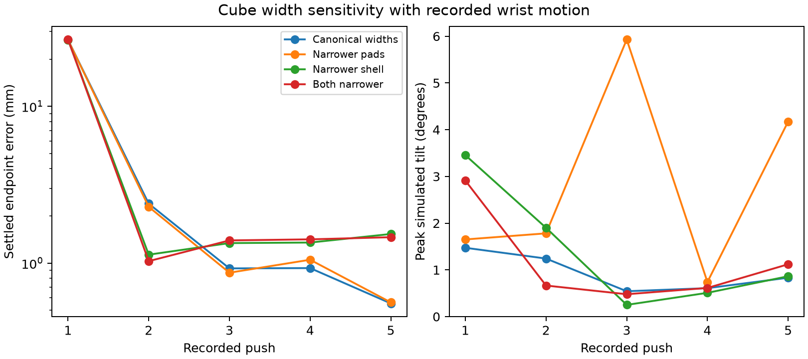

# Do the photographed widths explain the recorded lateral throw?

The first push moved the physical cube 26.72 mm right. Across four combinations of shell and rubber width, the simulated cube moved just 0.13–0.27 mm right. The largest predicted tilt during that push was 3.46°. Changing the horizontal outlines to match the apparent widths in the [stock photograph](photo-spans.md) did not reproduce the throw.

| Horizontal dimensions, shell / pads | Trial 1 endpoint error | Trials 2–5 mean endpoint error |
|---|---:|---:|
| 45.0 / 45.31 mm, canonical | 26.55 mm | 1.20 mm |
| 45.0 / 44.7 mm | 26.53 mm | 1.19 mm |
| 43.5 / 45.31 mm | 26.59 mm | 1.34 mm |
| 43.5 / 44.7 mm | 26.69 mm | 1.33 mm |



Widths were selected from the earlier photograph and the canonical scene before this replay. Trial 1 is the unusual lateral event. Trials 2–5 are previously studied physical comparisons, with no dimension fitted to their results. Peak tilt can change even with little endpoint improvement: on trial 3, changing only the pads raises the computed peak from 0.54° to 5.93°. No independent transient tilt is established for that trial.

The existing welded-wrist replay uses the five recorded chassis and lift trajectories, calibrated onboard initial cube centers, overhead initial headings, the printed fork decomposed into 58 convex pieces and the moving rails. We imported the Vector 2.0 canonical cube inertial properties and contact boxes, adapting their contact masks to the fixture. For each material, positions and widths of boxes beyond 21 mm from center are rescaled in the two horizontal axes. Interior pocket geometry, height, density-independent inertia, and friction are fixed. Treat the widths as perturbations: one oblique photograph does not determine the unloaded three-dimensional pad profile. Real fork asymmetry, transient engagement and compliance remain possible sources of discrepancy.

Build the fixture with the [printed fork instructions](../unit3-printed-fork-contact/README.md) and install the registered SDK assets for the rail exporter. Run from this directory:

```sh
python push_width.py ../.. /path/to/unit3-fork.xml
python plot_width.py
```

[All 20 results](push-width.csv) · [Physical endpoints](../unit3-paired-cube-push/comparison.csv)
