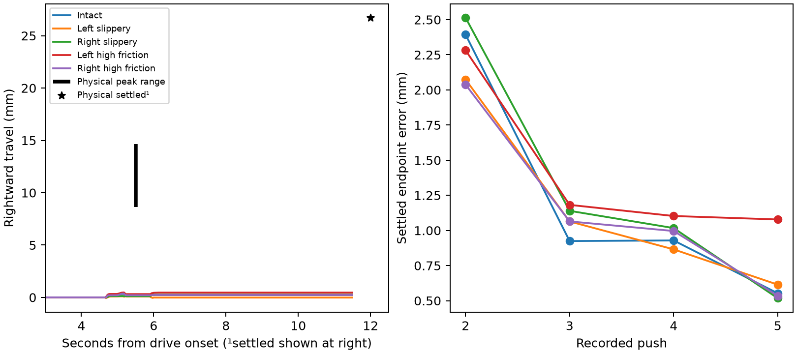

# Does one side of the fork slipping explain the sideways push?

At peak lift the physical cube had already traveled 8.63–14.64 mm right across four optical pose reconstructions. In five replays the cube was only 0.09–0.31 mm right at that instant. The physical settled displacement was 26.72 mm right. Even tripling friction on the left side moved the simulated cube just 0.46 mm right by settling.

| Sliding friction at fork contact | Rightward travel at peak lift | Settled rightward travel | Other four pushes, mean endpoint error |
|---|---:|---:|---:|
| Reference | 0.25 mm | 0.24 mm | 1.20 mm |
| Left ×0.05 | 0.09 mm | −0.02 mm | 1.15 mm |
| Right ×0.05 | 0.12 mm | 0.25 mm | 1.30 mm |
| Left ×3 | 0.31 mm | 0.46 mm | 1.41 mm |
| Right ×3 | 0.21 mm | 0.23 mm | 1.16 mm |

Each case uses the same five recorded wrist paths, intact printed fork, moving rails, optical starting poses and Vector 2.0 contact boxes as the [width experiment](push-width.md). Mesh pieces wholly on the named side use a separate collision mask. Only sliding friction at those fork–cube contacts changes. Midline-spanning pieces, floor, rails, torsional and rolling friction retain their parameters. All 20 altered replays registered contacts with the affected surfaces. Ten neutral rerouting controls reproduced the direct reference. The selected multipliers bracket strong slip and grip and are sensitivity probes. The settled optical star is drawn at the right of the plot for readability.

The missing tooth was reported after this recording. Its side and break date remain unknown. Earlier [geometric cuts into either tooth](../unit3-printed-fork-contact/README.md#could-a-missing-fork-tooth-explain-the-sideways-sweep) also fell short. Neither experiment models a fracture snag or the elastic deflection of printed material. The lateral discrepancy is already present during the rise.

Run `python side_grip.py ../.. /path/to/unit3-fork.xml ../../web/public/robot/vector2/vector-free-dock.xml` here, using the fixture documented in the width experiment. Append `--neutral` for the two mask controls. [All cases](side-grip.csv) · [Neutral controls](side-grip-controls.csv)
