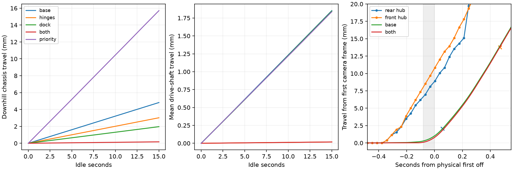

# Where does idle downhill travel come from?

In the v1 42 mm scene, the chassis moved 4.82 mm downhill in the first 15 s without a command. The two drive shafts turned the equivalent of 1.85 mm of tread travel. Increasing the impedance of just the drive-hinge friction constraints nearly eliminated shaft travel, but the chassis still moved 3.02 mm. Increasing the impedance of the dock support contacts reduced chassis travel while leaving shaft travel near 1.85 mm. Both constraints contribute.



| 15 s diagnostic | Downhill chassis travel | Mean drive-shaft travel |
|---|---:|---:|
| Canonical | 4.823 mm | 1.853 mm |
| Front drive hinges | 3.020 mm | 0.018 mm |
| Dock support contacts | 1.966 mm | 1.847 mm |
| Both | 0.169 mm | 0.018 mm |
| Dock priority alone | 15.706 mm | 1.838 mm |

The hinge variant preserves the friction torque limit and sets its solver impedance to 0.999. The dock variant applies the same constant impedance to the base, pocket, ramp bed, apron and lip at contact priority 3. The priority-only control uses the same five surfaces and priority with their previous impedance. Changing priority can also select different friction and constraint settings from the pair; its large effect makes it important to include this control. The reported shaft distance is rotation times nominal wheel radius. It is not a separate physical track motion measurement.

With both changes the idle v1 stayed electrically connected throughout 70.7 s, with 0.77 mm of X displacement. A 60 mm/s command at 70.7 s released it by the 71.15 s sample. In the [physical comparison](../workshop-joints-20261127/lift-duration/history-52/README.md), the v1 kept charger contact throughout the lift sequence. The experiment did not measure its absolute displacement.

## Independent Vector 2.0 departure

Replaying the recorded head, lift and wheel schedule on the Vector 2.0 shelf showed a tradeoff. With both changes, simulated electrical release came 468 ms after the physical first-off packet, compared with 58 ms for the frozen solver. Measured from the first camera frame, release occurred after 13.78 mm versus 2.06 mm in the baseline. The physical hubs tracked approximately 8.84–10.74 mm by the first-off frame. At that physical time, the two simulated displacements were only 0.79 and 1.02 mm. Both replays use the recorded wheel reports as controller inputs and inherit that method’s drive-response delay and starting-depth uncertainty. We have not applied these settings to production. [Original recording and optical registration](../dock-posture-history/README.md)

From this folder with the web dependencies installed:

```sh
for mode in base hinges dock both priority; do node probe.mjs "$mode" 15 > "$mode-screen.csv"; done
node probe.mjs both 72.2 70.7 > long-both.csv
(cd ../dock-posture-history && python3 history.py) > /tmp/impedance-history.json
node ../dock-posture-history/replay.mjs full < /tmp/impedance-history.json > depart-base.csv
node ../dock-posture-history/replay.mjs full both < /tmp/impedance-history.json > depart-both.csv
python3 compare.py
```
