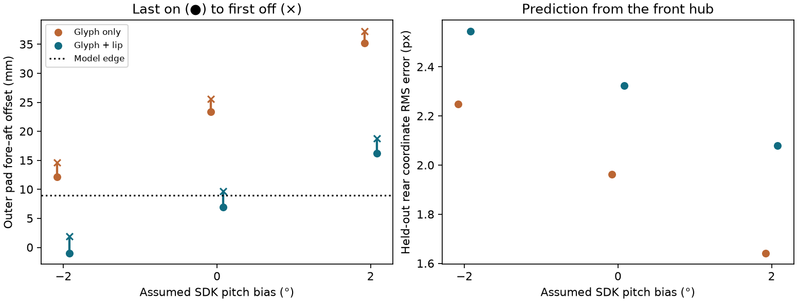
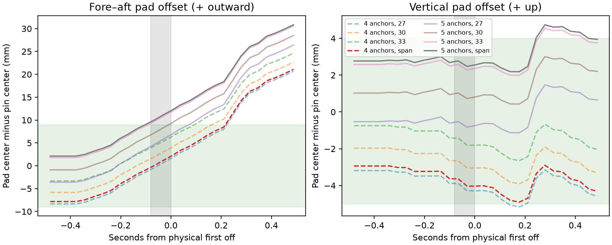

# Vector 2.0 belly pads at the W35 release

One side view of the W35 departure contains both hubs. Neither belly pad nor spring pin is visible during contact. This reconstruction projects the canonical pad and pin centers using the corrected camera, the dock glyph, the optional lip landmark, the physical 48 mm axle spacing and the recorded SDK pitch. It asks whether the geometry already explains the flag edge before fitting any change to the electrical envelope.

With the glyph and lip registration, recorded pitch, nominal 30 mm hub-face offset, zero roll and constant heading and lateral chassis position, the two pad centers are **6.25 and 6.92 mm outward** of their pins at the last on-charger report. At the first off report they are **8.99 and 9.66 mm outward**. The canonical fore–aft tolerance is 9 mm and it requires both pads to pass. The modeled release is therefore consistent with one pad crossing the existing edge in this 81 ms interval. At first off, the estimated vertical error is +1.26 mm and the larger absolute lateral error is 0.92 mm. Both are inside the canonical envelope.

These are inferred offsets. The last-on and first-off SDK flags were used only to select scoring times. No contact flag, pin overlap, or travel-to-release target was used in the camera pose fit.

## Checks on the reconstruction

- The W34 seated hub picks provide an independent axle-span scale check. Fitting the 48 mm spacing and 3.75 mm axle height difference in that frame gives visible hub planes of 32.86 and 33.37 mm from dock center in opposing cameras for the glyph-plus-lip fit. Glyph alone gives 22.01 and 27.62 mm. This difference carries into estimates of the absolute pad positions. [W34 dock registration](../unit3-dock-side-registration/README.md)
- The constrained W35 fit holds one lateral position and yaw across the short departure. It fits both tracked hubs in camera frames strictly before the last on report. For each subsequent frame, the front hub alone sets fore–aft position and height. Rear pixel coordinates are withheld. With the nominal assumptions their RMS coordinate error is 2.32 px. The glyph-only fit achieves 1.96 px while placing the pads about 18 mm sideways from their pins even before release. A close rear-hub reprojection by itself cannot certify absolute pad position.
- Keeping the glyph and lip but changing assumed pitch by −2° or +2° moves the outer pad at first off from 9.66 mm to 1.94 or 18.80 mm. The held-out pixel errors stay between 2.08 and 2.54 px. This is a sensitivity experiment, not a measured pitch confidence interval. Varying the face offset alone from 27 to 33 mm changes the nominal fore–aft estimate only to 9.55–9.76 mm, but also changes the lateral offset.
- The fixed-plane alternative back-projects each hub separately and recovers pitch from their baseline. The unconstrained two-ray alternative uses SDK pitch and solves exactly for rigid separation frame by frame. Both expose the sensitivity to depth and yaw that the shared-position fit suppresses. [Fixed-plane offsets](brackets.csv) · [Independent rigid-pair fits](rigid.csv) · [Withheld-frame scores](sequence.csv)

The data support retaining the existing electrical dimensions. Independent pitch, yaw or a second view during release would be needed to assign millimetre-level error to the envelope. The observed dock lip is curved, the pins are model projections, and all methods use the same measured hub tracks. These are alternate interpretations of one departure.

Run python register.py, python rigid.py, python sequence.py and python plot.py from this directory with NumPy, SciPy, OpenCV and Matplotlib. Source traces and camera conventions are in the [W34/W35 evidence](../unit3-w34-return/README.md).
