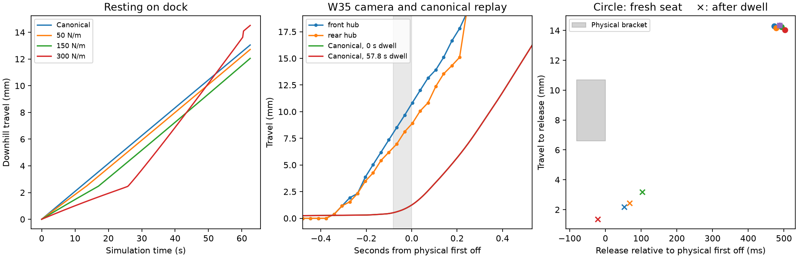

# Can spring-loaded charger pins explain dock creep or release?

On the physical Vector 2.0 departure following W34, camera estimates from the two hubs bracket release travel at roughly 6.6–10.7 mm. The last on-charger report preceded the first off report by 81 ms. The robot had spent about a minute on the charger. The [original capture](../unit3-w34-return/README.md) includes the wheel reports and camera track. This is one physical departure.

We tested the existing canonical seated pose and the same pose after 57.8 s of simulated rest, the approximate time from physical contact to the beginning of the replay input. Both use the same W35 measured wheel speeds as controller targets, initial head and lift, dock and shelf. The travel origin resets at the beginning of the wheel input so that passive drift and departure travel are reported separately.



| Condition | Passive displacement during dwell | First off relative to physical first off | Departure travel at first off |
|---|---:|---:|---:|
| Canonical, fresh seat | — | +473 ms | 14.28 mm |
| Canonical, after dwell | 12.07 mm | +53 ms | 2.17 mm |
| 300 N/m pins, after dwell | 12.79 mm | −22 ms | 1.36 mm |
| Four noslip passes, after dwell | <0.001 mm | +488 ms | 14.34 mm |

The stiffest spring put the electrical release inside the observed time bracket, yet its release travel fell more than 5 mm below even the lower camera estimate. Its two pins last carried a positive normal load at 1.20 mm. With a fresh seat, mechanical load persisted to 13.84–14.03 mm across the three stiffness settings. Changing the criterion from a pad envelope to bilateral mechanical contact does little to explain the discrepancy in these trials. The simulated passive displacement has no independent physical measurement during the full dwell. Docked SDK odometry suppresses planar travel. Timing alone would reward the wrong simulated behavior here.

The experimental pins are vertical slide joints with 4 mm of travel, 0.5 g moving mass, 0.35 N·s/m damping and 50, 150 or 300 N/m stiffness **per pin**. The existing pin boxes make contact with belly plates at the existing electrical pad centers. Plate half-widths are estimated by subtracting the pin footprint from the electrical envelope. Friction is assumed to be 0.3, and spring preload is zero. These values probe sensitivity and are unmeasured. The electrical envelope still uses the original unloaded pin reference. Spring geometries interact only with their own plates. The experiment never modifies the canonical XML.

The first panel uses the default wheel scene at the earlier workshop resting posture. The two departure panels use the recorded Vector 2.0 shelf posture and drive. Input through the motor controller reintroduces actuation latency. These runs establish neither a physical spring rate nor an absolute seated depth. [All ten departure scores](scores.csv)

Reproduce with the web dependencies and Python with NumPy and Matplotlib in this directory.

```sh
python departure-input.py > /tmp/w35-pin-input.json
for k in 0 50 150 300; do
  node replay.mjs vector-free-dock "$k" > "spring-$k.csv"
  node depart.mjs "$k" 0 < /tmp/w35-pin-input.json > "depart-$k.csv"
  node depart.mjs "$k" 57.8 < /tmp/w35-pin-input.json > "dwell-$k.csv"
done
for d in 0 57.8; do
  node depart.mjs noslip "$d" < /tmp/w35-pin-input.json > "noslip-$d.csv"
done
python compare.py
```
