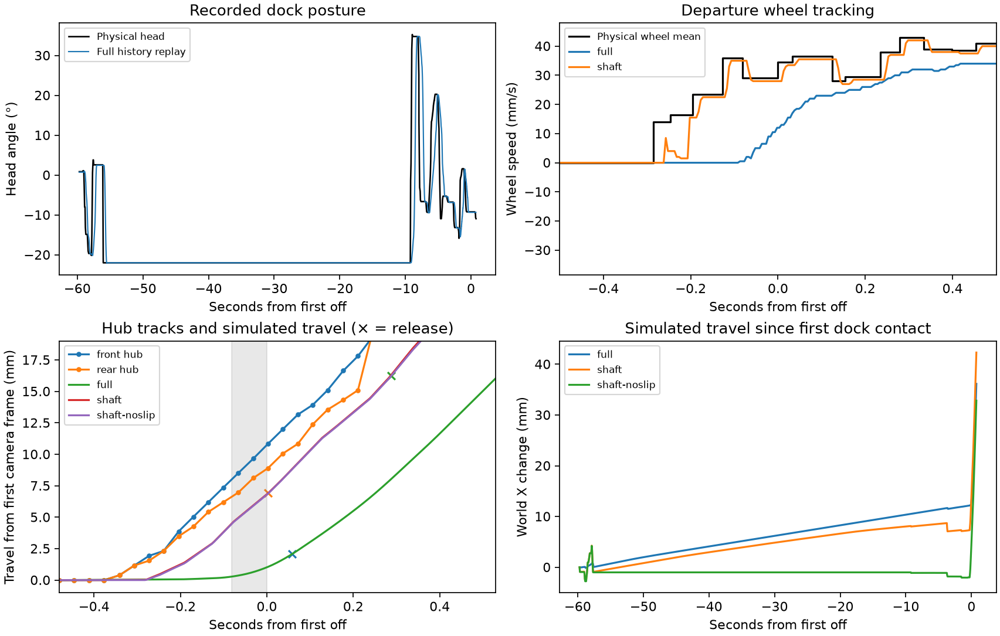

# W35 departure after replaying the recorded dock history

The W34 first charger contact and W35 first off-charger report were 59.702 s apart. Joining the two SDK listeners by UTC, using the continuation from its first packet, gives 1,007 samples up to 0.8 s after first off. The robot moved its head from −22.0° to +35.3° and its lift between 28.3 and 60.5 mm before the departure input window. Fifteen reports showed nonzero wheel speed, including the tail of docking. Holding each signed mean wheel report to the next packet gives −8.19 mm of shaft travel before that window. Shaft travel cannot establish the actual seated position.

All eight replays start at the canonical seated geometry and the first recorded servo posture. The four control runs differ only in whether measured wheels and servo targets are applied before −1.8 s. All four get the full input sequence from −1.8 s onward. The physical bracket spans −81 to 0 ms. Camera travel uses a fixed dock reference, 48 mm hub spacing and the first camera frame at −480.5 ms as its origin. Both visible hubs are from the **same side camera**. Simulated travel uses longitudinal world displacement of the chassis origin.



| Replay | Displacement before first camera frame | Travel at physical first off | Simulated release relative to physical first off |
|---|---:|---:|---:|
| Static dwell, then standard controller | +12.35 mm | 1.02 mm | +48 ms |
| Full history, standard controller | +12.13 mm | 1.02 mm | +58 ms |
| Full history, shaft-speed replay | +7.27 mm | 6.83 mm | +3 ms |
| Same, interpolate between shaft reports | +5.83 mm | 8.24 mm | +3 ms |
| Shaft-speed replay, four noslip iterations | −1.99 mm | 6.79 mm | +288 ms |
| Physical side camera | Unmeasured over full dwell | Rear 8.84 mm, front 10.74 mm | SDK bracket −81 to 0 ms |

With the same wheel inputs, replaying the predeparture servo history displaced the simulated start of the camera window by only 0.022 mm and changed travel at first off by less than 0.001 mm. The replayed joints tracked recorded angles and heights with errors of 7.27° and 3.09 mm RMS. This comparison cannot rule out sharper physical servo impulses.

The standard controller takes recorded wheel speeds as *new commands* and reapplies its queue and motor response. A diagnostic drives torque-limited velocity actuators at those measured shaft speeds directly (gain 0.8, same torque limits, following the existing spin replay). Interpolation uses the next packet and is an offline sensitivity bound on input reconstruction, not a live controller. It closes most of the optical travel shortfall in this one departure. At last on, even the interpolated result gives only 5.73 mm compared with the rear and front hub estimates of 6.63 and 8.01 mm. The two camera landmarks have distinct trajectories and registration uncertainty.

Switching to the stronger friction solver preserves much of the shaft-driven departure travel but shifts the release by 285 ms. The apparent timing match therefore depends on simulated seating during the preceding minute. Neither the physical starting depth nor longitudinal motion throughout that minute was independently measured. The canonical robot controller and contact envelope were left intact.

[Per-run scores](scores.csv) · [Physical recordings and optical method](../unit3-w34-return/README.md) · [Passive dwell and spring-pin control](../dock-pin-support/README.md)

Run from this directory with the web test dependencies and Python with NumPy and Matplotlib.

```sh
python history.py > /tmp/w35-history.json
for mode in static posture wheels full noslip shaft shaft-noslip shaft-linear; do
  node replay.mjs "$mode" < /tmp/w35-history.json > "$mode.csv"
done
python compare.py < /tmp/w35-history.json
```
