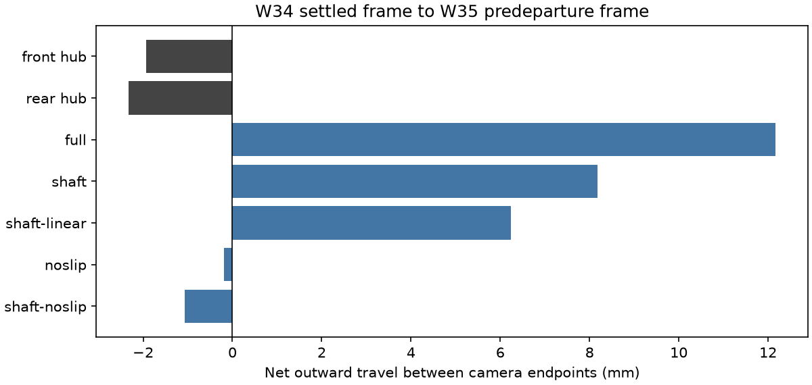

# How far did the robot move while it sat on the charger?

The last tracked W34 side-camera frame and the first W35 departure frame show the same two hubs and the same stationary dock patch. These stored pixel coordinates supply a check on **net** travel during 59.08 s between the recordings. They do not yield a continuous trajectory or establish absolute pad depth.

The dock patch was at (930,155) in both corrected views. The front hub moved from (763,243) to (768,242) and the rear from (886,234) to (892,230). With the archived scale of 48 mm per 124 px, this corresponds to **1.94 and 2.32 mm inward**. Independent initialization of the two trackers, small pitch or yaw changes, and perspective can bias both picks. A 5–6 px discrepancy between tracker origins could account for the entire apparent inward movement. There is no calibrated confidence interval. The result gives little support to a large outward slide.

Over those exact times the canonical full-history replay moved **12.16 mm outward**. Even the shaft-driven model that comes within 3 ms of the physical departure flag moved **6.24–8.18 mm outward** depending on interpolation. Four noslip iterations and direct wheel replay gave **1.07 mm inward**, much closer to the endpoint estimate, yet cleared the flag 288 ms late. The correction that best reproduces predeparture position still needs a better account of where electrical release occurs. A precise physical spring rate or threshold cannot be inferred from these two frames.

Run python endpoints.py after the eight replays in the [history comparison](README.md) to regenerate the [endpoint scores](endpoints.csv) and plot.
