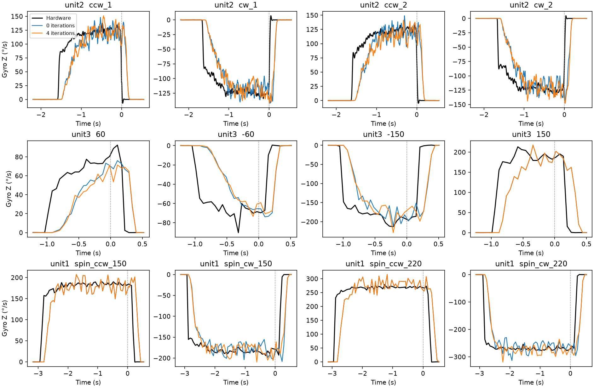
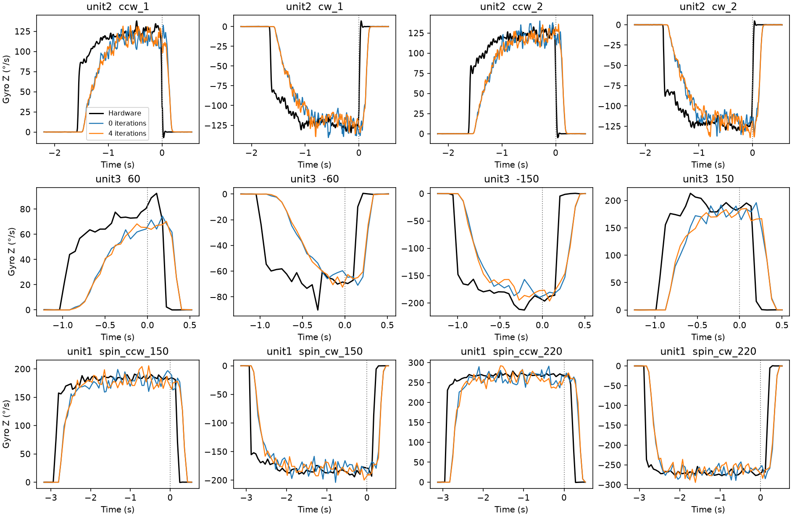

# Testing the dock solver against independent physical spins

Twelve archived spins from three robots on distinct hard surfaces were replayed under both the default wheel geometry and the optional 42 mm contact geometry. Each scene used the same measured wheel inputs, head angle, lift height and noise seed for its paired runs. Four additional MuJoCo noslip iterations had previously suppressed stationary charger creep. No motion or surface parameters were fitted to the turns.

| Default scene, mean of four turn RMSEs (°/s) | Steady, standard → candidate | Braking, standard → candidate |
|---|---:|---:|
| Unit 1, 150 and 220 mm/s each way | 19.43 → 17.36 | 125.35 → 117.67 |
| Unit 2, two 100 mm/s trials each way | 13.08 → 13.32 | 68.57 → 70.73 |
| Unit 3, 60 and 150 mm/s each way | 31.38 → 31.75 | 72.00 → 73.03 |

The candidate improved the default scene on both clockwise unit 1 stops and gave identical errors on its two counterclockwise stops. It increased error on three of four unit 2 stops and two of four unit 3 stops. In the 42 mm scene, the average braking error fell for all three robots, but four individual stops still worsened. Neither the robot nor the floor can be isolated as the cause because they vary together. These paired comparisons do not justify a global default change.




The vertical line marks the last native encoder edge for unit 2 and the SDK stop command for units 1 and 3. Native steady and stop windows span −700 to −250 ms and −100 to +250 ms around the last edge. SDK steady windows begin 450 ms after command onset and end 100 ms before stop. SDK stop windows cover the first 350 ms from the stop command. Each physical sample is compared to the nearest 5 ms simulation tick. Identical held wheel reports drive the existing controller and its command queue. Absolute braking error therefore includes the effect of reapplying drive dynamics to measured wheel speeds. Head gyro is compared in its own frame. Simulated starts use the first recorded head and lift readings, with a 30.645 mm lift assumed for the native unit 2 runs.

A stationary control at the first workshop posture also distinguishes the two geometries. From seconds 3 to 62.5 the **default** scene drifted 12.42 mm downhill and retained the charger flag throughout. With four extra iterations it moved less than 0.001 mm. The previously reported 43.75 s charger loss occurred in the **42 mm** scene. Reproduce the default check with the earlier dock-settling.mjs script, substituting vector-free-dock.xml for vector-contact42-free-dock.xml, and use head −21.017°, lift 32.34 mm. [Default baseline](dock-default-baseline.csv) · [Candidate](dock-default-noslip.csv) · [42 mm experiment](../docked-idle-imu/settling.md)

[Per-turn scores](scores.csv) · [Across-turn summaries](summary.csv). Reproduce in this directory with the repository's web dependencies and Python with NumPy and Matplotlib.

```sh
python prepare.py
node replay.mjs > predictions.csv
python compare.py
python summarize.py
```
