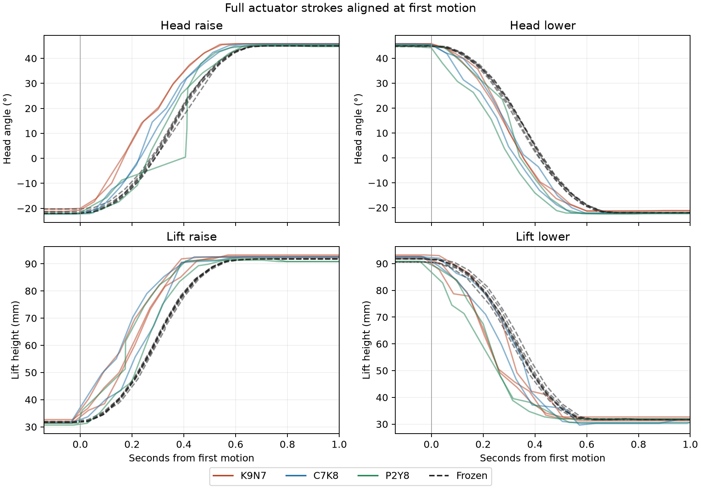

# unit 2 docked actuator timing

Unit 2 remained on the workshop dock and reported charging at the end. The recorder issued only head and lift actions. It requested three cycles per joint. Unit 2 moved its head between the first two head actions, including a return from +46° to approximately −6° after the first raise completed. That cycle had unmatched starting postures. The raw recording includes it. Two head cycles and all three lift cycles met the endpoint check.

Median time from host command to detected motion and median 10–90% travel time, in milliseconds. Each cell gives onset / travel time. Frozen values here replay unit 2. The CSV includes the separate replay for every robot and stroke.

| Full stroke | unit 2 docked | Frozen | unit 1 run A | unit 3 run O |
|---|---:|---:|---:|---:|
| Head −22° to +45° | 220 / 366 | 105 / 375 | 179 / 373 | 207 / 363 |
| Head +45° to −22° | 157 / 353 | 98 / 380 | 180 / 361 | 251 / 357 |
| Lift 32 to 92 mm | 189 / 327 | 129 / 344 | 223 / 318 | 232 / 318 |
| Lift 92 to 32 mm | 190 / 341 | 129 / 338 | 199 / 326 | 279 / 318 |

Unit 2 starts 59–115 ms later than its matched replay. After onset the largest median 10–90% discrepancy is 27 ms on head lowering. Individual unit 2 head lowers took 328 and 378 ms. The repeats and sample cadence limit conclusions about small differences. Unit 3 starts its head lower about 94 ms later than unit 2, yet their median traversal times differ by only 4 ms.

## Measurement

All recordings use SDK state delivery time on the recorder clock. For the head, subtract the precommand pitch gyro baseline and interpolate the first sustained directional 1°/s crossing. For the lift, use the midpoint of the bracket containing the first sustained displacement above 0.15 mm. The two successive readings rule rejects isolated spikes. Unit 2 onset brackets are typically about 60 ms wide. Host dispatch, transport, controller response and SDK reporting all contribute to measured onset. The data do not isolate motor dead time.

Select alternating full endpoint commands and require the median positions before command and during 1.25–1.53 s after command to be within 5° or 5 mm of the two endpoints. Interpolate 10% and 90% crossings of each measured excursion. Each overlay shifts only time and retains absolute angle or height.

Replay uses the unchanged actuator parameters at commit 69260a7, including the 105 ms command delay, measured initial joint positions, and each recording's sample times. The simulator's standard level-table replay supplies the reference for docked unit 2. Its generation was unverified, so the reference uses the base Vector 1 profile. Unit 1 is a refurbished Vector 1. Unit 3 is a Vector 2 with a printed lift and uses the Vector 2 profile. Both archived bots performed their sweeps off dock. These runs cannot independently identify a dock, generation or lift-hardware effect.

Run `MPLBACKEND=Agg python evidence/docked-actuator-timing/analyze.py` from the repository root with NumPy, Matplotlib and MuJoCo installed (analysis used MuJoCo 4.0.1). Inputs are the docked SDK log, the actuator excerpt from unit 3 run O before the wheelie phase, and the repository's unit 1 run A. See [per-move measurements](moves.csv).

## Three docked units

Two fresh docked captures from units 1 and 3 repeat the same command endpoints and analysis gates, with 1.45 s between action completion and the next command. The workshop's unit 2 was unreachable and absent from its access point's station list. Its earlier docked session supplies the third comparison. Units 1 and 3 both reported on the charger platform at the end. These sweeps issued no wheel commands.

Median physical 10–90% durations in ms (head up/down, lift up/down) were 366/348 and 305/336 for unit 1, 366/353 and 327/341 for archived unit 2, and 374/361 and 266/324 for unit 3. For unit 3 the frozen matched lift raise took 345 ms. Median receipt-clock onset on that stroke was 255 ms measured versus 121 ms simulated. The model starts early and traverses the stroke slowly on that unit, so a single duration measured from command dispatch hides both discrepancies. Most onset brackets span about one 60 ms state interval. The 21 accepted fresh strokes and 10 archived strokes are reported individually with the endpoint gates used above. No cause is assigned to generation, printed lift, or battery condition. [Overlay](repeat/profiles.png) · [per-stroke results](repeat/moves.csv) · [unit 1 raw](repeat/unit1.jsonl) · [unit 3 raw](repeat/unit3.jsonl) · [analysis](repeat/compare.py).

**Transfer to cube acquisition.** We measured the same 40–80 mm wrist travel in seven unit 3 raises, aligning at 40 mm to exclude command dispatch. Docked direct raises took 169, 225 and 291 ms, and the two earlier off-dock direct raises both took 238 ms. The earlier native cube pickup took 389 ms and the improperly engaged R5 pickup took 430 ms. Using the full consecutive-SDK-receipt brackets instead of interpolated crossing times, the R5 interval (332–495 ms) still lies beyond both off-dock direct intervals (179–305 ms). The earlier pickup bracket overlaps the direct brackets. The native pickup and direct lift commands use different behaviors, and the cube changes the load. These runs cannot isolate which caused the difference. Applying one faster global lift speed based on the docked median is unsupported. [Absolute-height overlay](repeat/pickup-transfer.png) · [crossing times and bounds](repeat/pickup-transfer.csv) · [analysis](repeat/pickup_transfer.py).

**Testing the pickup speed with empty forks.** In the public supervisor source, the post-dock low and high pickup cases request carry height at 1.5 rad/s and 10 rad/s². The direct SDK raise uses 10 rad/s and 10 rad/s² by default. We sent three empty docked raises per unit at the native pickup cap, with standard lowers between them. Both units finished docked. These were separate sessions from the default-speed trials. The installed firmware build's internal command was not recorded. [Supervisor defaults](https://github.com/kercre123/victor/blob/669ec7499a7084640b57706a7937884a6568be50/robot/supervisor/src/pickAndPlaceController.cpp#L57-L58) · [pickup command](https://github.com/kercre123/victor/blob/669ec7499a7084640b57706a7937884a6568be50/robot/supervisor/src/pickAndPlaceController.cpp#L535-L539).

Over 40–80 mm, unit 1's median increased from 238 to 399 ms and unit 3's from 225 to 422 ms. Changing only the empty simulation's speed setting increased predicted travel time from 242 to 420 ms. The 420 ms prediction falls within the SDK timestamp brackets for both physical cube pickups (389 and 430 ms interpolated). That accounts for most of the previously observed difference without invoking payload drag. This test covers the rising wrist after pickup begins; friction, acquisition and retention still require separate validation. [Overlay](repeat/pickup-speed.png) · [all strokes](repeat/pickup-speed.csv) · [unit 1 recording](repeat/slow1.jsonl) · [unit 3 recording](repeat/slow3.jsonl) · [analysis](repeat/pickup_speed.py).

**Head timing on a held-out robot.** Nine docked full strokes on units 1 and 2 gave a median physical-minus-frozen gyro onset of 91.6 ms. Applying that one shift to both simulated head angle and pitch gyro reduced first-second RMS error for both signals on every accepted unit 3 stroke. The four docked strokes had median angle error 7.20° before and 2.63° after, and gyro error 39.77 and 19.56°/s. The four off-dock strokes gave 7.10° and 3.46°, and 35.64 and 16.46°/s. Each session includes two raises and two lowers. The replay uses measured starting posture and a level-table model in both settings. Errors are per stroke at actual SDK receipt times from command through 1 s, with the precommand gyro median removed in each stream. The offset describes host-command to observed motion across these recordings. The data cannot allocate it between command delivery, actuation and state reporting. The shift is applied only in this diagnostic. [Command-aligned overlay](repeat/head-transfer.png) · [individual scores](repeat/head-transfer.csv) · [reproduce](repeat/head_transfer.py).

**Earlier-session challenge.** Against twelve archived head moves on Nov 15 and 18, the same 91.6 ms shift improves encoder error on four and pitch gyro error on three. All four Nov 18 strokes between −22° and +45° worsen in both signals, including both directions. Their original angle RMS errors span 1.21–2.49°, rising to 7.04–8.28° with the shift. Command range alone therefore cannot select the receipt offset. The two archives were independent of the 91.6 ms estimate, although some Nov 15 strokes contributed to the original 105 ms simulator delay. This uses the same first-second SDK receipt scoring and removes the precommand gyro median separately per signal. The model retains its existing default. [Paired error plot](repeat/head-archive.png) · [per-move scores](repeat/head-archive.csv) · [reproduce](repeat/head_archive.py).

## Fleet coverage for docked work

Run each experiment that works on the charger in darkness on every available household Vector. Check actual SDK reachability and charging status on each unit, and record the robot, hardware generation, surface or dock, and session. Keep each unit's results separate so a measurement from one unit can test a fit from another. A pod registry entry alone establishes enrollment. For cube tests, record whether that unit has a connected cube.

| Experiment | unit 1 | unit 2 | unit 3 |
|---|---|---|---|
| Full head and lift strokes | Recorded, see repeat | Recorded, see repeat | Recorded, see repeat |
| Partial head/lift and two lift speed crossovers | Pending | Pending | Recorded |
| White cube LED and stationary cube accelerometer | Pending, cube availability unverified | Pending, cube availability unverified | Recorded |

At the November 22 fleet check both pod routes returned no route to unit 1 and unit 2. The workshop access point was enabled and reported zero associated stations. Retain these units for the next available run.

**Passive docked state, November 22 at 22:13 UTC.** With quiet enabled, unit 3 returned 333 SDK states spanning 19.91 seconds. The wheels reported zero throughout, head angle stayed at 32.56° and lift height stayed at 33.02 mm. All states reported a forward object and a clear aggregate cliff flag. Range varied from 140 to 153 mm (median 145 mm), with signal quality 0.02396–0.02449. This provides a stationary noise and repeatability reference; the reflecting surface and its absolute distance were not independently measured. The SDK exposes the aggregate cliff flag here. The first capture attempted a nonexistent per-sensor field and yielded zero usable states; the recording linked here is the corrected repeat. Charger and charging were true before and after (4.075 and 4.072 V), and HA quiet was on at handback. Unit 1 and unit 2 both returned no route to host through both relay pods, so their passive baselines remain pending. [Physical trace](idle/unit 3.png) · [Raw states](idle/unit 3.csv) · [Passive recorder](idle/record.py).
