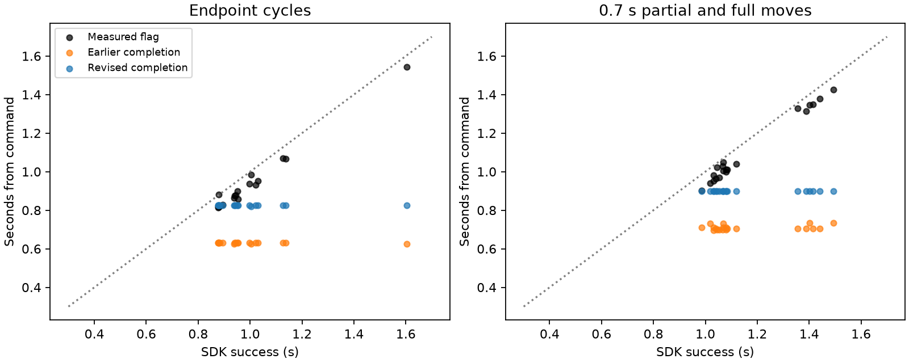
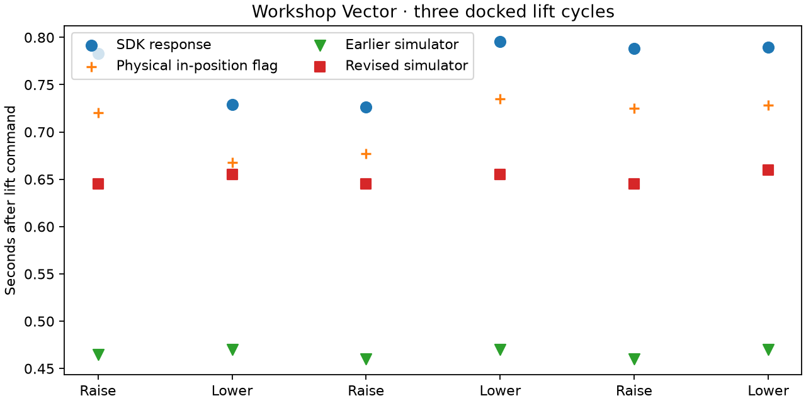

# Docked lift completion across three Vectors

The simulator previously completed a lift action on the first sample inside the angle tolerance. A moving lift now also waits for its existing in-position signal. A command that starts inside the angle tolerance can still complete immediately. Python and the browser use the same rule.

| Robot and recording | Moving commands | Earlier median absolute error | Revised median absolute error |
|---|---:|---:|---:|
| Unit 1, endpoint cycles | 6 | 318 ms | 123 ms |
| Unit 2, endpoint cycles | 6 | 250 ms | 55 ms |
| Unit 3, endpoint cycles | 6 | 373 ms | 178 ms |
| Unit 3, timed moves, blocks 0–1 | 10 | 374 ms | 180 ms |
| Unit 3, held-out timed moves, blocks 2–3 | 10 | 348 ms | 148 ms |
| All moving commands | 38 | 355 ms | 168 ms |

For each command, the replay starts at its measured head angle and lift height on a level support with charger contact asserted. The endpoint runs use the requested default speed. The timed runs request 0.7 seconds. Units 1 and 2 use the generation-one model and unit 3 uses generation two. Each group uses the existing model parameters.

The physical flag cleared and set again on all 38 moving strokes. The SDK response followed that fresh edge on 37 strokes. On the remaining stroke the response arrived 3 ms before the first observed set packet. Host-observed event times include packet delivery and SDK scheduling.

Seven additional commands started within 2 mm of the requested endpoint. Their hardware responses arrived in 0.10–0.22 s, ahead of the next fresh in-position edge. The simulator still omits that response delay. The 2 mm threshold labels recordings for analysis. The runtime uses its existing angular tolerance.

The remaining timing error includes simulated mechanism and settling errors as well as unmodeled response latency. This check does not measure lift force or reproduce dock ramp contacts.

[Per-command measurements](lift-ack.csv) · [Replay and plotting script](lift_ack.py)

## Prospective check on a workshop Vector

After freezing the change, a generation-one Vector performed three unloaded raise/lower cycles between a nominal 32 and 65 mm on its dock. The revised simulator finished early on all six moves, by 74–144 ms. Median absolute error fell from 318 to 133 ms. The physical SDK response followed the fresh in-position packet by 49–64 ms. Every one of the 160 SDK state packets indicated dock contact. The status check after releasing control reported the unit full and on its platform, with charging inactive.

[Recorded packets and acknowledgments](workshop-validation.jsonl) · [Trial values](workshop-validation.csv) · [Reproduce the comparison](workshop_validation.py)
