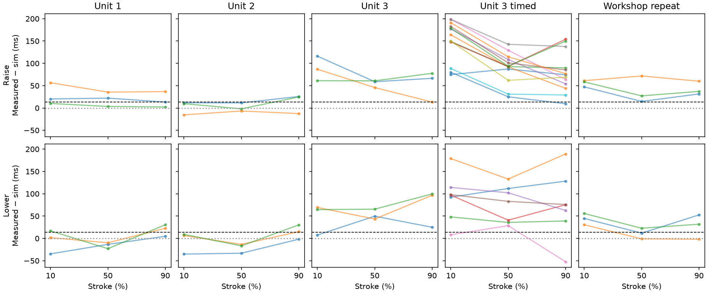

# Does lift encoder timing differ at the start or through the stroke?

On unit 3's 0.7-second timed raises the physical lift crossed 10% of its commanded stroke a median 164 ms later than the canonical simulator. Once moving, it crossed from 10% to 90% a median **70 ms faster**. For 8 of 13 raises even the longest transit consistent with the two bracketing SDK packet pairs was shorter than the simulated transit. A fixed command latency alone cannot reproduce these profiles.

Each line represents one stroke. A positive value means the measured encoder crossed that height later. A horizontal line would indicate a constant timing offset. The black dashed line is a 13 ms offset estimated only from the six unit 1 crossings at 10% stroke. The plot uses interpolated crossings. Packet brackets for every point are in the CSV.

| Recording | Strokes | Physical minus simulated 10–90% transit, raises | Lowers | Median absolute crossing error | With unit 1 offset |
|---|---:|---:|---:|---:|---:|
| Unit 1 endpoints, calibration robot | 6 | −8 ms | +21 ms | 19 ms | 11 ms |
| Unit 2 endpoints | 6 | +14 ms | +21 ms | 13 ms | 15 ms |
| Unit 3 endpoints | 6 | −50 ms | +27 ms | 63 ms | 49 ms |
| Unit 3 timed moves | 20 | −70 ms | −22 ms | 93 ms | 79 ms |
| Workshop repeat partial cycles | 6 | −16 ms | −24 ms | 34 ms | 21 ms |

All 44 moving strokes crossed all three heights. The tested 13 ms offset worsened the other workshop endpoint recording and left substantial error on timed strokes. The canonical controller remains unchanged. The 63 ms SDK response estimate in [the action-completion comparison](lift-residual.md) describes a later event.

Each replay uses the canonical model with the recorded starting head and lift pose, asserted charger contact and a level support. Thresholds are relative to the measured starting height and commanded target. The comparison uses the first directional crossing and linear interpolation between adjacent SDK reports. Labels refer to time since the client command. Timing at 10% includes command transport, actuation and encoder reporting. These data cannot identify the motor's first powered instant. The timed sequence includes different stroke lengths and approach histories, so a single motor speed correction inferred from its pooled median would be premature.

[Per-stroke measurements](lift-crossings.csv) · [Replay and plot](lift_crossings.py)
