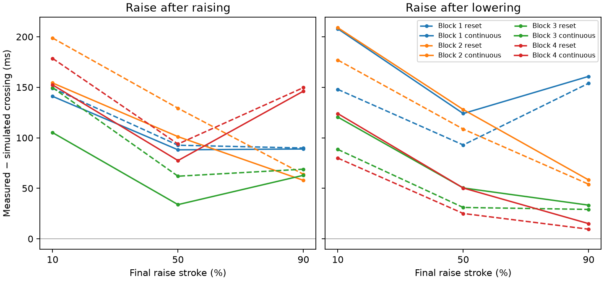

# Does lift controller history explain the timing gap?

Preserving the simulated controller state across consecutive commands made little difference to the timing of timed lift moves. The held-out blocks had **81 ms** median absolute crossing error when each move started at its measured pose and **80 ms** when the simulator ran continuously. On the first two blocks the corresponding errors were 97 and 103 ms. Each comparison uses all 30 measured 10%, 50% and 90% crossings in its two blocks.

The same 75%-to-full raise followed either an upward or downward move into the 75% target. The physical encoder ended at different heights in those two cases. That matters when picking the point at which to compare timing.

* At 10% of each measured stroke, the raise following a lower crossed earlier in all four physical pairs, by 2, 23, 62 and 99 ms. Continuous simulation predicted a 69–77 ms lead. The strokes started at different heights, so they crossed different physical thresholds.
* At a shared 80 mm threshold, the raise following a lower crossed **later** by 48 and 37 ms in the first two blocks and **earlier** by 26 and 15 ms in the held-out blocks. The continuous simulation predicted approximately 1 ms earlier in every block. Three of the four physical packet intervals for the paired differences include zero.
* At 88 mm, the paired differences were +15, +9, −13 and −86 ms. The fourth pair was 59–153 ms earlier even using the widest packet bracket. A repeatable reversal penalty would need to predict both the sign and magnitude on independent pairs.

The frozen generation-two simulation receives all six lift commands in each block, including same-target commands, and advances through the recorded gaps. Each block begins at its measured pre-command head and lift pose on level support with charger contact asserted. The head target was constant within each block. The isolated baseline reinitializes for each lift move. Physical packet intervals use host receipt time and the approximation of linear motion between adjacent reports.

This run supplies no basis for a uniform reversal delay. It identifies a specific unexplained movement in the final block and shows why timing at absolute heights is needed alongside fractional-stroke timing. All measurements were from one unloaded, docked robot.

[Fractional crossings](lift-history-crossings.csv) · [Absolute height crossings and packet brackets](lift-history-heights.csv) · [Replay script](lift_history_crossings.py) · [Physical recording and protocol](../unit3-lift-history/README.md)
