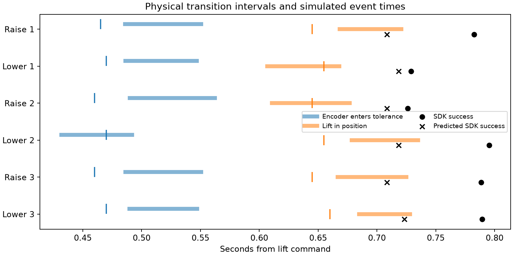

# Where lift completion time goes

Five of six fresh workshop strokes reached encoder tolerance early in the simulator, even allowing a full SDK packet interval around the observed transition. The simulated in-position flag was early on four strokes by at least 22–25 ms and inside the observed interval on two. These intervals use SDK host receipt time. Unknown transport latency still limits inference about the physical motor clock.

Each colored bar spans the last outside/first inside encoder reports or the last clear/first set status reports. Vertical ticks are canonical simulated events. Dots are SDK success receipts. Crosses apply a fixed 63.4 ms observation delay to the simulated settled time. For move 4, encoder entry falls inside its measured interval but the settled flag is early. A uniform shift of the entire lift trajectory cannot account for every move.

## Held-out SDK return prediction

The delay is the median time from the first in-position packet to SDK success on six endpoint strokes from unit 1. The other units and all six fresh workshop strokes are excluded from estimation. No motor or contact parameters change.

| Evaluation group | Moving commands | Median absolute SDK error, canonical | With 63.4 ms observation delay |
|---|---:|---:|---:|
| Unit 2 endpoint cycles | 6 | 55 ms | 12 ms |
| Unit 3 endpoint and timed cycles | 26 | 175 ms | 112 ms |
| Fresh workshop partial cycles | 6 | 133 ms | 70 ms |

On the fresh strokes the median difference between the *first observed* settled packet and simulated settled time was 72 ms. The additional median time from that packet to SDK success was 61 ms. The 72 ms includes sampling and delivery delay. The 61 ms characterizes the observed client path and cannot be assigned to a motor. The correction was evaluated offline. Adding it to a blocking simulator action would also have to preserve controller availability, status publication, cancellation, and already-at-target behavior.

[Packet brackets and predictions](lift-residual.csv) · [Reproduce the plot](lift_residual.py) · [Raw workshop recording](workshop-validation.jsonl) · [Three-unit calibration and evaluation data](lift-ack.csv)
