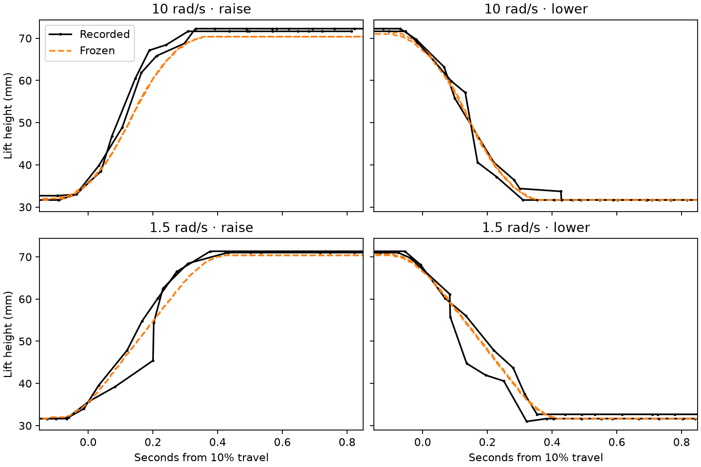

# unit 3 docked lift speed crossover

Eight new unloaded lift actions on unit 3, with 299 SDK states and 75 JPEG packets. The head was commanded to zero. Each pair raised the lift from its low position to normalized height 0.65 and lowered it to zero. The speed caps in order were 1.5, 10, 10, and 1.5 rad/s. All actions returned success. Unit 3 was charging at 4.04 V after the run and the quiet switch was on.

A single 84 ms shift minimized position error across the first raise and lower from the earlier partial-stroke recording. Freezing that value improved only two of the four remaining original moves and four of the eight new ones. The shift refers to SDK command and state receipt times. The results do not justify adding it to the lift controller.

After aligning each stroke at 10% travel, the two new speed-limited raises took 292 and 290 ms to reach 90%. Their frozen simulations each took 328 ms. At the higher cap the two physical raises took 284 and 209 ms, compared with 267 and 263 ms in replay. The difference between the two fast physical repeats exceeds either slow-raise residual. These are interpolated encoder crossings at SDK sampling cadence, with two independent cycles per cap on one robot. The replay starts from the recorded joint positions with a level-table support model. No load or contact parameters were fitted.

The CSVs retain the command boundaries, camera packet manifest and every state callback. Run `python compare.py` here for the overlay and individual scores. Errors use the first 1.2 seconds following each command. The previous partial-stroke report used a 1.0-second window.
