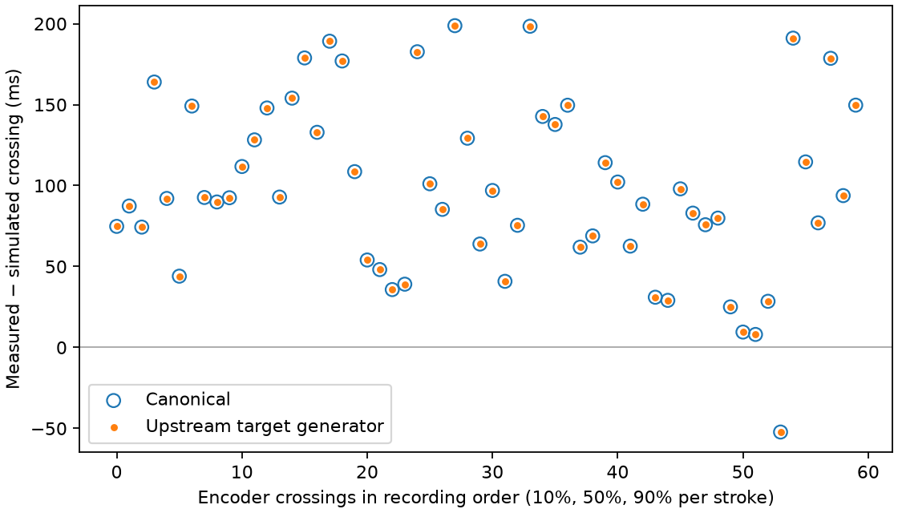

# Testing the firmware lift trajectory generator in MuJoCo

Swapping only the timed target generator left the central encoder crossings essentially unchanged. Across 20 docked 0.7-second moves, the maximum change in crossing time at 10%, 50% or 90% travel was below 0.001 ms. The held-out median absolute crossing error remained 81 ms. Replacing the generator alone therefore cannot explain the observed early-stroke discrepancy on this recording.

The substitution did change the final braking phase. The maximum lift-height difference anywhere on the traces was 0.12 mm. The simulated in-position transition moved by up to 20 ms. Against the first physical in-position packet, median absolute timing error went from 119 to 104 ms on blocks 1–2 and from 102 to 82 ms on held-out blocks 3–4. The latter 20 ms difference is smaller than a typical SDK reporting interval.

## Method

The firmware dispatches timed lift commands with 10% acceleration and braking ramps. We compiled the upstream velocity generator, initialized it at rest for each stroke, and passed its angular target to the simulator on every 5 ms step. The ordinary Python replay and experimental replay used the same starting pose, transport queue, MuJoCo plant, motor and sensor parameters. The upstream inputs were within the probe's speed and acceleration caps. The comparison covers successful fixed-duration profiles from rest. Mid-stroke retargeting, saturated profiles and cube loads need separate evidence. This experiment uses the published firmware implementation as a reference. It does not establish the exact firmware revision installed on the recorded unit.

[Command handler](https://github.com/kercre123/victor/blob/669ec7499a7084640b57706a7937884a6568be50/robot/supervisor/src/messages.cpp#L434) · [Lift controller](https://github.com/kercre123/victor/blob/669ec7499a7084640b57706a7937884a6568be50/robot/supervisor/src/liftController.cpp#L577) · [Upstream target generator](https://github.com/kercre123/victor/blob/669ec7499a7084640b57706a7937884a6568be50/robot/supervisor/src/velocityProfileGenerator.cpp#L249)

To reproduce, run lift_vpg_probe.py with the upstream robot/supervisor/src directory as its argument and the simulator repository on PYTHONPATH. It verifies the SHA-256 of the header and implementation, compiles the generator in a temporary directory, then replays the 20 moving commands. Only the platform and logging includes are stubbed. The prior [encoder crossing dataset](lift-crossings.csv) supplies the isolated baseline and physical crossing times. The canonical controller remains unchanged.

[Probe and replay](lift_vpg_probe.py) · [C++ driver](lift_vpg_probe.cpp) · [Crossing times](lift-vpg.csv) · [Settled times and maximum height differences](lift-vpg-endpoints.csv) · [Measured status edges](lift-ack.csv)
