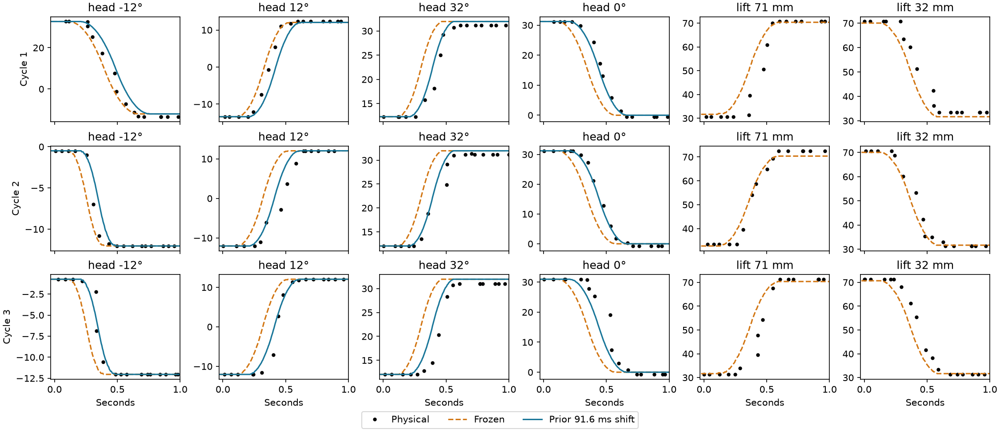

# unit 3 docked partial head and lift strokes

Three cycles on 2026-11-22 yielded 18 successful SDK actions, 513 state callbacks and 135 camera frames. Each cycle commanded head targets −12°, +12°, +32° and 0°, then lift targets 0.65 and 0.0. The first cycle started near +33° and subsequent cycles started near 0°. The robot stayed on its charger with quiet enabled. There were no wheel commands. Reported wheel speed peaked at 1 mm/s. The dock and charging state were checked again after restoring the starting posture. The final voltage reading was 4.07 V.

The frozen Vector 2 actuator replay starts from measured joint positions on a level table. It does not simulate charger support in this comparison. Error is the RMS position difference at actual state receipt times in the first second after each command, summarized by the median across moves. The earlier 91.6 ms shift, estimated on full head strokes from two other robots, improved 10 of 12 new head moves, reducing median RMS from 4.81° to 1.70°. Both exceptions were the first two actions. The six lift moves had 4.79 mm median RMS against the frozen model. The lift reached 70.7, 72.6 and 71.3 mm on the three raises.

States, command boundaries and image packet receipts use a common monotonic host clock. The state stream retains every callback, including repeated image timestamps, gyro, body pitch and both wheel speeds. Raw JPEGs are retained in the acquisition workspace. The published frame manifest contains their image IDs and timestamps. Run `python compare.py` in this directory to reproduce the overlay and scores.
