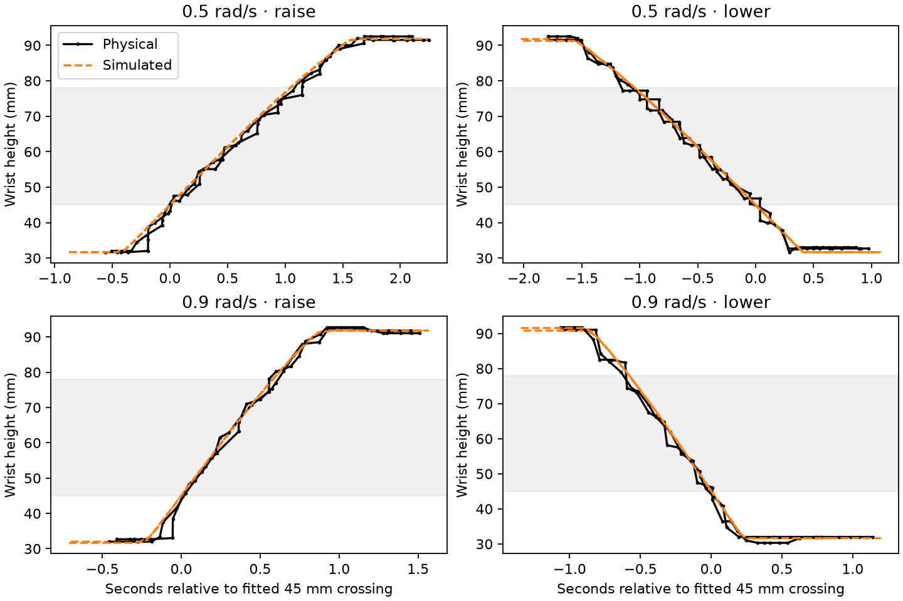

# Mid-stroke lift speed on unit 3

Unit 3 completed eight docked, unloaded full-travel lift commands. Each pair raised the wrist to normalized height 1 and lowered it to 0. The speed caps in pair order were 0.5, 0.9, 0.9 and 0.5 rad/s. The recorder captured 455 robot states and 113 JPEGs. The command, state and image packet CSVs share a host monotonic clock. Unit 3 finished charging at 4.03 V with quiet on.

Each speed estimate fits a straight line to shoulder angle versus time while the reported wrist height lies between 45 and 78 mm. Conversion uses the firmware lift geometry. Each physical estimate uses 9–19 states. Both timing offset and the arbitrary angular origin drop out of the slope. The graph aligns traces by the fitted crossing of 45 mm. The replay holds the measured starting joint positions and uses level-table support.

| Cap (rad/s) | Physical raise magnitudes | Physical lower magnitudes | Frozen model magnitudes |
|---|---|---|---|
| 0.5 | 0.457, 0.474 | 0.478, 0.492 | 0.501 |
| 0.9 | 0.854, 0.884 | 0.844, 0.805 | 0.902 |

Multiplying the cap by 0.933, estimated on the first raise and lower, reduced mid-stroke speed RMS error on the remaining six moves from 0.052 to 0.026 rad/s. On the three previously recorded full raises at 1.5 rad/s, the same multiplier increased error from 0.106 to 0.167 rad/s. Those archived raises match the movements used by the pickup-speed analysis. A single cap multiplier fails to transfer across the tested speed range. The simulator retains its existing actuator parameters.

Run `python speeds.py` here to regenerate the graph, individual speed estimates and transfer scores.
