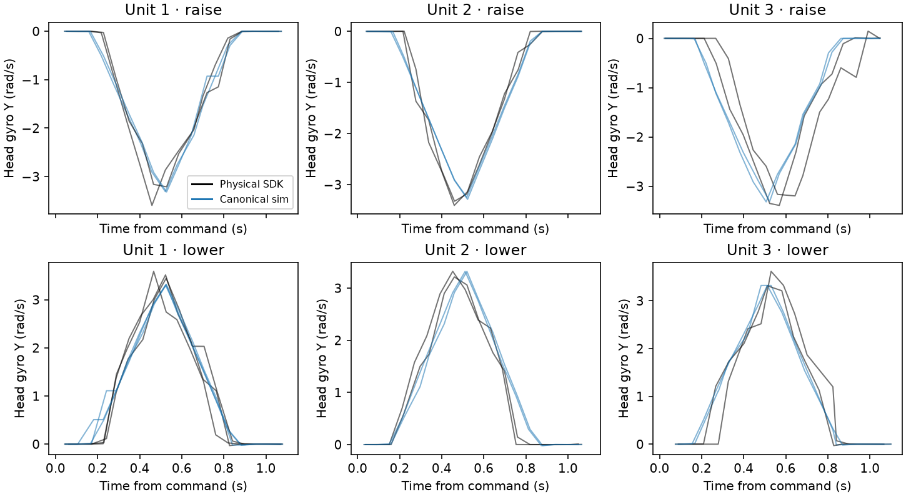

# Head encoder counts and gyro through docked strokes

The optional browser Spine BodyToHead snapshot used to place rounded head degrees and lift height in millimetres in the motor position fields. Its period and delta words were zero even during motion. It now samples the same four native encoder channels as the WireOS body bridge on each control tick and writes their signed position, signed delta and timer words at each Spine snapshot. The SDK joint and IMU paths still publish their usual values. Absolute encoder zero on hardware depends on calibration.

We replayed 13 completed docked head strokes from three physical units. The comparison decodes both sets of head count words at 180/(4 × 366.211) degrees per count and measures travel relative to the first report. Median per-stroke travel RMSE against the physical encoder fell from **41.77° to 2.14°** on unit 1, **42.25° to 3.38°** on unit 2, and **39.79° to 3.80°** on unit 3. The remaining errors include action timing and model dynamics. This verifies the corrected units through the browser interface using physical SDK travel as the reference. These captures did not include native shaft timer words.

The gyro provides an independent check on motion. On the physical command clock the median per-stroke gyro Y RMSE was 0.27, 0.29 and 0.40 rad/s respectively. The wire-format change does not alter head mechanics or gyro generation. The simulation starts each stroke at the last observed head and lift readings, settles on the dock for 300 ms, and issues the recorded target. Physical receipt times select the latest published simulated sample. Inclusion requires at least 55° of commanded travel and arrival within 4° of the target within 1.1 s. The figure contains five, four and four qualifying strokes; it measures full completed motions rather than success rate. No parameter was fitted.

[Per-stroke scores](scores.csv) · [Paired samples](replay.csv). Run replay.mjs with Node and installed web dependencies, then compare.py with NumPy and Matplotlib. Firmware tests check CRC, all four 12-byte motor records against the WireOS bridge during reversal and after reset, and native head/lift counts independently against joint angle.
