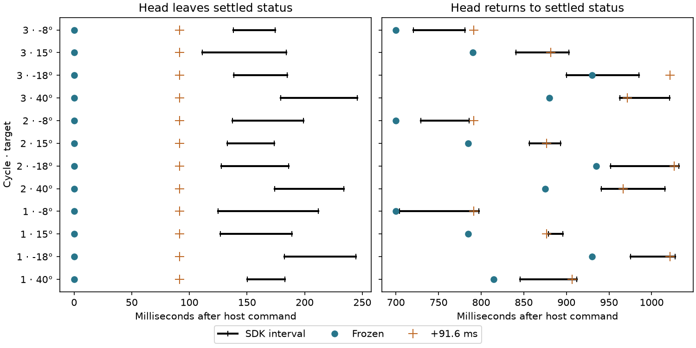

# Repeated head strokes, November 22

Unit 3 completed three cycles of +40°, −18°, +15° and −8° at default speed under continuous SDK override on the dock. Initial head angle was +1.59° for the first move. Subsequent cycles began near −8°. The recording contains all 12 successful commands and 373 state callbacks (median interval 61 ms). The SDK confirmed charging at 4.004 V after restoring the head, which measured +0.73°. The recording host reported quiet mode on after release.

Dots and solid curves show measured head encoder and pitch gyro. Dashed curves show each replay from the measured starting posture with the previously estimated 91.6 ms receipt offset. Horizontal bars on the gyro panels bracket the physical head-in-position transition. The replay uses level-table support. Across the 12 moves the median per-move encoder RMS was 5.87° on the unshifted host clock and 1.19° with the prior offset. Pitch gyro RMS was 38.21 and 11.20°/s respectively. No parameter was fitted on this session.

[State and command log](unit3.jsonl) · [Per-stroke transition brackets and errors](unit3.csv)

Unit 1 and unit 2 were unavailable from both pods. The workshop PodNet access point had zero associated stations at the final check. No workshop trials are included.

### Timing of the head status bit

On unit 3 the firmware cleared HEAD_IN_POS after the command and set it again near the end of every move. Each black interval below is bounded by consecutive SDK receipts carrying opposite bit values. The simulation clears the bit at command submission. On all 12 moves that prediction preceded the last still-set sample, with a median gap of 138 ms. Applying the prior +91.6 ms offset still placed all 12 clear transitions early (median gap 46 ms). For the return to settled status the same offset improved bracket coverage from 1/12 to 8/12. Of the four shifted misses, one was early and three were late. Median distance to the interval fell from 38 ms to zero.

The receipt clock includes action dispatch, firmware processing, and SDK state delivery. These recordings do not identify those delays separately. A single shift improves predictions for settled status and the continuous motion traces, while leaving a systematic discrepancy at command acceptance. No production timing parameter was changed.

