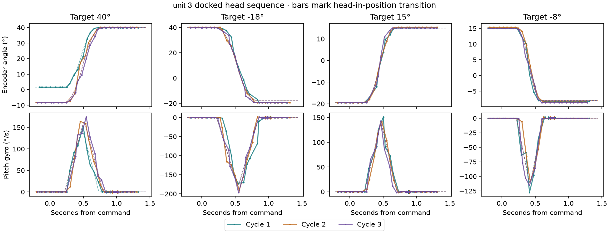
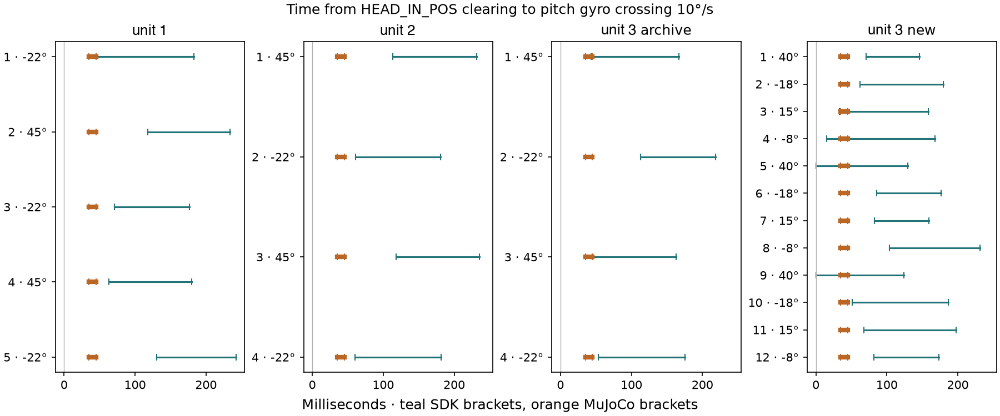
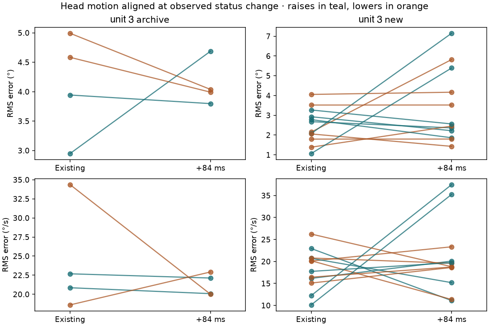

# Repeated head strokes, November 22

Unit 3 completed three cycles of +40°, −18°, +15° and −8° at default speed under continuous SDK override on the dock. Initial head angle was +1.59° for the first move. Subsequent cycles began near −8°. The recording contains all 12 successful commands and 373 state callbacks (median interval 61 ms). The SDK confirmed charging at 4.004 V after restoring the head, which measured +0.73°. The recording host reported quiet mode on after release.

Dots and solid curves show measured head encoder and pitch gyro. Dashed curves show each replay from the measured starting posture with the previously estimated 91.6 ms receipt offset. Horizontal bars on the gyro panels bracket the physical head-in-position transition. The replay uses level-table support. Across the 12 moves the median per-move encoder RMS was 5.87° on the unshifted host clock and 1.19° with the prior offset. Pitch gyro RMS was 38.21 and 11.20°/s respectively. No parameter was fitted on this session.

[State and command log](unit3.jsonl) · [Per-stroke transition brackets and errors](unit3.csv)

Unit 1 and unit 2 were unavailable from both pods. The workshop PodNet access point had zero associated stations at the final check. No workshop trials are included.

### Timing of the head status bit

On unit 3 the firmware cleared HEAD_IN_POS after the command and set it again near the end of every move. Each black interval below is bounded by consecutive SDK receipts carrying opposite bit values. The previous standalone simulation cleared the bit at command submission. On all 12 moves that prediction preceded the last still-set sample, with a median gap of 138 ms. Applying the prior +91.6 ms offset still placed all 12 clear transitions early (median gap 46 ms). For the return to settled status the same offset improved bracket coverage from 1/12 to 8/12. Of the four shifted misses, one was early and three were late. Median distance to the interval fell from 38 ms to zero.

The receipt clock includes action dispatch, firmware processing, and SDK state delivery. These recordings do not identify those delays separately.

The standalone simulator now sends the head command to the status controller through the existing actuator queue. At the default 105 ms servo delay, the first completed 5 ms tick reporting an accepted move is at 110 ms. Local cliff reactions flush this queue. The stock settling dwell remains 200 ms.

| Physical recording | Moves | Median distance outside SDK onset bracket, immediate → queued |
|---|---:|---:|
| unit 1 archived | 5 | 105 → 2 ms |
| unit 2 archived | 4 | 40 → 10 ms |
| unit 3 archived | 4 | 105 → 0 ms |
| unit 3 new | 12 | 138 → 28 ms |

These are per-control-tick predictions on the unshifted host clock. Error is zero inside the physical last-set/first-clear interval. The queued prediction falls late on every unit 2 move and early on every new unit 3 move. Stacking the additional 91.6 ms receipt offset onto the queue worsens median onset error on all three archived recordings. The offset remains an explicit comparison in the figure. [Cross-recording scoring script](acceptance.py)

### Motion relative to the status transition

We compared the time between HEAD_IN_POS clearing and the first pitch gyro magnitude above 10°/s within each recorded stream. This removes any constant host-command offset. The firmware populates the SDK gyro from head IMU data, status from its latest status flags, and the SDK image timestamp from the last processed camera image. That image timestamp cannot date the two state fields. The SDK interval subtracts the opposite endpoints of the two callback brackets. The replay uses its own 5 ms control-tick brackets. Variable receipt delay and relative sensor filtering remain possible.

Across 25 strokes the two intervals overlapped on 5. The gap between the intervals had medians of 26 ms on archived unit 1, 42 ms on archived unit 2, 5 ms on archived unit 3, and 20 ms on the new unit 3 session. This diagnostic isolates a discrepancy within the status-to-gyro sequence that a common time shift cannot resolve. The source recordings and actuator parameters are unchanged.

[Per-move intervals](state-relative.csv) · [Reproduction](state_relative.py) · [WireOS SDK state construction](https://github.com/os-vector/wire-os-victor/blob/3cec4844d24c4719b5b3892e4979494bcd260424/engine/robot.cpp#L2314-L2347)

### Does an extra delay after command acceptance transfer?

The median midpoint discrepancy between status clearing and the first gyro magnitude above 10°/s on the nine archived unit 1 and unit 2 strokes gave 83.7 ms. We froze that value and shifted the simulated motion relative to the observed status transition on 16 unit 3 strokes. Each comparison used the encoder and pitch gyro through 1.1 s after command submission. Both variants use identical initial posture, recorded samples and actuator dynamics.

With the midpoint of the physical status bracket as the timing reference, the four archived unit 3 strokes improved slightly in median per-stroke RMS (4.26° → 4.01° encoder, 21.77 → 21.11°/s gyro). On the 12 new moves the median worsened (2.42° → 2.51°, 18.92 → 19.20°/s). The unknown time of acceptance matters. Anchoring to the earliest possible acceptance favored the delay on 14 of 16 moves for both sensors. Anchoring to the latest favored it on zero. The comparison uses retrospective status alignment, which is available only when a measured status trace exists. The workshop threshold result alone does not support adding 83.7 ms to the production motion profile.

[All three timing references and trial scores](status-transfer.csv) · [Reproduction](status_transfer.py)
