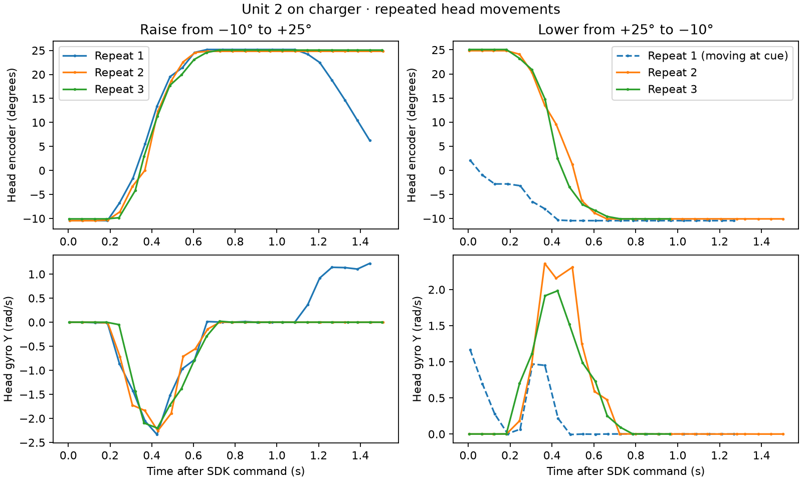
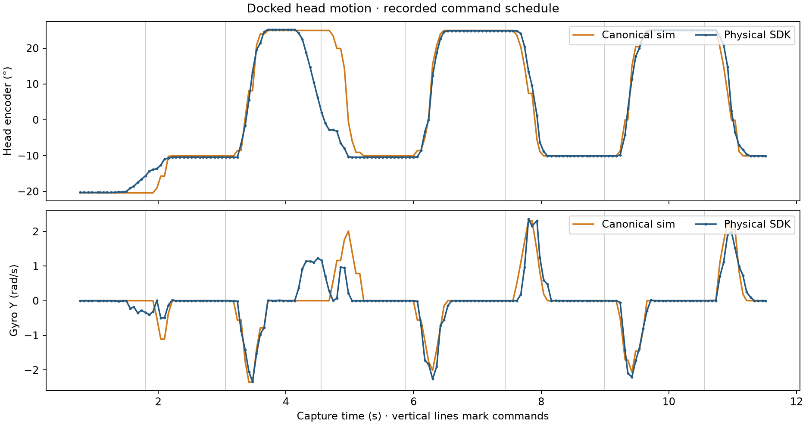
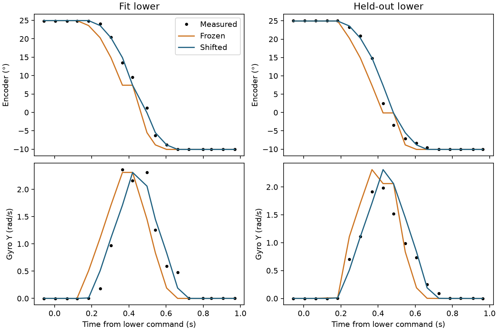

# Three docked Vectors, 2026-11-26

Unit 2 executed a conditioning move to −10° and three commanded round trips to +25° and back. All seven SDK actions returned success. It began and ended on the platform and charging at 3.966 V. The capture restored the initial head-angle target. Unit 3 (3.592 V) and Unit 1 (3.548 V) were on their platforms, below the pod's active-trial voltage threshold. Their recordings are stationary controls. Both head encoders stayed constant, and both reported zero wheel speed throughout.

The first observed encoder displacement of at least 2° occurred 245, 307 and 321 ms after the three raise commands. The two lowers starting from rest crossed that threshold at 303 and 304 ms. On the first lower the encoder had already fallen from +25.19° to +6.26° before the command. The gyro also records this movement. Its cause is unresolved. The dashed trace is retained and excluded from the timing estimate.

Times are SDK host receipt times on a monotonic clock, with a median state interval of about 60 ms. Millisecond values identify individual packets. Precision of physical onset is limited by sampling and transport. No fit to simulator parameters was attempted.

State rows contain angles and wheel speeds. Short command and return rows carry command index and target, and the fifth field of a return row is the SDK result code. Run analyze.py alongside these files to regenerate the figure and moves.csv. The capture used the stock SDK and an existing paired pod.

## Canonical replay

Replayed all seven SDK commands in order on the first-generation free chassis with the 42 mm dock contact model, initialized at the first measured head and lift readings. The simulator accepted every command and retained charger contact. The comparison uses the last published simulated state available at each physical host receipt time. The recording omits the final restoration command from the cue log, so the comparison ends one second after the last scheduled lower.

The final two raises cross 2° on the same physical sampling ticks as the model, with whole-interval angle RMSE of 0.95° and 1.38°. On the anomalous first lower the last physical angle before the cue was +6.26° while the simulator held +24.95°. That interval's RMSE is 14.32°. The physical head also moved before the initial conditioning cue. These observations limit any inference about why a particular move began.

The two clean lowers crossed the threshold one physical sample later than the simulator. Searching a −120 to +120 ms grid in 5 ms increments to minimize first-second angle RMSE on the first clean lower selected a 20 ms delay. Applying it unchanged to the next lower reduced angle RMSE from 2.69° to 1.51° and gyro Y RMSE from 0.283 to 0.205 rad/s. This single held-out move shares a session and clock with the fit. The offset includes SDK transport and state publication timing. Firmware latency and a universal downward delay remain unverified. The canonical runtime was kept frozen.

Reproduce with Node from the repository after installing web dependencies, then run Python with NumPy and Matplotlib. Execute replay.mjs followed by score_replay.py. The frozen input revision is 41dab7d.
