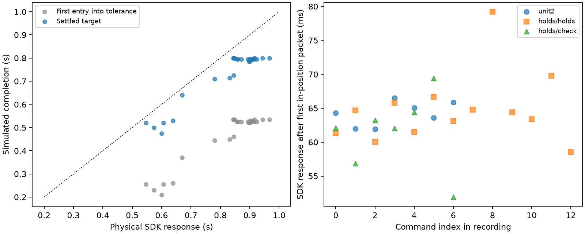

# Head command completion on the dock

Across three recordings on one workshop v1 Vector, all 27 successful head raises and lowers returned after the first SDK packet that both placed the head within 2° of target and set the head-in-position bit. The median gap between that packet and the action response was 62–64 ms in each recording. Receipt times include host and SDK transport.

The web and Python simulators previously returned when the angle first entered tolerance. A blocking head action now waits for its target to reach the motor and settle. The existing motor-in-position state requires over 200 ms of continuous tolerance after the final motor target arrives. Direct head commands remain asynchronous. Tests also exercise a queued reversal, where a previously latched status can still refer to the old command.

| Physical recording | Commands | Previous median absolute timing error | Revised median absolute timing error |
|---|---:|---:|---:|
| Initial sequence | 7 | 379 ms | 113 ms |
| Repeated +25° sequence | 13 | 346 ms | 76 ms |
| Held-out +15° and +25° sequence | 7 | 381 ms | 116 ms |

Each independent replay starts at the encoder positions from the last pre-command packet on the dock. The modeled completion is a local action boundary. It still precedes most physical SDK responses. The runs provide no separate estimate of network delay. This evidence applies directly to the tested docked head moves. Lift completion was outside the comparison.

[Revised scores](ack-scores.csv) · [Before scores](ack-before.csv) · [Reproducer](ack.mjs). Run ack.mjs in this checkout after installing the web dependencies. The before scores used the same script on the preceding runtime. Run ack_plot.py with NumPy and Matplotlib to generate the figure.
