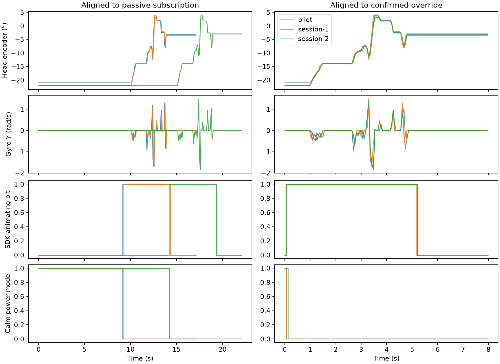

# Delayed SDK control grant on the dock

Three physical recordings began with a passive stock SDK connection to a docked robot in calm power mode. After 9, 9 and 14 seconds, respectively, the client requested override. It issued no head, lift, wheel or animation commands. A monotonic host clock records subscription, request, grant acknowledgement and incoming SDK state. The first eight seconds after grant were retained for each comparison.

The encoder stayed constant and the animating bit stayed clear in all 536 passive packets. Across the three grants, the encoder then traversed 23.84°, 25.80° and 26.17°. The first two successive gyro-Y samples above 0.1 rad/s in magnitude began 1.02–1.08 s after the grant acknowledgment. The final animating sample arrived 5.10–5.16 s after acknowledgment. The rising animation bit and falling calm-mode bit appear together at SDK reporting resolution. Delaying the grant shifted the response while the connection stayed open. This distinguishes the passive connection from the subsequent control/wake transition on this unit. The recordings do not separate control from calm-mode exit or identify the playing clip.

The pilot's explicit release timed out waiting for the SDK control-lost acknowledgment after the entire eight-second observation. Its later packets are in the raw CSV and excluded from the plot and scores. The two complete sessions exited via SDK disconnect, both ending on the charger and charging. The three observations include 402 post-grant packets. Run analyze.py next to the CSV files to reproduce the plot and summary.

The public WireOS source routes SDK behavior activation through SDKComponent and dispatches the control result. The activation functions examined do not name an animation clip. These links describe the public reference revision. The installed firmware build was not matched to this revision. [Behavior activation](https://github.com/os-vector/wire-os-victor/blob/3cec4844d24c4719b5b3892e4979494bcd260424/engine/aiComponent/behaviorComponent/behaviors/sdkBehaviors/behaviorSDKInterface.cpp#L223-L240), [SDK activation callback](https://github.com/os-vector/wire-os-victor/blob/3cec4844d24c4719b5b3892e4979494bcd260424/engine/components/sdkComponent.cpp#L697-L721).
