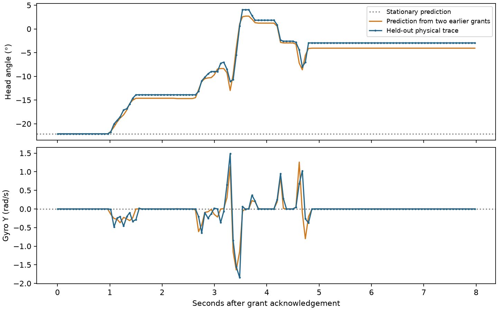

# Transfer of the docked wake response

The prediction averages the grant-relative displacement and gyro traces of the pilot and first complete capture, interpolated at 20 ms. The third capture contributes only the grant timestamp and the pre-grant one-second median posture and gyro bias. Scoring uses its native SDK packet times. No fitting or post-onset timing alignment uses the held-out run. All three sessions used the same robot, charger and SDK priority.

During the first 5.2 seconds, angle RMSE is 0.81° versus 14.01° for holding the observed starting pose. Gyro Y RMSE is 0.204 versus 0.395 rad/s. Through eight seconds those errors are 0.92° and 0.165 rad/s for the template. The gyro trace retains visibly larger peak errors than the angle. This is a signal-level prediction for a docked calm-to-override transition. It does not implement mechanical coupling, an animation selector or interruption by a head command in the simulator. Run transfer.py in this directory to regenerate the overlay and scores.
