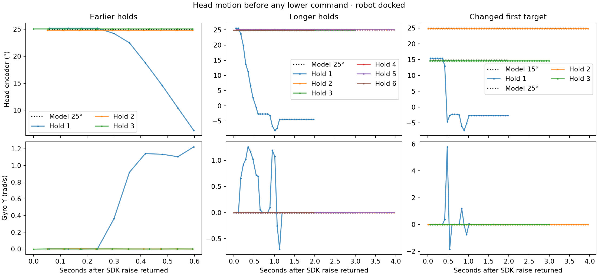

# Does the raised head move before a lower command?

Two new docked sessions yielded 951 physical SDK packets and nine holds. The first varied the wait after a successful +25° raise through 2, 4, 3, 3, 4 and 2 seconds. The second changed the targets to +15°, +25° and +15°, with 2, 4 and 3 second holds. Both sessions used continuous override, restored the initial head target, and began and ended charging at 3.966 V.

In all three sessions, including the earlier short-hold recording, the first hold moved before any lower command. The maximum drop was 18.92°, 33.67° and 22.86°, respectively. Across all nine subsequent holds the encoder stayed constant at the recorded resolution. A second +15° hold in the last session stayed steady for three seconds. The canonical simulator held both targets.

The SDK animating bit was present during each early drop, in 10/10, 25/33 and 23/33 packets of the respective first holds. Across later holds it appeared in zero packets, and the head-in-position bit remained set. This association suggests looking for a concurrent animation at the start of control. The recordings do not identify its name or source. The two-second holds finish with the head at −4.43° and −2.71°, several degrees above the excursions' minima. A constant servo sag would also have to account for this reversal.

The table gives the first of two consecutive positive gyro-Y samples above 0.1 rad/s and the first encoder sample at least 2° below the last pre-response reading. Times are seconds since the SDK raise response on a host monotonic clock. Packets are about 60 ms apart. The two new waits and the earlier recording share one physical unit.

Run the parent replay.mjs with arguments holds/holds.csv holds/canonical.csv, then holds/check.csv holds/canonical-check.csv. Run compare.py to score and plot both plus the earlier parent recording. Public replay used the first-generation dock model at 41dab7d. Capture scripts accept the paired SDK serial, IP and active mode.
