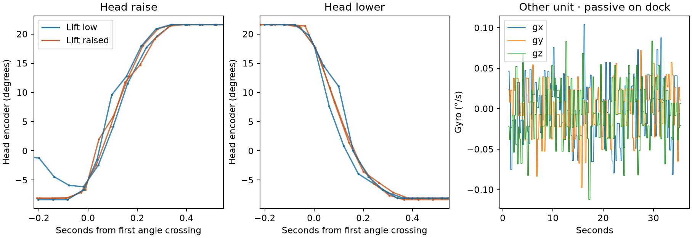

# Docked head timing at two lift heights and a stationary workshop reference

Workshop unit A completed eight measured head moves. The lift sequence was low, raised, raised, low. Each block included a head positioning move followed by one raise and one lower. The transit is between −5° and +18° on the encoder, reversing those endpoints on descents. Targets were −8° and +22°. All states retained the dock flag, the initial head angle was commanded again after the final block, and charging was confirmed before and after.

| 23° transit | Lift low (31.0–32.3 mm) | Lift raised (64.5 mm) |
|---|---:|---:|
| Head raise | 218, 244 ms | 223, 255 ms |
| Head lower | 219, 236 ms | 235, 249 ms |

The samples arrive about every 60 ms. Crossing times interpolate adjacent encoder samples; two moves per cell and the overlapping ranges do not establish a lift-dependent change in head speed. No wheel commands were sent. Two individual states reported both wheels at −4 and −37 mm/s respectively; the camera did not measure chassis translation.

Workshop unit B provided 572 passive SDK reports over 34.27 s at the same median cadence. Head, lift and wheel values stayed fixed. The stream contained 135 distinct gyro triples. Sample standard deviations across all reported values were 0.037, 0.031 and 0.037 °/s in head X/Y/Z. Repeated triples mean 572 reports cannot be treated as 572 independent IMU observations. Dock contact persisted; battery read 3.55 V with charging inactive, so this unit contributed a resting reference. The operator identifies B as refurbished first-generation hardware; the pod labels it 2.0. Results are reported per unit.

[Active trace](active.csv) · [Passive trace](passive.csv) · [Per-move figures](moves.csv). Times use monotonic host receipt relative to each recording's start. All angles are degrees except gyro channels (rad/s). Acceleration is reported in mm/s². Run `python analyze.py` here for the plot and summaries. This experiment adds physical references without fitting a simulator parameter.

[Canonical replay at control-tick and observed SDK cadence](replay.md)
