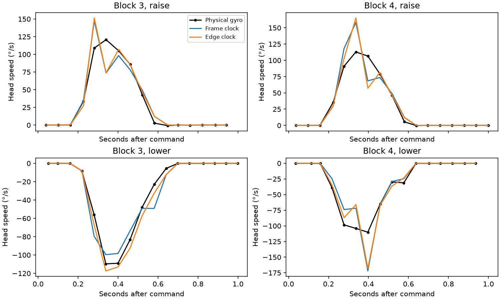

# Head and lift encoder packets through reversals

The WireOS body now timestamps the last head and lift encoder crossing within each 5 ms frame. Their quadrature counts follow the direction of shaft motion even if motor duty has the opposite sign. With no fresh edge the packet retains its signed delta for 25 frames, then clears the delta and keeps the last period. This models the stock interrupt decoder and syscon packet update. The supervisor applies its own five-update zero-speed rule. [Quadrature interrupts](https://github.com/os-vector/wire-os-victor/blob/3cec4844d24c4719b5b3892e4979494bcd260424/robot/syscon/src/encoders.cpp#L238-L262) · [Body packet update](https://github.com/os-vector/wire-os-victor/blob/3cec4844d24c4719b5b3892e4979494bcd260424/robot/syscon/src/motors.cpp#L114-L142)

## Physical head check

Eight moves on the docked workshop robot cover raises and lowers at two lift heights. The replay linearly interpolates recorded encoder angle, generates WireOS packets, and derives angular speed using the firmware scale, signed count delta, timer period and zero-speed rule. The independent comparison is the negative of the physical head Y gyro on the same SDK receipt clock. Neither encoder clock uses the measured gyro or a fitted lag. The figure shows the final four moves, including a return to the low lift posture.



The inter-edge clock reduced gyro RMSE on three of four lowers and two of four raises. For the last two blocks, lower RMSE changed from 9.7 to 5.5 and from 18.9 to 17.8 °/s. Raise RMSE changed from 15.7 to 16.1 and from 16.0 to 17.8 °/s. The approximately 60 ms physical angle samples leave the true within-sample shaft trajectory unknown. This check does not establish the encoder interrupt times on hardware. It also does not independently validate lift dynamics. The lift and head packet test exercises known fractional-frame crossings, opposing duty, reversal and rest for each joint.

Reproduce in this directory with the web dependencies, Python, NumPy and Matplotlib.

```sh
node edge-replay.mjs > edge-replay.csv
python edge-score.py
```
