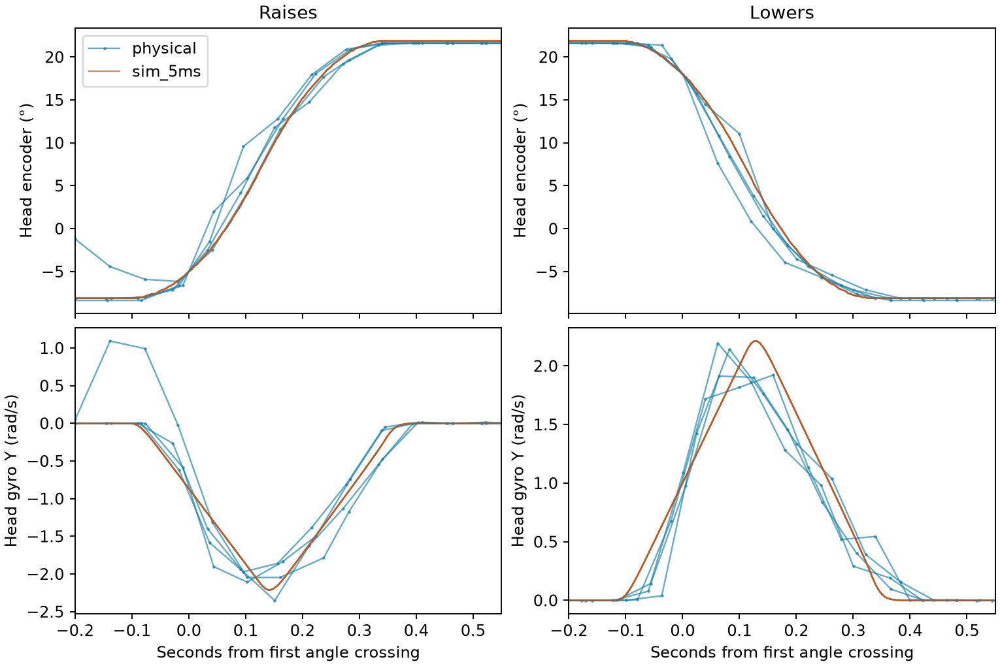

# Replay of eight docked head movements at two lift postures

The canonical first-generation model reproduced median transit through the central 23° of the physical head sweep within 5 ms in each direction when sampled at the observed SDK receipt times. Individual transit differences ranged from −18 to +21 ms with that sampling. The published-state comparison has more spread (−21 to +50 ms across the eight moves). This small dataset does not support changing the head speed.

| Signal | Physical raise / lower | Simulator at 5 ms | Simulator sampled at physical times | Latest published state at physical times |
|---|---:|---:|---:|---:|
| Median 23° transit (ms) | 233 / 236 | 237 / 235 | 238 / 240 | 236 / 248 |
| Median peak absolute head gyro Y (rad/s) | 2.08 / 2.03 | 2.21 / 2.21 | 2.04 / 2.06 | 2.03 / 2.04 |
| Median command to first crossing (ms) | 243 / 263 | 218 / 232 | 218 / 230 | 277 / 247 |

All logged head targets and command receipt times are replayed in sequence. Each lift command targets the median measured physical lift height during the following positioning move, to test head dynamics at the observed posture. This is not a test of lift targeting. The simulated median lift during sweeps was within 1.3 mm of the physical median. Dock contact persisted throughout the replay.

The physical head state arrives about every 60 ms. The 5 ms columns use encoder-quantized angle and the filtered simulated IMU on each control tick. The sampled column interpolates those signals at the actual host receipt times. The last column reads the most recent simulator SDK publication at those times. Those two publication clocks are not synchronized. Absolute command delay includes transport and scheduling; aligning the plot on the first angle crossing removes that delay from the displayed profile. The encoder thresholds are −5° and +18°, in reverse order for lowering. Each median uses four movements.

Run `node replay.mjs` and `python score_posture.py` here with normal web test dependencies. [Per-move scores](posture-scores.csv) · [Physical recording](active.csv)
