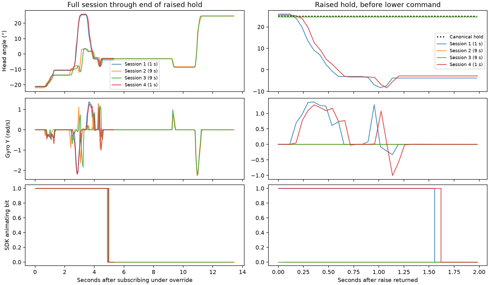

# Timing the first raised hold against control acquisition

Four new docked SDK sessions used the same continuous override, conditioning target (−10°), raise (+25°) and two-second raised hold. The only planned difference was the wait before the first command, ordered 1, 9, 9 and 1 seconds. Each session released control before the next began. The zero for cross-session alignment is stream subscription just after acquiring control, on the capture host's monotonic clock. All 12 actions succeeded. The robot was charging at both ends of each run and reported on-platform throughout all 793 state packets.

The short-wait sessions dropped 34.16° and 33.79° during the raised hold. The canonical held-pose angle RMSE was 25.55° and 24.64°. With nine seconds of initial waiting, the same first raise stayed up twice, with 0.25° angle RMSE in each replay. During those two initial waits, before any head command, the encoder traversed 25.07° and 24.58°. The final observed animating packet before the lower was 4.81–4.92 s after subscription in all four sessions. The last short-wait run repeated the original discrepancy after the long-wait runs.

This supports a roughly five-second startup animation window on this unit under the tested docked SDK setup. The first raise can overlap that window. Settled servo comparisons can use the observed animation flag to distinguish these cases. This experiment did not identify the animation, separate connection from wake or control acquisition, or establish the timing for another robot. The canonical head mechanics were frozen.

Run replay-all.sh with sh from this directory after installing web dependencies, then run score.py with NumPy and Matplotlib. Each canonical CSV contains the browser model's published angle and gyro on each tick. The scorer compares the last published angle available at each physical receipt time. Gyro onset requires two consecutive positive Y samples above 0.1 rad/s. The capture script takes paired SDK serial, IP and active mode, with HEAD_SESSION set to 1–4. All model replay is offline.
