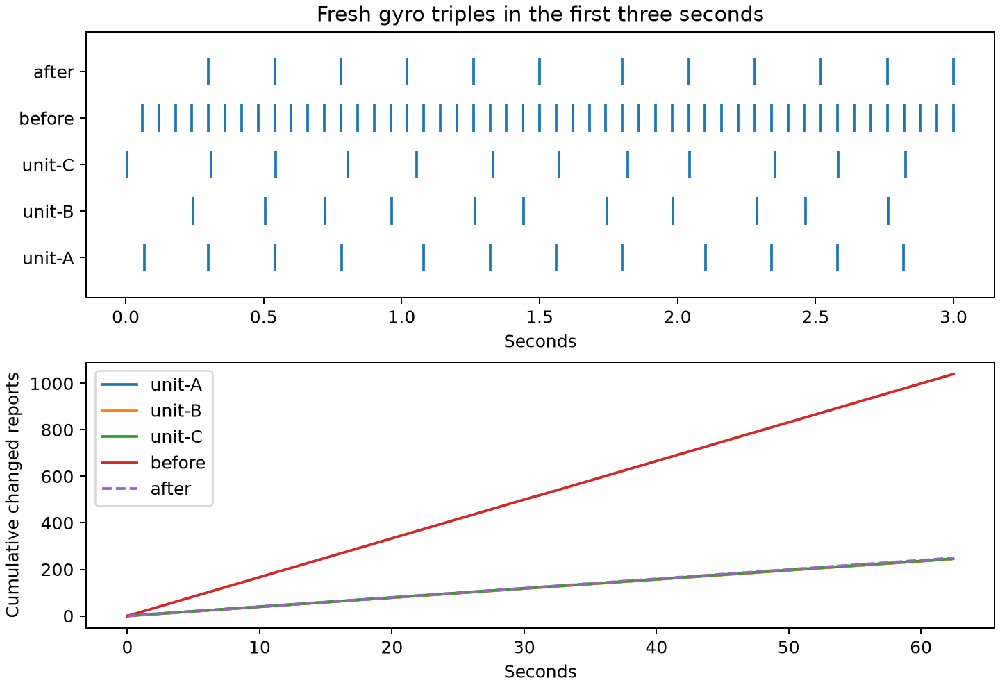

# Resting IMU publication on three physical robots

Three simultaneous passive SDK recordings lasted about 62 seconds each. All three robots were asleep at preflight, retained dock contact throughout, reported zero wheel speed, and finished on their chargers. No behavior-control grant was requested. Unit A was charging. Units B and C reported contact with charging inactive.

| Source | SDK states | Changes of gyro triple | SDK intervals with changed gyro | Mean interval between changes |
|---|---:|---:|---:|---:|
| Workshop A | 1,039 | 244 | 23.51% | 255.3 ms |
| Workshop B | 1,038 | 244 | 23.53% | 254.8 ms |
| Shelf C | 1,042 | 246 | 23.63% | 254.5 ms |
| Canonical calm replay before | 1,042 | 1,040 | 99.90% | 60.1 ms |
| Canonical calm replay after | 1,042 | 249 | 23.92% | 249.9 ms |

For every physical adjacent-report pair, the acceleration triple changed exactly when the gyro triple changed. Time uses monotonic host receipt, so the effective interval includes network and SDK publication phase. Each unit showed gaps of three, four and five SDK intervals between observed changes. Repeated values establish the timing of **visible changes**; the IMU's internal sampling rate cannot be measured from these reports.

In explicit calm mode the canonical SDK state now holds the most recent supervisor IMU sample between supervisor publications. The same existing 50-loop clock stamps cube events. Sensor noise, internal control-tick updates and awake reports retain their original paths. The default 5 ms loop predicts 250 ms per calm update. That is within 2.2% of all three measured effective intervals without a fitted rate. This verifies update cadence only. Automatic sleep entry, absolute IMU alignment, bias and noise magnitude are separate questions.

[Physical A](unit-A.csv) · [Physical B](unit-B.csv) · [Physical C](unit-C.csv) · [Scores](summary.csv). Capture uses angles in radians, angular rates in rad/s, acceleration in mm/s² and wheel speeds in mm/s. Replay with web test dependencies via `node replay.mjs > after.csv`; the retained before trace used the same script and seed on 3d89cf3. Run `python compare.py` to regenerate the plot and summary.
[Hardware count spacing and stationary variation](counts.md)
[Charger contact creep and three-posture replay](settling.md)
