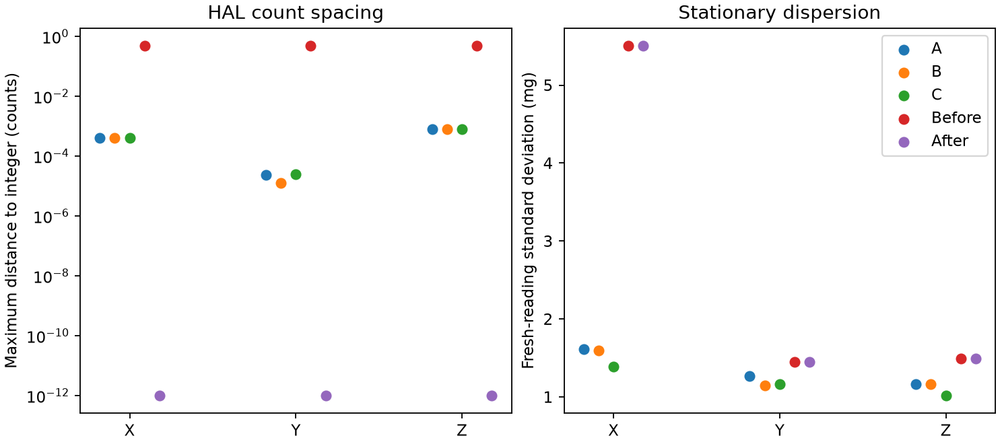

# Docked accelerometer count spacing

All three physical units reported acceleration on a grid spaced 0.59877 mm/s² apart. The largest deviation from an integer count across all axes and units was 0.000813 counts. Unit C was held out. The simulator now rounds each fresh accelerometer axis to the nearest signed 16-bit count after applying bias, scale and noise.

The conversion uses 2 × 9810 / 32767 mm/s² per count. It has no fitted parameters. These stationary recordings establish the spacing near rest. They do not exercise saturation. [Firmware scale constants](https://github.com/kercre123/victor/blob/669ec7499a7084640b57706a7937884a6568be50/robot/hal/include/anki/cozmo/robot/spi_imu.h#L14-L28) · [Firmware conversion](https://github.com/kercre123/victor/blob/669ec7499a7084640b57706a7937884a6568be50/robot/hal/src/hal_imu.cpp#L115)



After removing consecutive duplicate acceleration vectors and discarding the first 12 fresh samples for the dispersion calculation, the physical X-axis standard deviations range from 1.39 to 1.61 mg. The simulator gives 5.51 mg both before and after rounding. Successive simulated X readings are strongly correlated (+0.94), while the physical units range from −0.14 to −0.06. The source of this slow variation remains open.

Run the following in this directory to reproduce the replay and figure. The previous seeded simulation is stored in after.csv. [Per-axis scores](counts-scores.csv)

```sh
node replay.mjs > counts-replay.csv
python counts.py
```
