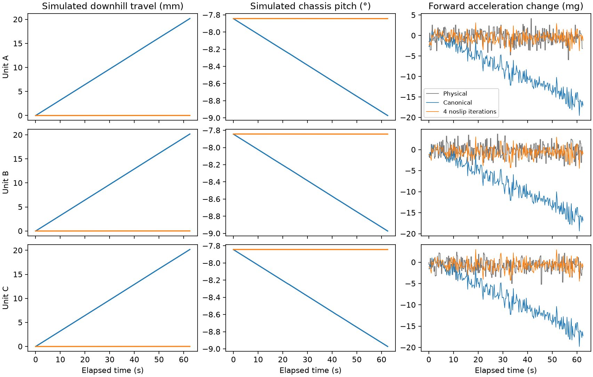

# Why a stationary Vector leaves the simulated charger

All three physical robots retained charger contact and reported zero wheel speeds throughout the docked recordings. The canonical simulation, replayed at each unit's median head and lift posture with no motion command, lost electrical contact at 43.75 s (sampled every 0.25 s). The dock is fixed in the world. Chassis displacement is measured from MuJoCo world position because the SDK odometry suppresses planar travel on charger contact.



| Replay | Travel from 3–62.5 s | Forward acceleration SD over that interval |
|---|---:|---:|
| Baseline, three postures | 19.22 mm | 4.92–5.02 mg |
| Four MuJoCo noslip iterations, same postures | 0.013–0.014 mm | 1.27–1.29 mg |
| Physical observations | Independent travel unavailable | 1.39–1.61 mg on fresh reports |

The zero-head control moved 19.21 mm down the ramp. Its front wheel turned 0.508 rad, about 7.4 mm at the modeled radius, so wheel rotation alone accounts for only part of the travel. On a level table the same control moved 0.047 mm. Four noslip iterations on the ramp preserved contact at every sampled time. These solver trials kept gravity, geometries, joint friction, IMU noise and drive control identical. This implicates numerical contact creep. It does not establish the physical dock friction coefficient or the absolute physical chassis pitch.

The acceleration overlay subtracts each trace's median from seconds 3–5 to expose drift. Absolute acceleration alignment remains open. Real traces use SDK receipt time and simulated traces use simulation time.

A separate 60 mm/s straight drive off the dock released contact at 0.45 s under both solvers and changed 1.5 s travel by 0.011 mm. Free-spin yaw changed by up to 1.8% and final world X by up to 2.35 mm across both directions at 100 and 180 mm/s. This sensitivity matters when evaluating a global solver change. The drive comparison uses synthetic commands and does not validate physical turning accuracy. The canonical solver is still the baseline. [Drive controls](settling-drive.csv)

Reproduce from this directory with the web test dependencies installed. The head/lift arguments are degrees and mm respectively. Repeat the first two commands for B using −21.877 and 32, and C using −21.631 and 32 with an additional v2 argument. Unit C tests the other hardware profile without changing the solver setting.

```sh
node dock-settling.mjs baseline -21.017 32.340 > settling-A-baseline.csv
node dock-settling.mjs noslip -21.017 32.340 > settling-A-noslip.csv
node dock-settling.mjs flat > settling-flat.csv
node settling-drive.mjs > settling-drive.csv
python settling-plot.py
```
