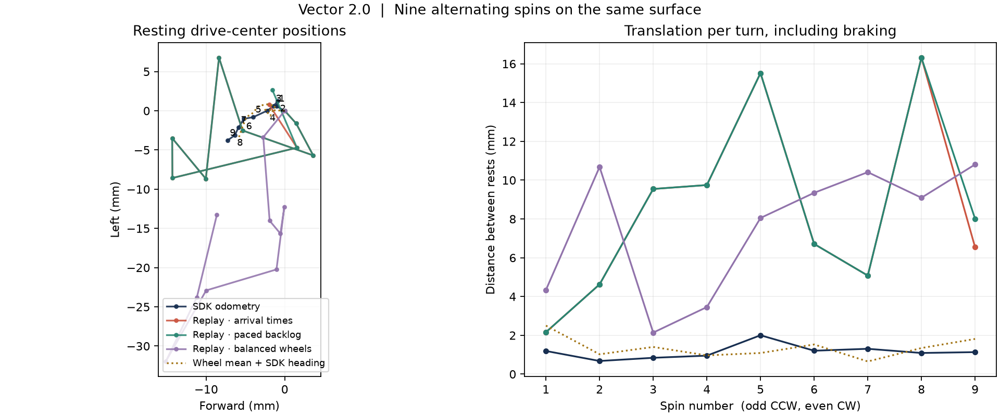
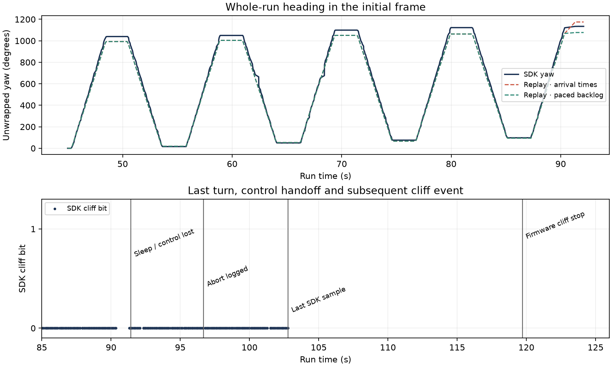

# Drift during nine alternating spins on Vector 2.0

The nine commands requested equal and opposite tread speeds of 300 mm/s for three seconds, alternating CCW and CW with pauses. The unloaded robot’s SDK drive-center estimate ended **7.29 mm backward and 3.78 mm right** of its first resting position, a net displacement of **8.21 mm**. An observer saw the robot approach the edge. The starting clearance, edge direction, overhead trajectory and movement after SDK disconnection were unmeasured. The physical distance traveled toward the edge therefore remains unknown.

## What accounts for the drift?

The SDK reports its origin near the front axle. The unloaded firmware propagates its drive center 25 mm behind that origin using tread travel and IMU heading, then transforms back to the origin. The origin ended 40.8 mm from its start after turn eight while the estimated drive center had moved 7.1 mm. A point fixed near the front of a rotating chassis can trace a large arc even when its center barely moves. We transformed the same body-fixed point in both traces and aligned the frames once, with forward and left positive. The recorder omitted the pose origin ID. [Firmware geometry](https://github.com/kercre123/victor/blob/669ec7499a7084640b57706a7937884a6568be50/robot/include/anki/cozmo/shared/cozmoConfig.h#L53-L64) · [Localization update](https://github.com/kercre123/victor/blob/669ec7499a7084640b57706a7937884a6568be50/robot/supervisor/src/localization.cpp#L578-L628)

The signed wheel mean integrated to **−8.5 to −14.1 mm per CCW interval** and **+10.8 to +14.9 mm per CW interval**, in the rotating robot frame. Successive opposite spins also left a heading residual. For example, the first pair ended 15.7° CCW of its start, and the first eight ended 97.4° CCW. Projecting the measured wheel mean along measured SDK heading and integrating gives **5.95 mm backward and 3.71 mm right** with the paced backlog below. That accounts for most of the *odometry* drift. This check shares inputs with firmware odometry and cannot independently measure tread slip.

The continuous 42 mm fore-aft contact-span MuJoCo replay used the Vector 2.0 parameters, measured signed wheel speeds, a free chassis and a level open table. No surface or axle parameters were fitted. Its paced replay ended **1.58 mm backward and 2.67 mm left**. The turn-by-turn disagreement is larger than the endpoint alone suggests. Even with wheel speeds forced exactly equal and opposite about their measured difference, the simulated center moved **15.8 mm net**. Balancing the wheels therefore does not eliminate simulated translation. The test exposes a remaining discrepancy in the simulated pivot/contact motion, but this recording cannot identify a unique friction or contact correction.

| Spin | Direction | SDK center travel between rests (mm) | Simulated center travel between rests (mm) |
|---:|:---|---:|---:|
| 1 | CCW | 1.2 | 2.2 |
| 2 | CW | 0.7 | 4.6 |
| 3 | CCW | 0.8 | 9.5 |
| 4 | CW | 1.0 | 9.7 |
| 5 | CCW | 2.0 | 15.5 |
| 6 | CW | 1.2 | 6.7 |
| 7 | CCW | 1.3 | 5.1 |
| 8 | CW | 1.1 | 16.3 |
| 9 | CCW | 1.1 | 8.0 |

Table values are straight-line distances between resting endpoints. [CSV with signed per-turn vectors, cumulative XY, signed wheel integrals and angles](turns.csv)

## Why the SDK showed no cliff flag

| Run time (s) | Evidence |
|---:|---|
| 90.216 | Recorder logged the ninth segment stop. |
| ~91.42 | SDK connection log reported control loss. In the same onboard log interval an AppIntent arrived, the engine recorded SleepCommand and entered Sleeping. |
| ~96.60 | SDK connection log reported control granted again. |
| 96.664 | Recorder emitted the control-lost stop marker. Its stop routine emits after the SDK motor call returns. SDK stderr explicitly records the call waiting for control. |
| 102.779 | Last of 1,603 SDK states. Zero states set 0x4000. |
| ~119.71 | Robot supervisor logged StoppingDueToCliff with possibleCliff=1 and possibleWhite=0. Engine logged a CLIFF stop, then ReactToCliff and its front-left reaction animation. |

Relative times use host SDK connection timestamps for control events and the onboard engine-time difference (1,611,507 − 1,583,220 ms) for the subsequent cliff stop. The final state’s last-image timestamp was 1,594,439 ms, independently consistent with the cliff stop occurring roughly 17 s later. Image timestamps refer to vision. They do not timestamp wheel or cliff acquisition. The SDK correctly defines 0x4000 and the supervisor sets it from current cliff detection. The engine forwards the latest status word. It is a snapshot, so these samples cannot rule out a separate brief earlier detection. The independently logged cliff stop occurred outside the recording. [Supervisor](https://github.com/kercre123/victor/blob/669ec7499a7084640b57706a7937884a6568be50/robot/supervisor/src/messages.cpp#L121-L154) · [Engine status forwarding](https://github.com/digital-dream-labs/vector/blob/360cccbf7ab2db049b4b15c25cc3169e269ca741/engine/robot.cpp#L2328-L2341) · [SDK flag](https://github.com/anki/vector-python-sdk/blob/d61fdb07c6278deba750f987b20441fff2df865f/anki_vector/messaging/messages.proto#L269)

## Reproduction and timing uncertainty

Run `python replay_endurance_drift.py` from the repository root with MuJoCo, NumPy and Matplotlib. The [input](run-g.jsonl) retains the original host times and the SDK fields used for replay or event checks. The nine spins share one simulation initialization. Each endpoint includes the braking and settling interval before the next command. The ninth endpoint is at 92.095 s, with stopped wheels.

SDK states arrived about every 60 ms (median). During the ninth stop a 958 ms arrival gap was followed by a burst. Yaw advanced only 0.22 rad between the states bracketing the gap and their last-image timestamps advanced 80 ms. The arrival-time replay stretches braking across that gap and predicts 1,082° for turn nine. Uniformly distributing the buffered samples between the last timely callback and the end of the burst gives 984°, versus 1,037° recorded. This sensitivity case estimates the missing timing. The first eight turns are identical in both replays. The simulator under-rotated each of those turns by about 40–55°. Neither wheel-arrival timing nor this one session justifies a new contact span.
