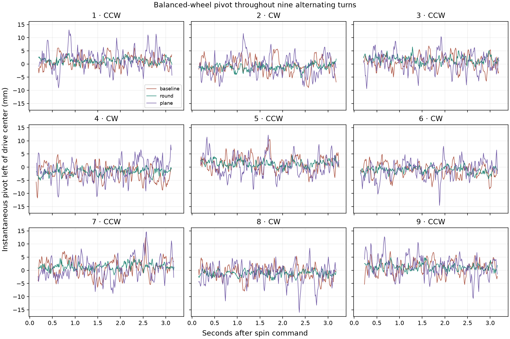
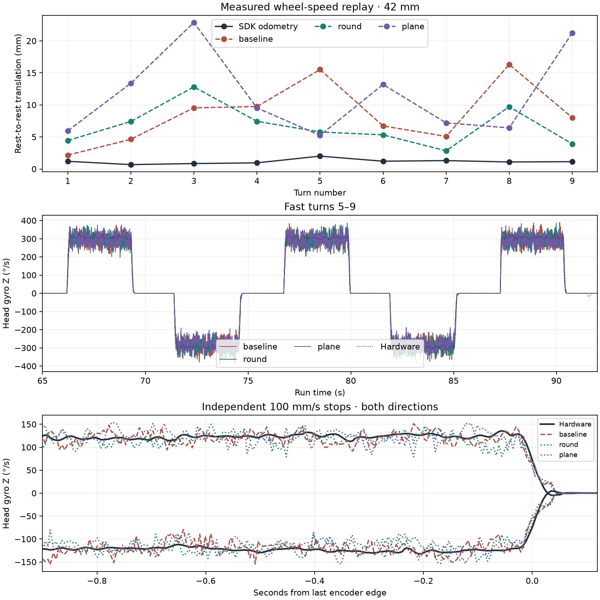

# What moves the pivot with balanced wheel speeds?

On a free Vector 2.0 chassis, equal and opposite shaft speeds still produce translation. The four baseline cylinder patches carry the load near their rims. Their lateral contact points move between edges during a spin. Changing only the rolling proxies to spheres of the same radius centers those forces, reduces pivot excursions and improves translation on later fast turns. It also degrades independent braking gyro predictions. **Keep the current 42 mm model.** Centering pressure explains part of the numerical drift, and the remaining translation has no independently measured physical trajectory for calibration.



The plot shows the lateral component of the instantaneous center of rotation relative to the body-fixed drive center (25 mm behind the front origin). From the continuous world-frame center velocity and yaw rate, the offset to that pivot is (−vy, vx)/ω. We estimate both derivatives with a centered 20 ms difference and show samples above 90°/s. At rest the pivot is undefined. The [pivot traces](pivot-paths.csv) include both components in body coordinates and both coordinates in the shared initial world frame. No resets between turns.

## Contact measurements and controls

For balanced input, the signed wheel mean was zero at every input knot. During the steady part of spins 5–9, the baseline normal-force-weighted absolute lateral contact offset averaged 4.91 mm. The tread half-width is 5 mm. For example, on the front-left patch of spin 5, among observations carrying over 0.04 N, 81% placed the pressure center more than 3 mm left and 14% more than 3 mm right. The round proxy brought the corresponding five-turn offset to 0.02 mm. All measured steady normal load in both configurations came through the four pressure proxies. This rules out the relieved outer wheel supports as the source in these windows. Changing the lever arms of the contact forces changes the resulting pivot despite identical inputs.

An independent geometry control substituted an infinite horizontal plane for the tabletop box, retaining the original cylindrical patches and elliptic friction solver. Balanced travel stayed high. Removing the box boundaries alone does little for this sequence. The plane is an interior-only diagnostic.

| Spins 5–9, mean across turns | Current 42 mm | Centered round patches | Cylinders on plane |
|---|---:|---:|---:|
| Balanced inputs, rest-to-rest displacement (mm) | 9.54 | 6.10 | 9.16 |
| Balanced inputs, median steady pivot radius (mm) | 3.52 | 2.34 | 3.76 |
| Measured inputs, rest-to-rest displacement (mm) | 10.33 | 5.51 | 10.66 |
| Measured inputs, endpoint vector error vs SDK (mm) | 10.04 | 5.79 | 10.29 |
| Measured inputs, steady head gyro RMSE (°/s) | 27.23 | 28.01 | 30.89 |

Each row averages per-turn values. Endpoint vector error uses the difference of the simulated and SDK displacement vectors, including direction. The SDK reference is wheel/IMU odometry. Turns 5–9 are a within-sequence transfer check on a previously studied run. No friction, span, lag, or shape parameters were fitted to these turns. Input timing uses the previously documented paced backlog at the last stop. The fast-turn gyro score uses recorded head gyro Z starting 1 s after the command and ending 0.1 s before the segment stop. [All nine turns and both wheel inputs](pivot-turns.csv)



## Independent held-out stops

The separate ccw_2 and cw_2 recordings have native 5 ms timestamps. We used reported wheel speeds and the established 17 ms gyro shift in every configuration. The fixed geometry candidates needed to improve drift while preserving the existing gyro agreement in both directions.

| Gyro RMSE (°/s) | Current 42 mm | Round patches | Cylinders on plane |
|---|---:|---:|---:|
| CCW steady | 12.85 | 12.77 | 15.04 |
| CW steady | 13.04 | 14.33 | 14.54 |
| CCW braking | 11.88 | 21.61 | 13.39 |
| CW braking | 13.91 | 15.19 | 12.65 |

Steady covers −850 to −250 ms relative to the last encoder edge, braking −100 to +100 ms. Neither diagnostic geometry passed both drift and gyro checks. Physical contact pressure, slip and instantaneous pivot were not measured on the robot.

## Reproduce

From the repository root, with the simulator dependencies installed, run the following. The replay records contact forces every 5 ms and chassis pose every solver step. The plotting script also replays the two independent native stops.

```sh
mkdir -p /tmp/vector-pivot
for input in balanced measured; do
  for contact in baseline round plane; do
    python replay_pivot.py "$input" "$contact" "/tmp/vector-pivot/pivot-$input-$contact.npz"
  done
done
python plot_pivot.py /tmp/vector-pivot
```
