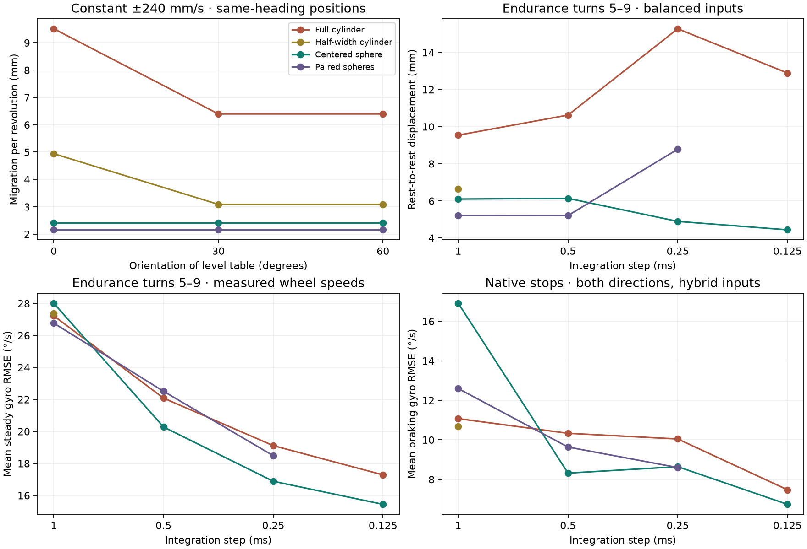
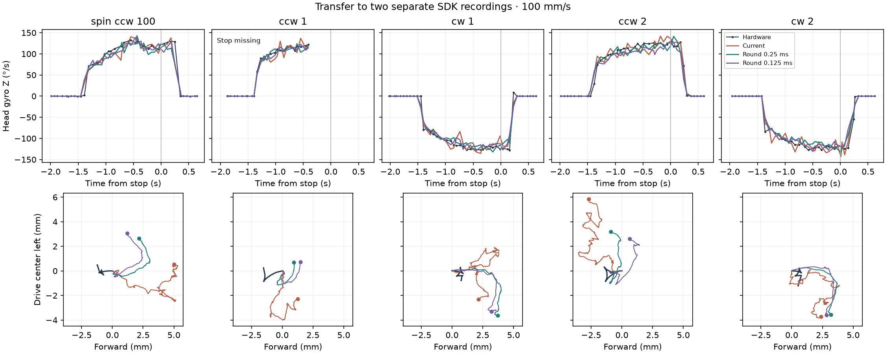

# Separating numerical drift from wheel imbalance

The level tabletop's orientation changes the predicted migration of a cylinder-supported Vector 2.0 even when both shafts run at perfectly constant, equal and opposite speeds. Centered spherical pressure proxies remove that orientation dependence in the tested headings. Their gyro behavior depends strongly on integration step. They improve several native benchmarks at small steps, but the gain does not carry over consistently to separate SDK stops. We retained the current simulator configuration.



## A control that does not use SDK wheel data

Each synthetic trial starts from rest, ramps to ±240 mm/s over 250 ms and holds. After one second, compare the chassis origin at successive identical headings exactly one full revolution apart. A rigid origin offset and any repeatable orbit cancel. Both turn directions contribute three intervals each. Only the tabletop rotates about its vertical axis. No surface inclination, friction change or shaft noise is involved.

| Geometry, 1 ms step | Table 0° | Table 30° | Table 60° |
|---|---:|---:|---:|
| Full-width cylinders | 9.51 | 6.40 | 6.40 |
| Half-width cylinders | 4.94 | 3.09 | 3.09 |
| One centered sphere per patch | 2.41 | 2.41 | 2.41 |
| Two spheres per patch, 5 mm apart | 2.16 | 2.16 | 2.16 |

Values are mean same-heading migration in mm per revolution. With the recorded and balanced speed profiles, the corresponding stock-model rest-to-rest drift on turns 5–9 was 9.54, 11.35 and 18.36 mm at the three angles. The centered sphere produced 6.10 mm at all three. Thus orientation sensitivity survives both constant and recorded inputs, and its sign and magnitude depend on the sequence. Centered spheres on a plane and on a box also produced the same summary values in the tested interior. These are properties of the contact representation. They do not establish physical directional friction on the test table. [Earlier contact-force measurements and pivot traces](pivot.md)

## Geometry and solver step interact

Recorded turns run continuously from the settled initial pose. The 42 mm fore-aft spacing, axles, gravity, surface coefficients and physical constraint time constants are fixed. Only the replay integration interval changes after settling. Narrow cylinders have half the original width. Paired spheres split the original proxy mass. Full-width outer supports remain present. Each row below averages turns 5–9 individually, or averages the two native directions individually.

| Geometry and step | Balanced drift (mm/turn) | Measured-input vector error vs SDK (mm/turn) | Fast steady gyro RMSE (°/s) | Native hybrid braking RMSE (°/s) |
|---|---:|---:|---:|---:|
| Full cylinder, 1 ms | 9.54 | 10.04 | 27.23 | 11.07 |
| Half-width cylinder, 1 ms | 6.63 | 7.27 | 27.37 | 10.68 |
| Paired spheres, 1 ms | 5.22 | 5.92 | 26.77 | 12.59 |
| Centered sphere, 1 ms | 6.10 | 5.79 | 28.01 | 16.91 |
| Full cylinder, 0.25 ms | 15.27 | 17.02 | 19.11 | 10.04 |
| Centered sphere, 0.25 ms | 4.90 | 6.56 | 16.89 | 8.64 |
| Full cylinder, 0.125 ms | 12.89 | 18.38 | 17.29 | 7.47 |
| Centered sphere, 0.125 ms | 4.44 | 4.57 | 15.44 | 6.74 |

Refining the stock cylinder's step improves fast gyro RMSE while worsening translation. Combining the round proxy with a finer step removes the severe native braking regression seen with the same proxy at 1 ms. The residual drive-center displacement and its variation with step preclude treating an individual simulated path as ground truth. SDK translation is encoder/IMU odometry; this experiment has no independent physical trajectory.

## What transfers to other turns?

On the separate native 5 ms pair (CCW 2, CW 2), the centered sphere at 0.125 ms reduced hybrid braking RMSE from **10.03 to 7.62°/s CCW** and **12.12 to 5.86°/s CW**. With reported-speed inputs throughout, braking RMSE also improved in both directions. But the mean steady yaw-rate shortfall grew from 2.39 to 4.36°/s CCW and from 3.76 to 7.00°/s CW, despite lower steady RMSE. This pair has appeared in previous work and was used to evaluate the sweep.



For a separate check we took the 0.25 ms centered sphere to two SDK recordings outside the geometry sweep, then repeated with 0.125 ms as a sensitivity check. Each turn used its recorded starting head and lift, measured wheel speeds, and the same 17 ms comparison shift for both models. The SDK inputs lack native count increments. These scores compare different sessions and coarser observations than the native test.

| Sample-pooled SDK gyro RMSE | Current | Sphere at 0.25 ms | Sphere at 0.125 ms |
|---|---:|---:|---:|
| Steady, 42 samples in five turns | 9.99 | 9.86 | 10.38 |
| Stop, 24 samples in four turns | 18.65 | 19.75 | 20.24 |

The repeat session's first CCW turn has no sample in the braking window. The transfer CSV leaves its stop score and final endpoint error blank. Each other braking window has six samples. These data support a numerical contact diagnosis and a better native replay candidate, but do not establish a general replacement. [Transfer results per turn](pressure-transfer.csv) · [All sweep results](pressure-sweep.csv)

## Reproduce

Run the following from the repository root. The four sweep invocations write 60 distinct case files. Results include both clockwise and counterclockwise constant-speed probes, all nine endurance turns and both native stops as applicable. Native windows, braking handoff and gyro lag follow the published native replay. Fast steady windows begin one second after each command and end 0.1 s before its stop. SDK transfer windows are −650 to −100 ms and −100 to +250 ms relative to the issued stop. [Native replay protocol](../hw-rec-20261119/hybrid-replay.md)

```sh
python experiment_pressure.py /tmp/vector-pressure
python experiment_pressure.py /tmp/vector-pressure --constant
python experiment_pressure.py /tmp/vector-pressure --interaction
python experiment_pressure.py /tmp/vector-pressure --refine
python plot_pressure_sweep.py /tmp/vector-pressure
python plot_pressure_transfer.py
```
