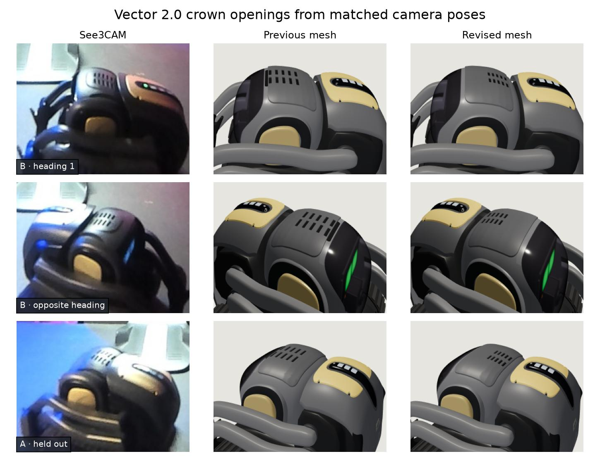
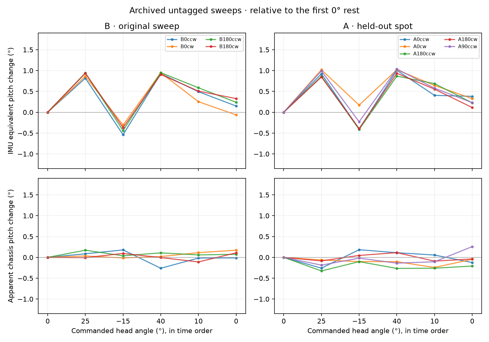
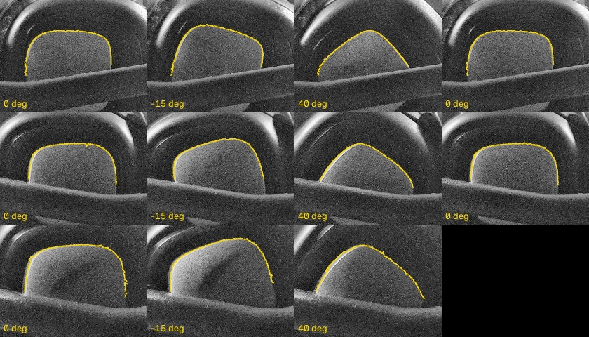
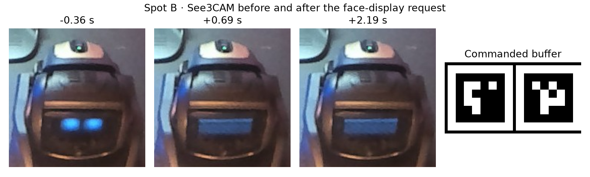
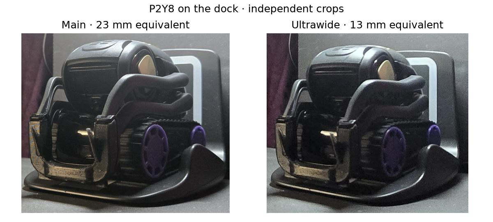

# Optical check of P2Y8's head and chassis

P2Y8 is a Vector 2.0 with printed lift and hubcaps, stock treads and its clear faceplate removed. The crown and backpack provide stock geometry. The printed hub centres serve as axle landmarks only. The web renders below show an assembled Vector. The fit uses the crown aperture centres.

## Crown geometry

The dock-glyph camera pose and shelf-line lens correction come from see3cam_shelf.py. For each view the two hub centres set heading and the backpack strip tip sets translation. Three views at B fit three dimensions. The first and last openings in each bank at A were reserved for validation. These dimensions are estimates conditional on the camera calibration, assumed landmark heights and manual picks.

| Vector 2.0 mesh | Previous | Revised |
| --- | ---: | ---: |
| Strip tip to centre of slot array | 23.85 mm | 15.31 mm |
| First-to-last slot centres | 12.80 mm | 8.32 mm |
| Separation of bank centres | 7.10 mm | 5.60 mm |
| Held-out A, four-centre RMS error | 21.51 px | 5.51 px |

Run `python fit_crown_vents.py` from the repository root. The three training views gave 32.38 → 2.26, 37.71 → 5.28 and 30.17 → 4.46 px. Slot width and length are visual estimates. The residual includes camera pose and the assumed shape of the existing roof. Generation 1 uses its previous mesh dimensions.

## Where the apparent lean comes from

Nine earlier See3CAM sweeps provide 54 stationary windows. Fixed backpack features were followed with bidirectional optical flow, then a local rigid-motion fit estimated chassis pitch. Varying assumed backpack slope tests sensitivity to feature depth. From −15° to +40° the median apparent forward inclination from the IMU changed +1.33° at B and +1.28° at held-out A. Median optically estimated chassis pitch changed −0.03° and −0.07°, respectively. At A individual changes spanned −0.16° to +0.07°. This constrains differential lean across the head sweep. It does not measure absolute shelf slope or distinguish head-angle calibration from IMU mounting and accelerometer bias. Run `python fit_chassis_tracks.py` and `python plot_chassis_tag_check.py`.

The new phone sweep follows the upper edge of the gold side insert while separate fixed rear-shell patches track the chassis. A coarse manual outline seeds a local gradient search. A trimmed bidirectional edge-distance fit estimates image-plane rotation relative to the level hold in each sweep. Camera motion within each sweep is estimated by forward/backward optical flow on the dock/back wall. The median chassis shift after that correction stayed under 0.3 native pixels at both A headings and the usable B profile. This measures displacement at the tracked patch. It does not independently bound every axis of chassis rotation.

At B the projected insert moved −13.8° and +28.0° relative to level. At held-out A the two opposing views gave −12.8°/+27.6° and −13.9°/+29.4°. The positive hold measures about +40° on the encoder. Its 5–8 px edge-fit residual, foreshortening and lift occlusion make these single-view fits unsuitable for a subdegree encoder correction. The second level visit at A returned within 0.06° in image space. We retained the physics calibration.

Phone comparisons use within-sweep reference frames. Two fixed wall screws also moved in the photograph between the original dock baseline and later frames. Their displacement varies by landmark, so a single translation across the entire session would bias measurements. The low-level flashlight reference was captured by the See3CAM with the Flip torch on its lowest setting. The main-lens and ultrawide phone stills are ordinary RGB photographs.

## Face display trial

The source image decoded both 16h5 tags in software. Neither tag decoded in the physical frames during the display interval. The on-robot screen appeared blank and an animation-engine disconnect was reported around the trial; causation is unresolved. The subsequent sweeps used molded features and issued no further display writes.

The fixed-phone dock baseline includes two separate 4000 × 3000 captures. Their EXIF reports 5.4 mm and 1.7 mm focal lengths (23 mm and 13 mm equivalent). We checked the Flip6 Camera2 capability sets and sensor inventory. There was no public DEPTH_OUTPUT camera or LiDAR sensor. The vendor-specific depth metadata does not establish a calibrated laser range measurement. No laser depth measurement was used. The crops below are individually framed and do not form a rectified stereo pair.

Run `python fit_phone_head_edges.py` to replay the phone rotations from the released native-pixel contours. The asymmetric lower boundary of the gold panel is occluded by the lift. This is a source of ambiguity in edge-only registration.
