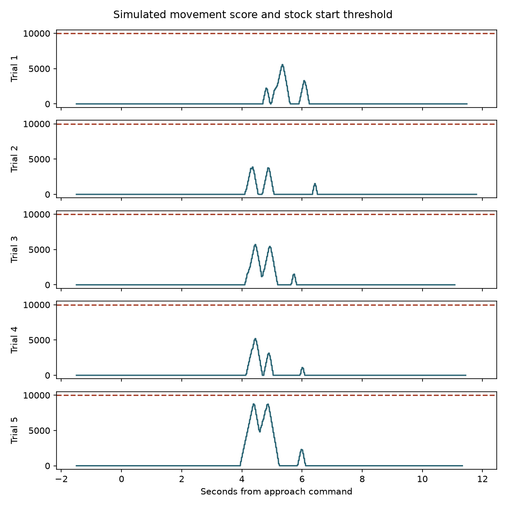

# Free cube sensor checks

The Python simulator exposes the engine's estimate of which cube face points up as `sim.cube.up_axis.axis`. Its `events` list contains (simulated packet delivery time in seconds, SDK axis code) pairs. The unknown axis is 0; −X, +X, −Y, +Y, −Z, +Z are 1 through 6. The listener consumes the three reported accelerometer samples from each stock or averaging-app packet. It initializes silently, low-pass filters with weight 0.03 per sample, and reports changes to the largest absolute component. Initialization and reset clear the listener history. Packet delivery is immediate in the simulation; hardware notifications carry the robot's engine timestamp and arrive over the SDK.

Run S contains 22 real up-axis notifications covering all six codes. The log lacks paired raw cube acceleration or measured rotation, so it establishes event coverage only. The separate synthetic quarter turn establishes the modeled delay: from steady +Z to −X at 0.300 s, the filtered axis crosses on reading 23 and the containing packet arrives at 0.540 s. The model test exercises both firmware packet modes.

Reproduce with `python evidence/free-cube-sensors/up_axis.py`. The processing order comes from Anki's CubeAccelComponent, UpAxisChangedListener and LowPassFilterListener. [Stock engine source](https://github.com/kercre123/victor/tree/669ec7499a7084640b57706a7937884a6568be50/engine/components/cubes)

## Movement start and stop

The hardware engine filters successive accelerometer samples for changes, adds at most 500 to its score per sample, subtracts 300, and clips to 0–20,000. At the nominal 100 Hz sample rate, even a sustained maximum input needs 51 samples from zero to cross the strict 10,000 start threshold. Falling below 5,000 ends an episode. The simulator exposes the listener transitions as `sim.cube.movement.events` (packet time, moving boolean). The robot engine separately suppresses SDK broadcasts while carrying or docking with that cube.

Five printed-fork replays used the recorded chassis/lift paths, baseline fork reach and an accelerometer at the assumed cube center. Each simulated cube moved (2.83–5.93 mm net); none triggered the stock movement listener. The largest observed packet-end score was 8,763 on trial 5. The listener checks every slot. An episode could start within a packet even if its final score fell back below threshold. The CSV counts those transitions too.

The overhead camera measured 5.16–27.23 mm across these same physical cycles. Their recordings lack synchronized cube packets or movement events, so they cannot validate whether the physical listener fired. A separate SDK recording, run S, contains 11 starts and 11 stops without a matched acceleration trace. Absence of a simulated notification therefore gives no basis for scoring a physical push as stationary.

From the repo root run `python evidence/free-cube-sensors/movement.py . /tmp/p2y8-fork.xml` with the registered printed-fork fixture. [Numerical results](movement.csv)
