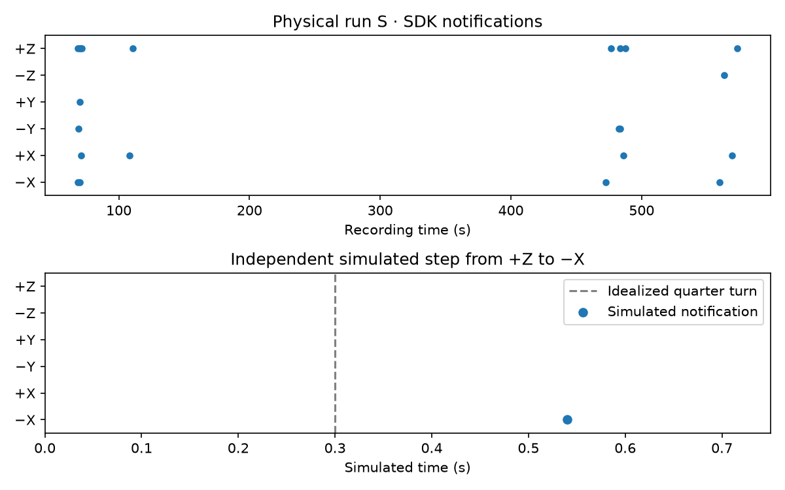

# Free cube sensor checks

The Python simulator exposes the engine's estimate of which cube face points up as `sim.cube.up_axis.axis`. Its `events` list contains (simulated packet delivery time in seconds, SDK axis code) pairs. The unknown axis is 0; −X, +X, −Y, +Y, −Z, +Z are 1 through 6. The listener consumes the three reported accelerometer samples from each stock or averaging-app packet. It initializes silently, low-pass filters with weight 0.03 per sample, and reports changes to the largest absolute component. Initialization and reset clear the listener history. Packet delivery is immediate in the simulation; hardware notifications carry the robot's engine timestamp and arrive over the SDK.

Run S contains 22 real up-axis notifications covering all six codes. The log lacks paired raw cube acceleration or measured rotation, so it establishes event coverage only. The separate synthetic quarter turn establishes the modeled delay: from steady +Z to −X at 0.300 s, the filtered axis crosses on reading 23 and the containing packet arrives at 0.540 s. The model test exercises both firmware packet modes.

Reproduce with `python evidence/free-cube-sensors/up_axis.py`. The processing order comes from Anki's CubeAccelComponent, UpAxisChangedListener and LowPassFilterListener. [Stock engine source](https://github.com/kercre123/victor/tree/669ec7499a7084640b57706a7937884a6568be50/engine/components/cubes)
