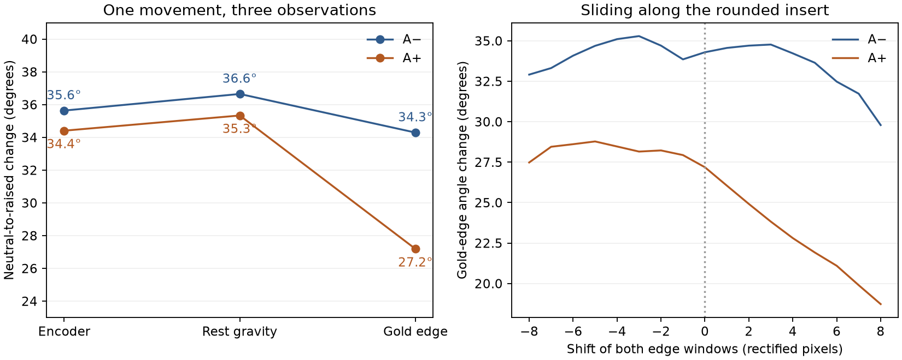
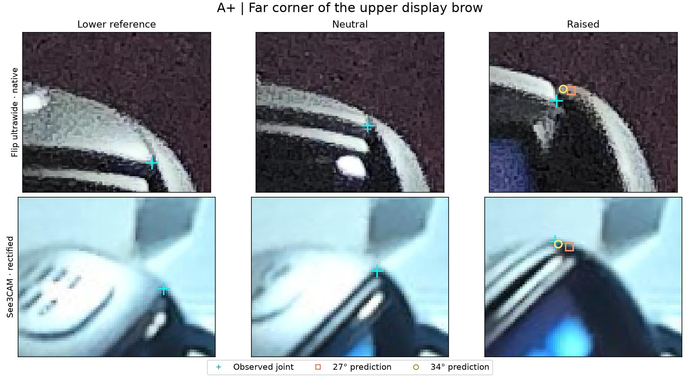
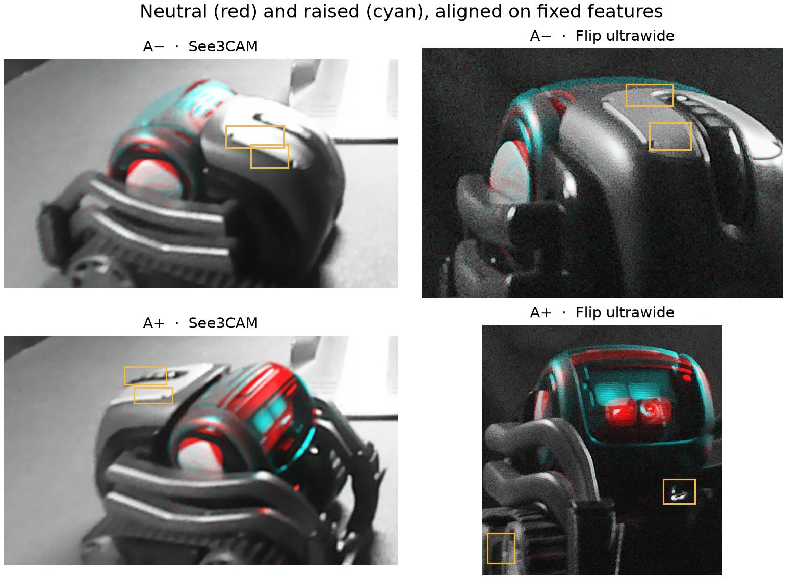
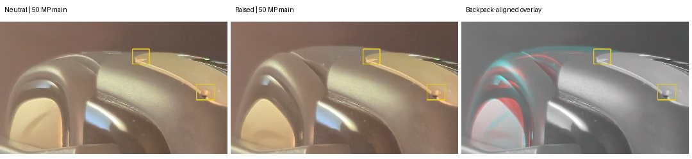

# Why the same head raise looked different at shelf spot A

The two opposite headings gave a 7.11° difference when measured from the upper edge of the gold head insert. The encoder and the stationary head accelerometer independently put the difference near 1.3°. Both measured a slightly larger raise at A−.

| Neutral to raised | A− | A+ | Difference |
|---|---:|---:|---:|
| Gold insert edge | 34.29° | 27.18° | 7.11° |
| Head encoder | 35.64° | 34.41° | 1.23° |
| Head pitch relative to gravity | 36.65° | 35.34° | 1.31° |

The gold insert has a rounded edge partly hidden by the lift. A straight-line fit samples a different tangent depending on which part is visible. Moving both fitting windows by eight pixels on the resampled sagittal image took A+ from 27.2° to 18.7° and A− from 34.3° to 29.8°. In comparison, varying assumed chassis yaw by ±3° with the original pixels took A+ from 25.6° to 28.7°. Window placement explains how a large apparent heading effect can arise. It does not uniquely identify every source of error.

## A second landmark on the moving head

At A+ the far corner where the upper display brow meets the side lip is visible at low, neutral and raised positions in both the 4000 × 3000 Flip ultrawide and the See3CAM. The crosses mark this corner. The square and circle are independent predictions for the raised position using 27° and 34°.

For a rigid pitch rotation the corner traces a circle in the sagittal plane. The low-to-neutral chord and the independently measured 14.43° gravity increment determine its radius and orientation. We reserved the raised point for the endpoint comparison. At A+, 34° fits better than 27° in both cameras. Stereo endpoint errors were 1.05 mm and 2.74 mm respectively, conditional on the [existing camera calibration](../three-camera-survey/). Uniform changes in length scale cancel from the fitted angle.

The best-fit angles were 31.2° from the Flip, 33.9° from the See3CAM and 37.7° from stereo. The short reference chord makes these estimates sensitive to landmark placement. In 2,000 perturbations the stereo estimate spanned 27.2–50.6° between its 5th and 95th percentiles. Draws used independent Gaussian coordinate offsets of 2 native Flip pixels and 1 rectified See3CAM pixel, chassis yaw offsets of 3° and low-to-neutral pitch offsets of 0.5° (all one standard deviation). These are assumed input sensitivities. The photos favor the larger angle, while the stationary measurements supply the tighter cross-check.

## Fixed references and opposite view

The fixed backpack patches moved at most 0.07 rectified See3CAM pixels between neutral and raised after registration checks at each heading. Both cameras show the backpack at A−. At A+ the phone sees the chest and wheel hub, so those fixed chassis features transfer the reference for its view. The See3CAM sees the backpack directly. The overlays show which references were available in each image.

The opposite view hides the far brow corner. The native 8160 × 6120 Flip main-camera pair at A− provides a separate check on two microphone scallops on the fixed backpack. The two patches shifted 0.67 and 0.25 native pixels. There is no matching main-camera raised frame at A+.

For the gravity check we selected stationary samples within 1.8 seconds of the ultrawide exposure, with gyro magnitude below 0.035 rad/s and each wheel speed below 0.5 mm/s. Pitch is atan2 of the median fore-aft and vertical accelerations. It includes any chassis pitch change. The fixed references constrain visible motion in the image plane.

[Pixel picks, patch offsets and camera parameters](observations.json), [stationary telemetry](stationary.csv) and [gold-edge fit pixels and original bounds](gold-edge.csv) accompany the figures. Run `python replay.py` with NumPy and SciPy to reproduce the brow fits, endpoint errors and sensitivity ranges.
