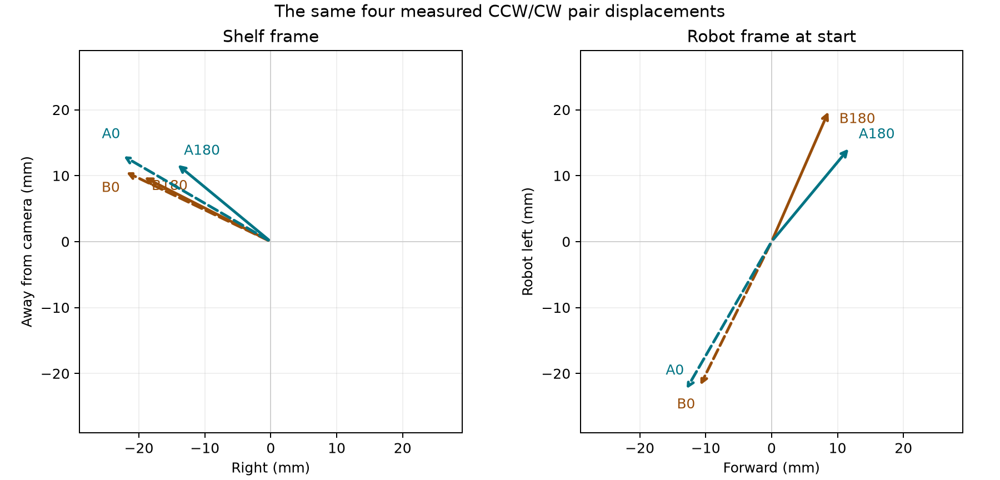
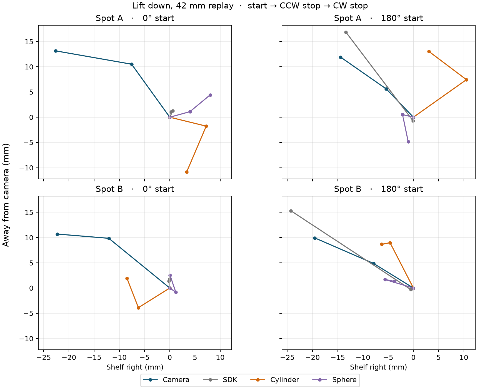
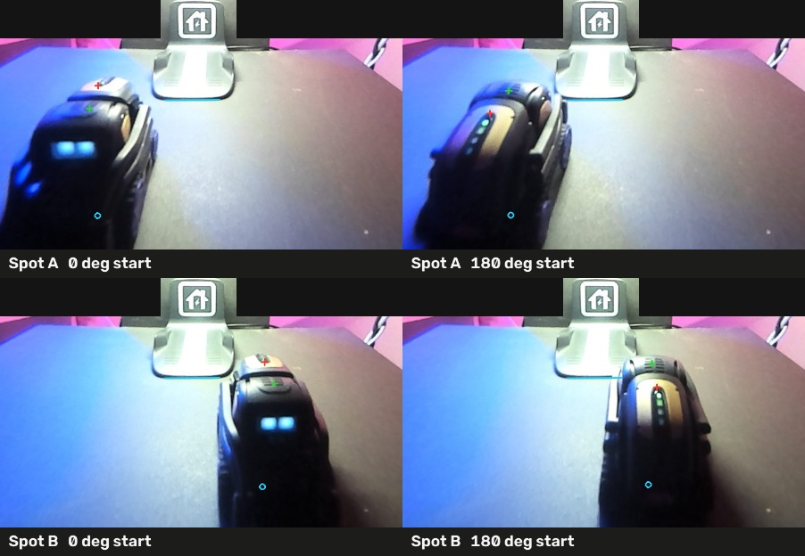

# Heading reversal at two shelf locations

unit 3 drifted toward **shelf-left on all eight accepted spins**. At each of two locations, turning the robot around left the drift pointing left and back toward the dock. In the robot's starting frame the lateral component reversed. This favors a shelf-fixed contribution over a fixed bias toward one side of the chassis under these test conditions.

| Spot and nominal heading | Camera, left / toward dock (mm) | 42 mm cylinder, left / toward dock (mm) | 42 mm sphere, left / toward dock (mm) |
|---|---:|---:|---:|
| A · 0° | 22.7 / 13.2 | −3.4 / −10.8 | −8.0 / 4.4 |
| A · 180° | 14.4 / 11.9 | −3.1 / 13.0 | 1.0 / −4.9 |
| B · 0° | 22.3 / 10.7 | 8.5 / 1.9 | 0.0 / 2.6 |
| B · 180° | 19.5 / 9.9 | 6.3 / 8.7 | 3.8 / 1.3 |

Each row is one CCW spin followed by one CW spin. Positive components in the table mean shelf-left and toward the dock. Negative components mean right and toward the camera. The panel below plots the start, the CCW stop and the CW stop separately. The cylinder model produced some leftward drift at B and rightward drift at A. Neither model reproduced the measured leftward displacement at both spots and headings.

[Corrected camera video with endpoint overlays](rectified-spins.mp4) · [Eight turn vectors and four pair totals, in both frames](vectors.csv)

## Heading-reversal test

At each spot, take the measured pair displacement from the 0° start and predict the 180° result in two ways. The shelf prediction keeps the vector's direction and length. The chassis prediction rotates that vector through the optically measured heading change. The endpoint errors were **8.3 versus 44.8 mm at A** and **2.9 versus 46.6 mm at B**, shelf versus chassis. In optical sensitivity trials the corresponding middle 90% ranges were 6.1–11.5 versus 41.0–50.9 mm at A and 1.7–5.7 versus 42.9–50.7 mm at B.

The two spot centers were about 78 mm apart. The two starts within each spot differed by 5.2 mm at A and 8.7 mm at B. Measured heading changes were about 180° and 176°, respectively. Execution order was B0, B180, A180, A0. There is one pair per condition. Shelf tilt, directional surface texture and tread interaction with the surface remain possible causes. Reversing the starting heading establishes the frame of the observed displacement for this maneuver. It does not identify a material property of the shelf.

## Clearance and controls

The operator observed possible ramp contact during near-dock positioning. Those three pilot pairs were excluded. Before the accepted runs unit 3 drove another 50 mm forward. Camera-guided moves set up the remaining conditions. The four starting drive centers lay 195–196 mm forward of the glyph plane, or 101–102 mm beyond the front ramp lip. Even the closest of the twelve **resting drive centers** was 89 mm forward of that lip. These are center measurements, not tread-to-ramp gaps. The cropped clip shows the four accepted pairs in execution order.

The cyan marks show the ramp front and projected drive center. The red and green crosses identify the backpack and head landmarks.

Lift height stayed at 32.7 mm. Both wheels were commanded at opposite 150 mm/s for three seconds, then stopped and allowed to settle before reversing. The median measured wheel magnitudes in the steady portions ranged from 147.5 to 150 mm/s. The two existing Vector 2.0 replay models took the measured wheel speeds, with physical axles in their stock locations. Each turn started settled at the measured lift and head posture. Cylinders used a 1 ms integration step and spheres 0.125 ms. Simulated displacement was rotated into shelf coordinates using each turn's starting camera heading. No surface or contact parameter was fit to these endpoints.

SDK drive-center pose jumped 21.9 mm at A180 and 28.2 mm at B180 within individual state intervals after the CW stop. This occurred while facing the dock. The recorded fields do not identify what triggered those corrections. This is why the camera supplies the independent position reference even where the final SDK endpoint appears close.

## See3CAM correction

The capture node identified itself as an e-con Systems **See3CAM_24CUG** (USB 2560:c128), producing 1920 × 1080 MJPEG. It uses a global-shutter sensor with an interchangeable lens. We calibrated the installed optics from this setup. Input frames were rotated 180° and landmark coordinates restored to their full-sensor offsets before rectification. The driver reported automatic exposure and white balance at readback. The optical picks use settled frames to limit blur, and the SDK and camera clocks are aligned by host wall time. The 111 ms median and 168 ms maximum inter-frame gaps in the accepted turn windows are measured acquisition-request intervals. There was no hardware exposure trigger. [Camera specifications and lens configuration](https://www.e-consystems.com/industrial-cameras/ar0234-usb3-global-shutter-camera.asp)

We fit a one-coefficient division model to three straight shelf uprights using robust point-to-line distances in the original sensor pixels. The local distortion center is (912.9, 541.2) upright pixels and the coefficient is −1.499 for radii normalized by 960 px. On a **held-out fourth upright**, median error dropped from 2.88 to 0.28 px. Two central vertical boundaries improved from 0.68 to 0.19 and 0.44 to 0.26 px. A separate bright horizontal boundary got worse, from 2.33 to 4.28 px. This is a local correction for the operating area, with weaker validation in the horizontal direction. The clipped video is resampled into a rectilinear view. The computation applies the same mapping directly to the landmark coordinates.

The 46 mm dock glyph corners, their known heights, the front ramp midpoint 94 mm forward of the glyph and the shelf-side directions constrained the camera pose. The dock references had 0.88 px in-sample RMS error. The stationary glyph matched at the same whole-pixel location across all twelve resting images. [Dock geometry in firmware](https://github.com/kercre123/victor/blob/669ec7499a7084640b57706a7937884a6568be50/engine/charger.h#L101-L115)

The camera tracks the forward tip of the backpack indicator lens, nominally 65.5 mm high and 11.3 mm behind the comparison point. The center of the head vents supplies a second optical landmark. With the head level, a constant-spacing fit across views gave an effective vent height of 64.5 mm and lens-to-vent horizontal separation of 18.9 mm. The transverse eye axis provides heading for the front-facing starts and finishes. The drive center is defined as 25 mm behind the front axle. Reconstructing translation using the vent instead of the lens as the primary mark gives 14.4–23.7 mm left for the four pairs. This check shares the calibration and headings.

The sensitivity ranges above perturb dock and shelf picks, focal prior, shelf constraint weight, lens and vent picks (±3 px), eye picks (±1 px), optical height and lever arm, and substitute fits from different subsets of uprights. They describe reconstruction sensitivity, not statistical confidence across repeated runs.

Run `python plot_heading_crossover.py --replay` from the repository root to reproduce both contact-model replays and plots. Run `python see3cam_shelf.py` for the lens and dock checks. [Measured-wheel inputs](turns.json) · [Full-sensor landmark picks](picks.csv) · [Eye picks](eye-check.csv) · [Shelf-edge samples](edge-pixels.csv)
