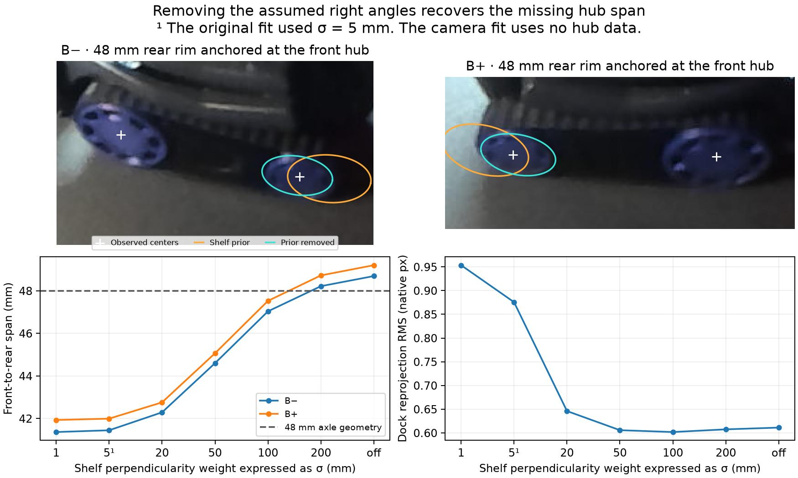
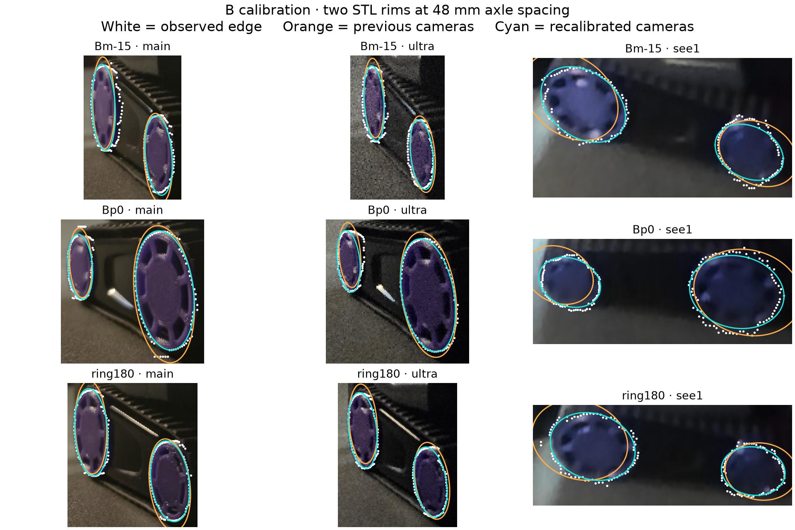
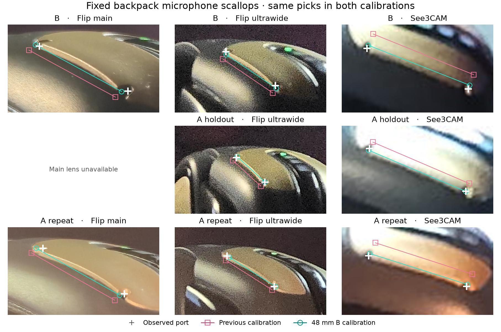
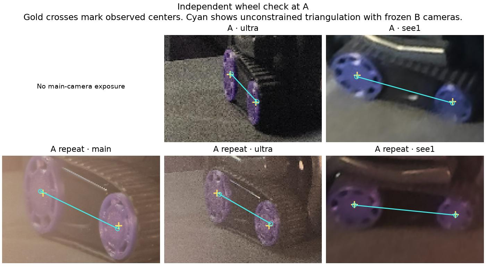

# Wheel-calibrated camera rig at B, checked at A

The fixed backpack microphone pair measured **20.99 mm at held-out A** and **20.74 mm on the independent A repeat**. B measured 21.21 mm. The calibration also recovered longitudinal wheel spacing at A within 1 mm of the 48 mm reference when the two hub centers were triangulated freely.

| Measurement | Previous calibration | Recalibrated at B |
|---|---:|---:|
| Backpack microphone pair, B | 19.22 mm | 21.21 mm |
| Backpack microphone pair, A | 18.44 mm | 20.99 mm |
| Backpack microphone pair, A repeat | 18.68 mm | 20.74 mm |
| Horizontal hub spacing, A | 41.69 mm | 48.83 mm |
| Horizontal hub spacing, A repeat | 42.49 mm | 48.93 mm |

## What selected the shorter wheelbase

The old See3CAM fit enforced perpendicularity between both visible shelf sides and its back edge. Relaxing just those constraints moved the two B wheelbase estimates from 41.45/41.99 to 48.69/49.20 mm. Both solutions reproduce the dock observations within one native pixel. The assumed shelf geometry selected a camera height and viewing angle that compressed distances at the robot. The two phone cameras subsequently inherited those short B distances through the hub observations used in their calibration. Which physical edge, corner pick or lens error contributed to the conflict remains open. [Controlled comparison and replay](dock-diagnosis.md)

## Fitting the B cameras

Three first-pass poses at B supplied 18 rim observations across both Flip lenses and the rectified See3CAM. The outer rims have STL diameters of 26.0 and 18.5 mm. We fixed the fore-aft axle spacing at 48 mm, the front and rear center heights at 14.5 and 10.75 mm, and estimated the horizontal position and yaw of each pose. Glyph corners, the dock lip, focal-length priors and a weak phone-baseline prior anchored the joint fit. The resulting matrices map the dock coordinate frame in millimetres into each camera. Flip coordinates use 1000-pixel working width. See3CAM coordinates use the original 1200-pixel rectified crop. All A photos and all microphone picks were held out of calibration. [STL scale check](../orbit-cap-scale/) · [Wheel geometry](https://github.com/digital-dream-labs/vector/blob/main/simulator/protos/CozmoBot2.proto#L27-L30) · [Camera matrices](cameras.json)

Equal-rim RMS error at B fell from 4.82 to 2.74 working pixels on the main camera, 2.64 to 1.22 on the ultrawide, and 12.03 to 2.97 on the See3CAM. Each model had its own best robot pose. The fit traded some See3CAM dock agreement for wheel agreement. Its five-point dock RMS increased from 0.89 to 2.55 working pixels. The fitted phone baseline was 12.97 mm against a 14.23 mm prior. [Before and after residuals](B-comparison.json)

## Transfer and remaining uncertainty

At A, the full rig and both phone–See3CAM pairings in the repeat support roughly 21 mm between the visible scallops. The phone-only pair gives 24.02 mm. Omitting one B pose gave 21.23/20.81 mm on the two A captures. Using the narrower STL face diameters gave 20.98/20.64 mm. Changes in rim selection or training pose have a smaller effect here than loss of the independent See3CAM viewpoint. [Microphone overlays, omitted-camera predictions and uncertainty](microphone-findings.md)

The independent wheel check used only image centers and the frozen cameras. The two A images still give 0.83 and 0.93 mm more than nominal. This limits claims of absolute accuracy. [Independent checks and image coordinates](transfer-notes.md)

With NumPy and SciPy installed, run `python refit.py` from this directory to regenerate the primary camera matrices from the recorded B rim samples and calibration inputs. The alternatives use `--variant omit-ring180` and `--variant face-land`. Run `python holdout.py` and `python wheel-holdout.py cameras.json` to repeat both held-out measurements. [Camera inputs](inputs.json) · [Rim samples](edges.json) · [Omitted-pose fit](omit-ring180.json) · [Narrower face fit](face-land.json)
