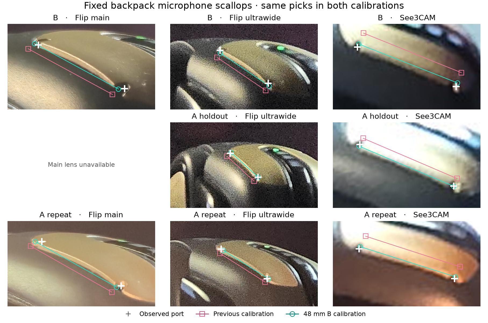
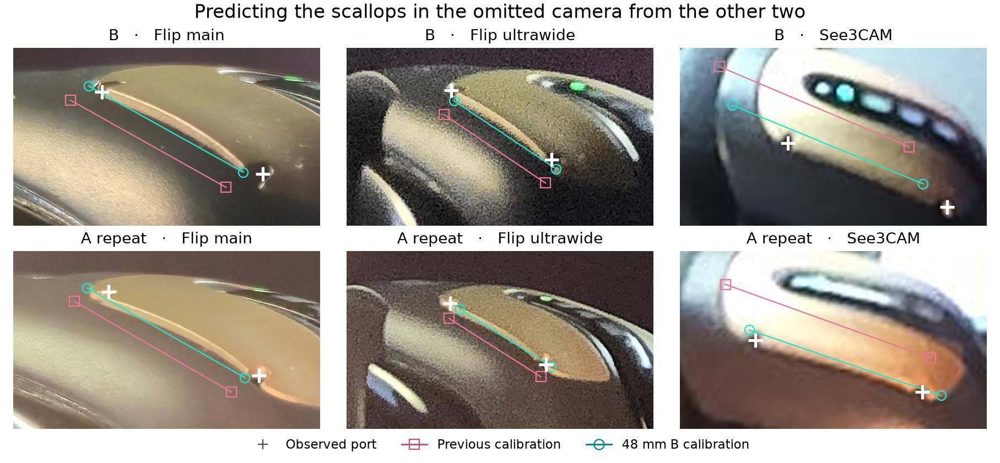

### Fixed backpack, held-out A

The same two microphone scallops give a straight-line chord of **21.21 mm at B, 20.99 mm at held-out A and 20.74 mm on the three-camera A repeat**. No microphone observations or A captures entered the camera calibration. Using the same picks and triangulation, the previous calibration gave 19.22, 18.44 and 18.68 mm, respectively. The new B-to-A differences are 0.22 and 0.46 mm. These data support a spacing around 21 mm for this pair.

On the A repeat, triangulating either phone lens with the See3CAM gives 20.69–20.78 mm. The two phone lenses alone give 24.02 mm. Using the phones to predict the two omitted See3CAM image coordinates misses them by 4.4 and 7.3 rectified pixels, down from 24.1 and 13.5. The short phone baseline still leaves substantial uncertainty in depth. The repeat uses all three cameras while the first A hold has only the ultrawide and See3CAM.

The primary comparison uses unchanged landmark coordinates. Subtracting the median static-background offset of the repeat main lens in a separate sensitivity check changes the chord from 20.74 to 20.77 mm. A one-working-pixel independent perturbation per picked coordinate gives first-order chord sensitivities of 0.37 mm at B, 0.56 mm at A and 0.42 mm on the repeat. These quantify assumed pick errors only. They exclude systematic uncertainty from camera geometry, the physical print and identifying the same points on each scallop.

[Per-camera residuals, chord estimates and transfer checks](microphone-holdout.json) · [Validation script](holdout.py). Run `python holdout.py` with NumPy and SciPy from the evidence folder. Rendering the two overlays with `--archive PATH` also uses OpenCV, Matplotlib and the original capture archive.
