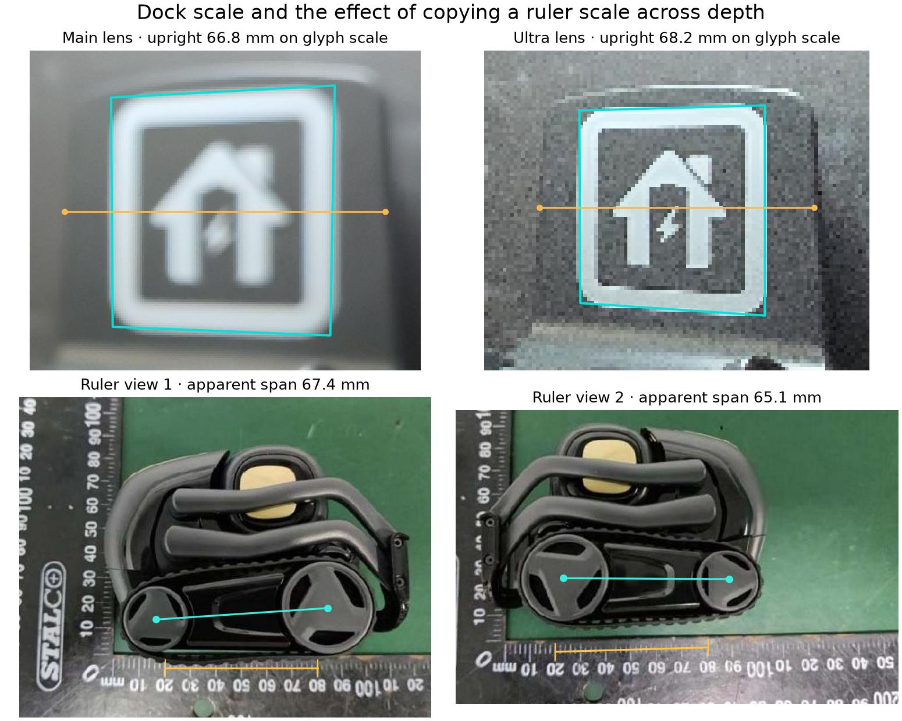
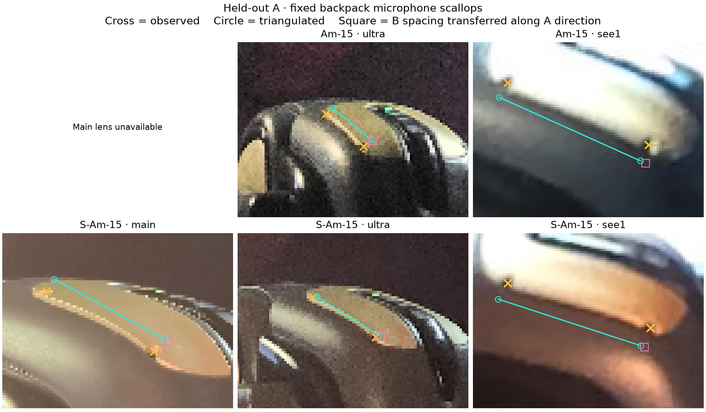

# P2Y8 wheelbase scale and fixed backpack spacing

The shelf cameras give a shorter longitudinal wheelbase than the released Vector simulator. The dock-width check supports a scale adjustment of about 4%. Reaching 48 mm from the original 41.45–41.99 mm would require 14–16%. The current evidence supports retaining the 48 mm axle geometry and treating the camera dimensions as conditional. The lateral tread-contact span used in turn replay is a separate parameter.

## Dock and ruler checks

In the B neutral-reference setup (capture Bm-15), the four straight sides of the outer white glyph define a plane homography. The released charger model specifies both a 46 mm square marker and a 70 mm upright. Measuring the upright at glyph mid-height gives 66.83 mm on the main lens and 68.25 mm on the ultrawide. The two implied multipliers are 1.047 and 1.026. We apply their mean, 1.0365, as a sensitivity check. The upright has rounded edges and the fitted points are on its apparent silhouette. Both views share the same target, and this comparison constrains scale best at the dock plane. [Charger geometry](https://github.com/digital-dream-labs/vector/blob/main/simulator/protos/VictorCharger.proto#L10-L21) · [48 mm wheelbase in the released robot model](https://github.com/digital-dream-labs/vector/blob/main/simulator/protos/CozmoBot2.proto#L27-L30)

Two stock Vector 2.0 side photographs give apparent longitudinal hub separations of 67.4 and 65.1 mm if the adjacent ruler’s 20–80 mm ticks are transferred directly to the hub faces. The ruler and hub faces occupy different depths. These numbers quantify the projection problem. Neither measures the physical wheelbase. Antigravity’s separate fit of an oblique ruler exhibit also failed a physical check, predicting a 15 mm axle-height difference in one fit versus 3.75 mm from the released wheel radii. These photographs do not resolve P2Y8’s wheelbase to millimetres. [DDL Vector 2.0 external photographs, page 5](https://fccid.io/m/f715ecdccc13ef685afd7a3a3221e5ec5971fe605c006cf883b6620114e3d932.pdf#page=5)

## Holding out A

Antigravity reproduced the original 41.7–42.1 mm triangulated horizontal distances. We independently removed every wheel observation from the phone calibration, retaining the glyph, dock lip, wall features, lens priors and phone-baseline prior. The camera fit used B and the existing See3CAM calibration. The three measured wheelbases then became 40.25, 40.59 and 40.96 mm (B−, B+, A−). Antigravity found 40.59, 40.69 and 41.23 mm using EXIF-based focal priors. Even the latter A value gives only 42.7 mm with the upright multiplier. Camera-to-camera depth and landmark transfer remain unresolved. For the B− hub pair the wheel-free fit misses the See3CAM observations by 36 and 44 working pixels. This is poor enough to rule out treating the reconstructed hub separation as ground truth.

| Fixed microphone pair, straight-line chord | B | Held-out A | Held-out A repeat |
|---|---:|---:|---:|
| Original hub-assisted calibration | 19.22 mm | 18.44 mm | 18.68 mm |
| Wheel-free calibration, glyph scale | 18.24 mm | 17.58 mm | 17.76 mm |
| Wheel-free calibration, upright scale | 18.90 mm | 18.22 mm | 18.41 mm |

The same two scallops are 0.69 and 0.49 mm closer together at A than at B under the upright check. The three-camera A repeat differs from the first A observation by 0.19 mm. The between-fit variation is larger than the repeat difference. The held-out images support a spacing around 18–19 mm and do not justify a submillimetre mesh adjustment. The overlays show each A observation, its projection from triangulation, and the endpoint obtained by carrying B's spacing along A's observed three-dimensional direction. That last check tests chord length only. Uniformly scaling a reconstruction and its camera translations leaves pixel projections unchanged.

Run `python check.py` with NumPy and SciPy to reproduce the dock-plane widths, ruler readings and backpack results from [the picks and fitted cameras](measurements.json) and the [original survey](../three-camera-survey/).
