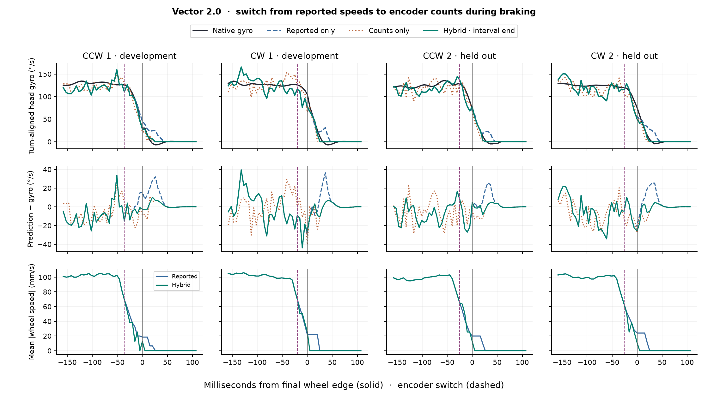

# Hybrid encoder replay of Vector 2.0 stops

Switching to raw count increments during braking reduced gyro error on both held-out stops while preserving the reported-speed steady trace. The largest gain fell in the first 100 ms after the last wheel edge. This is a replay input reconstruction for these recorded 100 mm/s turns.

## Encoder handoff

The detector arms after eight consecutive native samples with mean absolute wheel speed at least 90 mm/s, then latches into braking after two consecutive samples below 85 mm/s. It uses the same thresholds in both directions. It reads only the speed observations up through the current tick. Each isolated turn starts disarmed. The final edge and gyro are used only for evaluation. The handoff occurred 36 and 20 ms before the final edge on the development CCW and CW stops, and 25 and 26 ms before it on the held-out stops.

Keep the reported speed through the decision sample. From the following interval forward, convert the two shaft-count increments independently to tread speed with the reference count pitch and the observed interval duration. Preserve recorded shaft polarity with the right-side conversion. The single-channel encoders rely on firmware-assigned direction; sub-count travel and mechanical rebound are unresolved. Place each reconstructed speed at the interval end, when the counts were available. We also scored midpoint timing. Interpolation between speed knots is an offline reconstruction. All replays use the same 42 mm effective fore-aft span, stock axle locations, Vector 2.0 physics and 17 ms gyro comparison offset. The offset applies only to the simulator's predicted gyro; native input and switch times stay on the robot clock.

## Results

Sample-pooled head gyro RMS error in °/s. The first pair served for development. The second pair used the same rule and no parameter refit. All four recordings come from one session and have appeared in earlier comparisons. Braking spans −100 to +100 ms around the last detected shaft edge; the tail spans 0 to +100 ms. The steady window spans −850 to −250 ms.

| Window | Samples | Reported only | Counts only, interval end | Hybrid, interval end |
|---|---:|---:|---:|---:|
| Development CCW 1, brake | 39 | 12.62 | 9.46 | 8.79 |
| Development CW 1, brake | 39 | 15.52 | 9.02 | 13.43 |
| Held-out CCW 2, brake | 39 | 11.88 | 10.16 | 10.03 |
| Held-out CW 2, brake | 39 | 13.91 | 8.96 | 12.12 |
| Held-out pair, brake | 78 | 12.94 | 9.58 | 11.12 |
| Held-out pair, tail | 40 | 10.83 | 5.23 | 5.59 |
| Held-out pair, steady | 235 | 12.94 | 13.90 | 12.94 |

The replay asserts identical reported-only and hybrid predictions through each switch (absolute tolerance 0.0000001°/s). Counts alone still did better over pooled braking, particularly on CW 2. The hybrid preserves the steady-turn accuracy of reported speeds.

## Peer review and sensitivity

a lane suggested checking when count intervals become observable, asserting pre-switch equality, and shifting the handoff by one native frame. The ongoing simulacrum lane also proposed triggering from stop-command arrival. These recordings have host command-issue time and native sensor timestamps; they lack a robot-stamped stop-command arrival. The encoder-only latch is reproducible on the native clock. A period-based reconstruction remains a separate candidate.

| Held-out brake | Samples | One frame early | Original switch | One frame late | Reported only |
|---|---:|---:|---:|---:|---:|
| CCW 2 | 39 | 9.86 | 10.03 | 10.04 | 11.88 |
| CW 2 | 39 | 11.43 | 12.12 | 11.73 | 13.91 |

Both shifted handoffs improved on reported-only in each direction. Midpoint-timed hybrid rates scored 11.95°/s over pooled braking and 7.75°/s over the tail. Removing the gyro comparison offset from the endpoint hybrid raised braking RMS to 25.41°/s. None of those controls was used to retune the threshold or contact physics.

Over the first 100 ms after the last edge the measured turn-aligned head gyro integrated to 0.797° CCW and 0.860° CW. Reported-only predicted 1.262° and 1.379°. The endpoint hybrid predicted 0.822° and 0.729°.

Run `python replay_hybrid_stops.py` from the simulator root with NumPy, MuJoCo and Matplotlib. [Inputs](unit2-native-replay-input.csv) · [Per-sample hybrid inputs, gyro and sensitivity traces](hybrid-encoder-replay.csv) · [Single-input replay and span comparison](native-replay.md)
